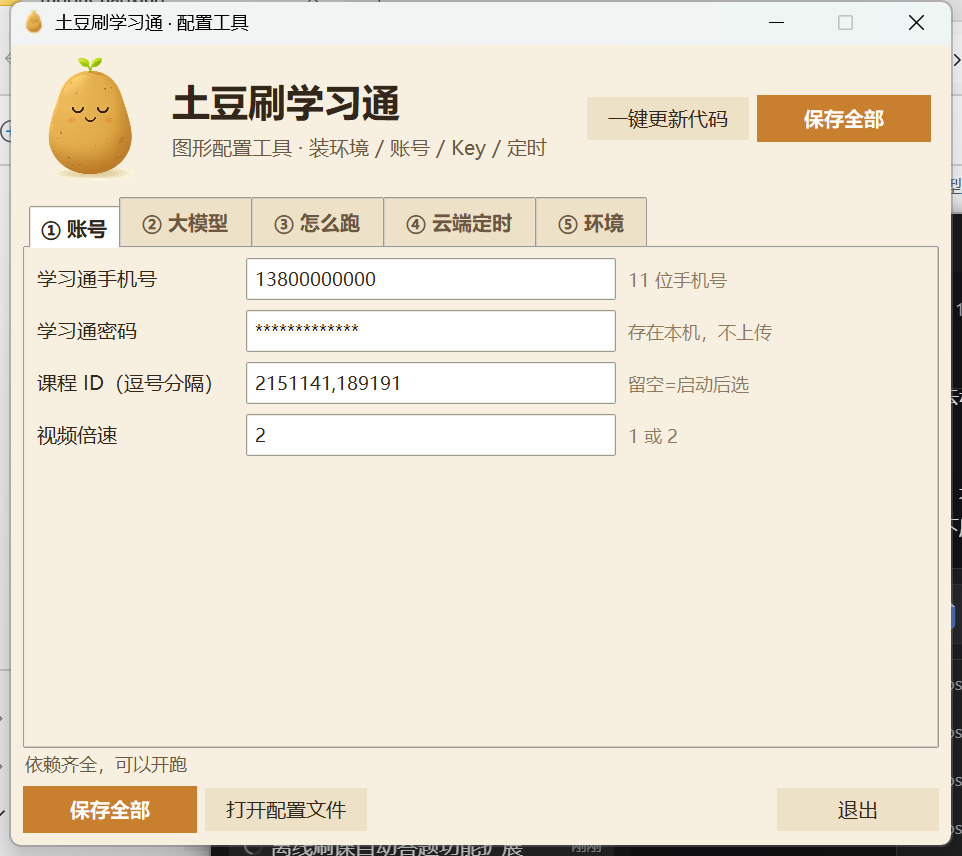
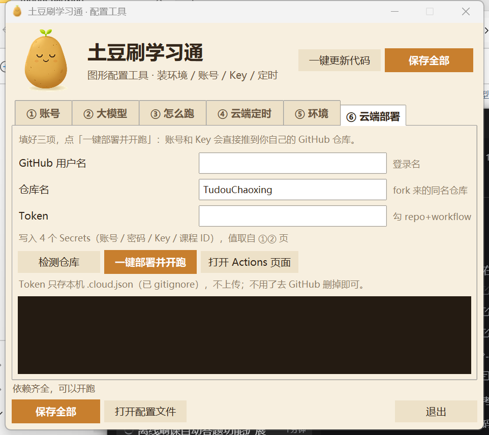
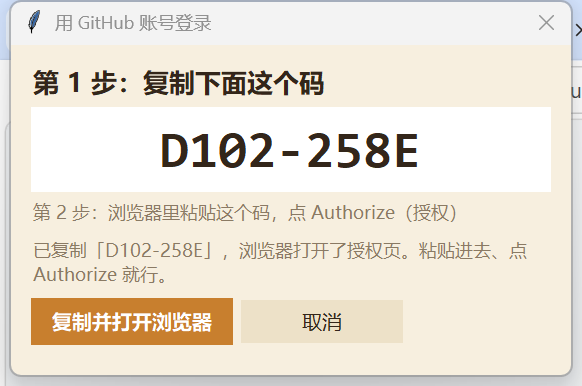

# 土豆刷学习通


超星学习通 / 超星尔雅 / 泛雅 的自动刷课工具：视频、文档、阅读、章节测验和作业一锅端，答题交给大模型投票。土里土气，但管用。

---

## 能干什么，不能干什么

| ✅ 会做 | ❌ 不会做 |
| --- | --- |
| 视频 / 音频任务点刷进度，支持 1~2 倍速 | **考试**（`exam-` 开头的任务点，一个请求都不发，直接跳过） |
| 文档、阅读任务点一键完成 | 替你做需要人脸识别 / 手机验证的登录 |
| 章节测验、作业：取卷 → 解析题目 → 作答 → 保存或提交 | 绕过学校的后台审计，也不改任何成绩数据 |
| 已被判「已通过」的任务点自动跳过，不重复刷 | 帮你补交已经过期的作业 |
| 任务点巡检：只看状态不动手，一个学习请求都不发 | 自动抢课、改选课、退课 |

答题有三条腿，从高到低：**大模型多轮投票 → 题库搜题 → 随机兜底**。答不出来就用下一条，所以题库配得越差，卷面越像土豆丝（碎）。

---

## 功能

| 功能 | 说明 | 代码位置 |
| --- | --- | --- |
| 刷课 | 视频 / 音频按进度上报，支持倍速；文档、阅读任务点一键完成 | `api/base.py: study_video / study_document / strdy_read` |
| 章节测验与作业 | 取卷 → 解析题目 → 答题 → 保存或提交；覆盖率不够只保存 | `api/base.py: study_work` |
| 任务点巡检 | 逐章列出「已通过 / 待办」，看过的视频不会再刷 | `main.py: scan_jobs` |
| 大模型投票解题 | 每题多次独立采样投票，票占比过阈值才算「可信」；不达标先升级采样，再不行回退题库 | `api/solver.py` + `api/llm.py` |
| 题库接入 | 言溪 / Like / TikuAdapter / AI / 硅基流动 / TikuLLM 六种 provider | `api/answer.py` |
| 字体加密解密 | 自动识别 `style#cxSecretStyle`，用字形哈希表还原被加密的题干和选项 | `api/font_decoder.py` + `api/cxsecret_font.py` |
| 章节未开放处理 | `retry` 重试 / `ask` 问你 / `continue` 跳过，最多回滚 3 次 | `main.py: RollBackManager` |
| 只做测验 | `--solve-only` 跳过视频 / 文档 / 阅读 | `main.py` |
| 防风控 | 全局请求间隔 5s+抖动、章节间隔、每 N 章长休息、换课停顿、9010 识别 + 5/15/30 分钟冷却 | `api/base.py: ThrottleSession` + `main.py: process_course` |
| 一键装环境 | 图形界面点一下就装齐依赖，自动挑最快的国内镜像，一个不通换下一个；连 Python 本体都能从国内镜像下载 | `env_setup.py` + `配置工具.pyw` ⑤ 环境页 |
| 跑完推送 | ServerChan / Qmsg / Bark，成功或报错推一条 | `api/notification.py` |

技术栈很朴素：`requests` + `BeautifulSoup`，纯 HTTP，不启动浏览器、不装驱动。

---

## 30 秒快速开始

**最省事的本地跑法**（不碰命令行）：

1. 下载仓库（或 `git clone`）解压到任意目录；
2. 双击 **`一键配置.bat`** —— 机器上没有能用的 Python 时，它会自己从国内镜像下 Python 3.12 装好；
3. 在窗口里点 **⑤ 环境 → 一键安装依赖**，自动挑最快的国内镜像装齐依赖（不用官网、不用加速器）；
4. 回去把 ① 账号、② 大模型 填上，点「保存全部」，收工。

**本地跑（命令行版）**：

```powershell
git clone https://github.com/yyzbuhaohe/TudouChaoxing.git
cd TudouChaoxing
python -m venv .venv
.\.venv\Scripts\Activate.ps1
python -m pip install -r requirements.txt
Copy-Item config_template.ini config.ini
# 打开 config.ini，改 username / password / tiku.key 三处
python main.py -c config.ini
```

```bash
git clone https://github.com/yyzbuhaohe/TudouChaoxing.git
cd TudouChaoxing
python3 -m venv .venv && source .venv/bin/activate
python -m pip install -r requirements.txt
cp config_template.ini config.ini
# 打开 config.ini，改 username / password / tiku.key 三处
python main.py -c config.ini
```

**云端跑**（自己的电脑不用开机，GitHub 的机器替你刷）：

1. 把仓库传到你的 GitHub（或直接 fork），打开 **Settings → Secrets and variables → Actions**；
2. 加两个必填 secret：`CHX_USER`（手机号）、`CHX_PASS`（密码），再加一个 `CHX_LLM_KEY`（答题用，不填会退化成随机）；
3. 仓库 **Actions** → 左边选「土豆刷学习通 · 云端刷课」→ 右边 **Run workflow**。

完整的坑位和额度说明看 [云端运行教程](docs/云端运行教程.md)，本地一步步装看 [本地安装教程](docs/本地安装教程.md)。

---

## 初始化：把图标丢到桌面（第一次用先跑这个）

第一次用，双击根目录的 **`初始化快捷方式.bat`**。它现在做四件事：

| 顺序 | 做什么 | 说明 |
| --- | --- | --- |
| 1 | 找能用的 Python | 会自动跳过 Windows 应用商店那个假 `python.exe`（路径带 `WindowsApps`，双击只会弹商店） |
| 2 | 一个都没有就装一个 | 从华为云 / npmmirror 下 Python 3.12 静默安装，**不用去官网** |
| 3 | 建桌面图标 | 指向 `pythonw.exe + 配置工具.pyw`，双击**不会弹黑框**，图标用 `assets/mascot.ico` |
| 4 | 依赖体检 | 直接调 `env_setup.py --check`，11 个包哪个缺一目了然，并告诉你下一步点哪 |

桌面路径读系统的「桌面」位置，OneDrive 重定向过的也能正确识别。

不想跑脚本也行：打开配置工具 → **⑤ 环境** → 点「建桌面图标」，效果一样。

不想要图标了，直接删桌面上那个 `.lnk` 就行，项目文件一个不动。

---

## 装环境：不用官网，不用加速器

国内装 Python / pip 包最容易卡在"连不上 python.org / pypi.org"。这套东西把那条路整个绕开了：

| 要装什么 | 怎么装 | 走哪儿 |
| --- | --- | --- |
| Python 本体 | 双击 `一键配置.bat`（自动触发），或双击 `安装Python.bat` | 华为云 → npmmirror → 阿里云，静默安装，不要管理员权限 |
| 刷课依赖 | 双击 `安装环境.bat`，或配置工具 **⑤ 环境 → 一键安装依赖** | 华为云 → 阿里云 → 清华 → 腾讯 → 中科大 → 官方，按实测延迟排序 |
| 网页版依赖（可选） | ⑤ 环境页勾上「连网页版依赖一起装」 | 同上 |

几个实打实的设计：

- **先测速再装**：开装前给每个镜像发一个 HEAD 请求，谁快先用谁（实测华为云 60ms、阿里云 66ms，官方 PyPI 7400ms）。
- **失败自动换源**：一个镜像装不成功，不问你，直接换下一个；全都失败再用 `--user` 兜一次。
- **pip 缺失也不怕**：`python -m ensurepip` 是离线的，不需要联网就能把 pip 补回来。
- **应用商店那套假 Python 会被跳过**：路径里带 `WindowsApps` 的一律当成没装，否则双击只会弹微软商店。
- **TLS 被公司网拦了也能装**：pip 命令自带 `--trusted-host`。

命令行等价物：

```powershell
python env_setup.py --check                     # 体检：Python / pip / 每个包
python env_setup.py --install                   # 自动挑最快镜像装齐
python env_setup.py --install --mirror huawei   # 指定镜像
python env_setup.py --download-python           # 只下载并安装 Python 3.12
```

详细的界面说明和报错对照看 [本地安装教程 4.5.2](docs/本地安装教程.md)。

---

## 图形配置工具（不想碰 ini 的用这个）

双击根目录的 **`一键配置.bat`**，会弹出一个窗口，六个标签页把你的东西全填完：



| 标签页 | 填什么 |
| --- | --- |
| ① 账号 | 学习通手机号、密码、课程 ID、视频倍速 |
| ② 大模型 | 接口地址、API Key、模型名、每题投票次数（带「测试这把 Key 能不能用」按钮） |
| ③ 怎么跑 | 只做测验 / 答完提交 / 每门课最多跑几章 |
| ④ 云端定时 | 每天几点开始（北京时间）、单次最多跑多少分钟、一键开关定时 |
| ⑤ 环境 | 检查 Python / pip / 11 个依赖，一键安装依赖（走国内镜像），没有 Python 直接下载安装，也能建桌面图标 |
| ⑥ 云端部署 | 填 GitHub 用户名 / 仓库 / Token，一键把 Secrets 和定时推到仓库并触发第一次运行 |

点「保存全部」后它会做两件事：写 `config.ini`（**保留模板里的注释**），以及改 `.github/workflows/main.yml` 里的 `cron` 和 `timeout-minutes`。

几个细节：

- 非 Windows 系统直接跑 `python 配置工具.pyw`（或 `python 配置工具.py`，把后缀改掉）
- 密码和 Key 在窗口里是掩码显示，`config.ini` 里仍是明文（本机文件，已在 `.gitignore` 里）
- 「测试 Key」会真的发一次 1 个 token 的请求，成功会回显模型说的话，失败回显报错原文
- 关掉定时开关，它会把这行注释成 `# schedule:`，不是删掉

---

## 别人想用这个脚本跑云端：第⑥页一键部署

把仓库给同学用，最烦的一步是让他自己去 GitHub 后台加 Secrets、改 YAML。现在有 **⑥ 云端部署** 页：



**他要做四件事**（大约 8 分钟）：

| 步骤 | 做什么 | 注意 |
| --- | --- | --- |
| 1 | Fork 这个仓库到自己账号下 | 仓库要**公开**，私有库 Actions 只有 2000 分钟/月 |
| 2 | 在**自己**仓库页面点绿色 **Code → Download ZIP**，解压到任意目录 | 见下面「前端在哪」 |
| 3 | 进解压出来的文件夹，双击 **`一键配置.bat`**，填 ① 账号、② 大模型 | 没有 Python 会自动装 |
| 4 | 到 ⑥ 页点 **「GitHub 一键登录」**，浏览器点 Authorize，回来点 **「一键部署并开跑」** | **不用申请 Token**，登录后自动填好 |

### 前端在哪：fork 完其实什么都不在电脑上

这一步最多人卡住。**Fork 只是把代码复制到他的 GitHub 账号里，代码还在云端，他电脑上一个文件都没有。**
必须先把代码弄到本地，才能找到那个图形界面。

```text
① 自己仓库页面  →  绿色 Code 按钮  →  Download ZIP
② 解压（比如到 D:\TudouChaoxing）
③ 进文件夹，双击「一键配置.bat」 → 图形界面就开了
```

**解压后的结构长这样**，注意 GitHub 的 ZIP 会多包一层文件夹，别停在最外面：

```text
TudouChaoxing-main\          ← 解压出来是这个（fork 改过名的会是别的名字）
    一键配置.bat              ← 双击这个
    配置工具.pyw              ← 图形界面本体
    安装环境.bat              ← 只装依赖（可选）
    安装Python.bat            ← 只装 Python（可选）
    初始化快捷方式.bat         ← 只在桌面建图标（可选）
    main.py
    ...
```

| 想干什么 | 双击哪个 |
| --- | --- |
| 打开图形界面（**最常用**） | `一键配置.bat` |
| 只装依赖，不开界面 | `安装环境.bat` |
| 只想在桌面放个图标 | `初始化快捷方式.bat` |
| 以后更新代码 | `update.bat` |

> 不想下载也行：他会 `git clone` 就 `git clone`，效果一样，而且以后 `update.bat` 走 git 更快。

**Token 不用手填了。** 以前要进 Settings → Developer settings → Personal access tokens 里点八下、
还要勾对 scope，新手十个有八个卡在这。现在点「GitHub 一键登录」会弹一个 6 位验证码：



它自动把码复制到剪贴板并打开授权页，粘贴进去、点 **Authorize**，窗口就自己关了，Token 也填好了。
整个过程 20 秒，不需要理解什么是 Personal Access Token。

点下去之后工具会自动做完这些：

```text
✅ 身份验证通过：his-name
· 仓库：his-name/TudouChaoxing（默认分支 main）
· 这是个 fork 仓库，提醒对方：fork 后要在 Actions 页手动点一次「I understand…」才会跑定时
✅ Secret 已写入：CHX_USER
✅ Secret 已写入：CHX_PASS
✅ Secret 已写入：CHX_LLM_KEY
✅ Secret 已写入：CHX_COURSE
✅ workflow 已上传：.github/workflows/main.yml
✅ 已触发一次运行（去 Actions 页面看进度）
```

第一次跑的是「只刷 1 章」的试水（`run_mode=video` + `max_chapters=1`），确认账号密码通了他再放开定时。

几个说明：

- Secrets 用 GitHub 的公钥做过 libsodium 密封盒加密，**写进去连他自己也看不到明文**；
- Token 只存在本机 `.cloud.json`（已在 `.gitignore`），不上传、不进日志；用完去 GitHub 删掉这个 Token 就收回权限了；
- 缺 `pynacl` 时会明确告诉你「去 ⑤ 环境 点一键安装依赖」，不会静默失败；
- **fork 的仓库 GitHub 默认禁用定时任务**，他必须在 Actions 页点一次绿色的 `I understand my workflows, go ahead and enable them`，不然 cron 永远不会触发——这一步工具替不了，只能提示。

---

## 一键更新（不用重新下载 ZIP）

项目更新了（修 bug、改接口）不用重新下整个仓库，跑一下更新脚本就行，**你的 `config.ini` 不会被覆盖**：

**Windows**：双击根目录的 `update.bat`（或在文件夹里右键「在终端中打开」后执行 `update.ps1`）

```powershell
powershell -ExecutionPolicy Bypass -File update.ps1
```

**macOS / Linux / Git Bash**：

```bash
bash update.sh
```

脚本干四件事：

1. 把你的 `config.ini`、`cookies.txt`、`cache.json`、`retry_pending.json` 备份到 `_backup_时间戳/`
2. 拉最新代码
3. 把备份的数据放回去
4. 装依赖 + 自检，最后告诉你缺不缺模块

**第 2 步的关键：更新源永远是上游仓库，不看你自己仓库指哪儿。**

| 你的情况 | 它怎么做 |
| --- | --- |
| 你就是上游（`git remote` 里是本项目地址） | `git fetch origin` + `reset --hard FETCH_HEAD` |
| 你 **fork** 了这个仓库 | 自动挂一个 `upstream` 远程，从上游拉，**不动你自己的 origin** |
| 你下载的是 ZIP、没有 `.git`，或者机器上没装 git | 直接下上游 ZIP 覆盖 |

> 以前这里是 `git reset --hard origin/main`——fork 的人 origin 指自己的仓库，
> 不手动 Sync fork 就永远停在旧代码，甚至被 reset 回更老的版本。现在这个坑补上了。

更新完它会把版本号打出来，比如 `当前版本: fa628cd fix: ...`，对一下就知道是不是最新。

跑完想回滚：把 `_backup_时间戳/` 里的文件复制回来即可。

不想开命令行也行：**图形配置工具右上角有个「一键更新代码」按钮**，点了会弹一个窗口实时显示更新日志，你的 `config.ini` 一样会被备份再还原。

---

## 配置

配置文件只有一份：把 `config_template.ini` 复制成 `config.ini`。`config.ini` 已经在 `.gitignore` 里，本地的密码不会被推到仓库。

```powershell
Copy-Item config_template.ini config.ini
```

```bash
cp config_template.ini config.ini
```

> **只改三处就能跑**（三处都是示例值，全部换成自己的）
>
> - `username`：11 位手机号，示例 `13800000000`，不带 +86、不带空格；
> - `password`：登录密码，示例 `your_password`，本地放明文没问题，这个文件不上传；
> - `[tiku] key`：自己的 API Key，示例 `sk-xxxxxxxxxxxxxxxxxxxxxxxx` 只是占位符。

下面是完整的模板，每个键上面都写了注释：

```ini
; ============================================================
; 土豆刷学习通 · 配置模板
; ------------------------------------------------------------
; 用法：复制一份改名成 config.ini，再照着注释填。
;   PowerShell : Copy-Item config_template.ini config.ini
;   bash       : cp config_template.ini config.ini
; config.ini 已经在 .gitignore 里，密码不会被提交到仓库。
; ============================================================

[common]
; ---------- 账号怎么填（下面两行的值是示例，请换成自己的） ----------
; username：学习通登录手机号，11 位数字。
;           前面不要带 +86，中间不要空格或短横线。
;           示例：username = 13800000000
; password：登录密码，明文写在本地 config.ini 里就行，这个文件不上传。
;           示例：password = your_password
;   ⚠ 密码里带百分号 % 的话：本地照原样写；云端（GitHub Actions）要把每个
;     % 写成 %%，例如 Abc%123 要写成 Abc%%123，否则读配置时会报
;     InterpolationSyntaxError。
; 两行都留空 = 启动后让你在命令行里交互输入账号密码。
username = 
password = 

; 要学习的课程ID列表, 逗号隔开(选填，不需要则留空)
; 留空 = 运行时列出你所有课程让你选；填了 = 只刷这几门
; 课程ID 抓法见 docs/本地安装教程.md
course_list = 

; 视频播放倍速(默认1，最大2)
speed = 2

; 只做章节测验与作业: true 时跳过视频/文档/阅读任务(默认 false)
solve_only = false

; 每门课最多处理几个未完成章节, 0 = 不限制。想小步试跑就填 1 或 2
max_chapters = 0

; 长休息（防风控）: 每连刷 rest_every 个章节停 rest_min~rest_max 秒
; rest_every = 0 表示关掉。测验轮建议 5 / 180 / 420，视频轮 8 / 120 / 300
rest_every = 8
rest_min = 120
rest_max = 300

; 任务点巡检: true 时只列出每章任务点状态, 一个学习请求都不发(默认 false)
scan_jobs = false

; 章节没开放时怎么办: retry 重试 / ask 问你 / continue 跳过(默认 retry)
notopen_action = retry

[tiku]
; 题库实现(必填): TikuYanxi / TikuLike / TikuAdapter / AI / SiliconFlow / TikuLLM
; TikuLLM = 接 OpenAI 兼容接口（DeepSeek / 硅基流动 / OpenAI / 中转站都行）按投票机制解题，正确率最高
; 这一行漏填的话程序会停用题库, 所有题变成随机作答
provider = TikuLLM

; ---------- 答题引擎怎么填 ----------
; endpoint：OpenAI 兼容接口地址，必须带 /v1
;   示例：endpoint = https://api.deepseek.com/v1
;         硅基流动：https://api.siliconflow.cn/v1
;         自建 one-api：http://127.0.0.1:3000/v1
; key：服务商给你的一串密钥，示例 sk-xxxxxxxxxxxxxxxxxxxxxxxx
;      这只是示例占位，换成自己在服务商后台申请的那一串
; model：模型名，必须和服务商列表里写的一字不差
;   示例：deepseek-chat / gpt-4o-mini / Qwen/Qwen2.5-72B-Instruct
endpoint = https://api.deepseek.com/v1
key = sk-xxxxxxxxxxxxxxxxxxxxxxxx
model = deepseek-chat

; 每道题独立采样次数（投票用），越大越准越慢，建议 3
votes = 3
; 判定"可信"的最低票占比，0~1
confidence = 0.67
; 采样温度, 越低越稳定(默认 0.6)
temperature = 0.6
; 置信度不足时的额外升级轮数(默认 2)
max_escalations = 2
; 两次 API 调用最小间隔秒数, 防止被限流
min_interval_seconds = 1
; 访问大模型用的 http(s) 代理，留空直连（不认 socks5）
http_proxy = 
; 是否把成功答案写进 cache.json, 下次同题直接命中
cache_enabled = true

; 是否直接提交答题，填写false表示答完题后不提交而是保存，随后你可以自行前往学习通修改或提交
; 填写true表示直接提交，不保证正确率！不正确的填写会被视为false
; 对于那些需要解锁的章节，你必须要提交章节检测才能继续下一章节的学习，自行决定是否开启
submit = false
; 覆盖率低于这个比例就不提交，只保存草稿（防止乱答一通直接交上去）
cover_rate = 0.8
; 用于言溪题库的TOKEN，同样使用英文逗号隔开多个，会按顺序去使用
tokens = 
; 用于判断判断题对应的选项，不要留有空格，不要留有引号，逗号为英文逗号
true_list = 正确,对,√,是
false_list = 错误,错,×,否,不对,不正确

; ------------------------------------------------------------
; 跑完/出错推一条消息到手机（可选，不用就把整段注释留着）
; provider 三选一：ServerChan / Qmsg / Bark
;[notification]
;provider = ServerChan
;url = https://sctapi.ftqq.com/你的SENDKEY.send
```

### 最常改的几个键

| 键 | 默认 | 说明 |
| --- | --- | --- |
| `common.username` | 空 | 学习通登录手机号，必填，11 位 |
| `common.password` | 空 | 登录密码，必填；带 `%` 时云端要写 `%%` |
| `common.course_list` | 空 | 课程 ID，英文逗号分隔；留空 = 运行时列出来让你选 |
| `common.speed` | 2 | 视频倍速，程序会夹到 1.0~2.0 |
| `common.solve_only` | false | true = 只做测验和作业，不刷视频 |
| `common.max_chapters` | 0 | 每门课最多处理几个未完成章节，0 = 全部；小步试跑填 1 |
| `common.rest_every` / `rest_min` / `rest_max` | 8 / 120 / 300 | 连刷 N 章后停 M~K 秒；`rest_every=0` 关掉。防风控最关键的一项 |
| `tiku.provider` | TikuLLM | 必填，**漏了这行题库会被静默停用，全部题变随机** |
| `tiku.endpoint` | `https://api.deepseek.com/v1` | OpenAI 兼容地址，**必须带 `/v1`** |
| `tiku.key` | 空 | 答题引擎的 API Key |
| `tiku.model` | deepseek-chat | 模型名，要和服务商列表一模一样 |
| `tiku.votes` / `confidence` | 3 / 0.67 | 每题采样次数 / 判定可信的最低票占比 |
| `tiku.submit` | false | false = 只保存草稿，你回头自己提交；true = 直接交 |

---

## 答题引擎：TikuLLM

`provider = TikuLLM` 走的是 **OpenAI 兼容接口**，所以 DeepSeek、硅基流动、OneAPI 中转站、甚至本地 vLLM，只要能说 `/v1/chat/completions` 都能接。三个键决定它连到哪：

| 键 | 填什么 | 例子 |
| --- | --- | --- |
| `endpoint` | 服务商的接口根地址，**带 `/v1`** | `https://api.deepseek.com/v1` |
| `key` | 服务商后台申请的密钥 | `sk-xxxxxxxxxxxxxxxxxxxxxxxx` |
| `model` | 模型名，一字不差 | `deepseek-chat` / `gpt-4o-mini` / `Qwen/Qwen2.5-72B-Instruct` |

Key 去哪申请：DeepSeek 开放平台（`platform.deepseek.com`）或硅基流动（`cloud.siliconflow.cn`），注册后在后台建一个 API Key 复制过来。中转站的就用中转站给的地址和 key，注意地址结尾同样要带 `/v1`。

两个关键旋钮：

- `votes`：同一道题问几遍。3 表示采 3 次样、投票定答案；调大更准更慢，调小省钱但容易瞎猜。
- `confidence`：判定「可信」的最低票占比。默认 0.67 + votes=3 时，2 票一致就采信；不够就先加轮再升级，升级完还不信就回退题库、最后随机兜底。

解题链路（`api/base.py: _solve_one_question`）：

```text
大模型结构化解题(llm / llm_low) → 题库搜题(tiku) → 随机兜底(random)
```

来源是 `random` 的题算「没答出来」，会拉低覆盖率；覆盖率低于 `cover_rate`（默认 0.8）时只保存不提交，把没把握的题留给你人工复核。

想调准 / 调快：

| 想要 | 改什么 | 代价 |
| --- | --- | --- |
| 更准 | `votes` 3 → 5，`confidence` 0.67 → 0.8 | API 调用量成倍涨 |
| 更快更省 | `votes` → 1~2，`max_escalations` → 0 | 更容易掉到随机兜底 |
| 少被限流 | `min_interval_seconds` 1 → 2~3 | 慢 |
| 复用旧答案 | `cache_enabled = true`（默认） | 题目改版但题干没变会命中旧答案，删 `cache.json` 即可 |

---

## 命令行参数

| 参数 | 说明 |
| --- | --- |
| `-c, --config` | 配置文件路径，给了就忽略命令行里的账号参数 |
| `-u, --username` / `-p, --password` | 手机号 / 密码（不给 `-c` 时用） |
| `-l, --list` | 课程 ID 列表，英文逗号分隔 |
| `-s, --speed` | 视频倍速，默认 1，最大 2 |
| `-a, --notopen-action` | `retry`（默认）/ `ask` / `continue` |
| `--solve-only` | 只做章节测验与作业 |
| `--scan-jobs` | 任务点巡检，只读不写 |
| `--video-only` | 只刷视频 / 文档 / 阅读，跳过测验与作业（和 `--solve-only` 互斥，两个都给时 `--video-only` 优先） |
| `--max-chapters N` | 每门课最多处理 N 个**未完成**章节，用于小步试跑（0 = 不限） |

命令行显式给的 `--solve-only` / `--video-only` / `--max-chapters` / `--scan-jobs` **会覆盖配置文件里的对应项**，所以 `python main.py -c config.ini --solve-only` 一定按只做测验跑，不会被 `config.ini` 里的 `video_only=true` 反盖回去。
| `--max-chapters N` | 每门课最多处理 N 个未完成章节，小步试跑用 |
| `-v, --verbose` | 打开 DEBUG 日志 |

常用组合：

```bash
python main.py -c config.ini                 # 正常刷
python main.py -c config.ini --scan-jobs     # 先看还差哪些任务点
python main.py -c config.ini --solve-only    # 只做测验和作业
python main.py -c config.ini --max-chapters 1  # 每门课只跑一章，试水
```

日志同时写 `chaoxing.log`（10MB 轮转）和终端。

---

## 防风控：做了哪些事，为什么这么慢

超星对"操作异常"的判定（日志里表现为 HTTP 202 + `antispiderShowVerify`，页面写着「提示页面【9010】操作异常，请输入图片中的验证码」）不是按单次请求算的，是**按账号在一段时间内的活跃程度**算的。所以这里做的不是"藏起来"，而是**把自己伪装成一个正常的慢速用户**：

| 动作 | 默认值 | 在哪改 | 为什么 |
| --- | --- | --- | --- |
| 全局请求间隔 | 5 秒 + 0~2 秒随机抖动 | `api/base.py: _MIN_REQUEST_GAP` | 实测连发 8 个请求不拦，紧接着再来就翻脸 |
| 章节间隔 | 3~9 秒随机 | `chapter_delay_min` / `chapter_delay_max` | 章与章之间不该是"秒开" |
| 长休息 | 每 8 章停 2~5 分钟 | `rest_every` / `rest_min` / `rest_max` | 风控看的是"连续活跃时长"，几秒间隔挡不住 |
| 换课停顿 | 20~60 秒随机 | `main.py: COURSE_SWITCH_DELAY` | 连着刷三门课一眼就是机器 |
| 视频上报节奏 | 每次 30~90 秒随机 | `api/base.py: get_random_seconds` | 跟真人看视频的节奏对齐 |
| 三种风控都认 | 硬拦(202/验证码页)、软拦(200 但卡片为 0)、上报 403 | `_looks_blocked` + `AntiSpiderError` | 软拦最坑：看着像"这章没任务"，其实卡被抽走了 |
| 撞上之后 | 冷却 5 → 15 → 30 分钟，三轮都撞就停 | `main.py: process_course` | 硬撞只会让阈值更低；一章跑顺了计数自动清零 |
| 分两轮刷 | 视频轮 + 测验轮，相隔 6 小时 | `video_only` / `solve_only` + 两条 cron | 同一时间段的动作类型单一，最像人 |

**另外一件事比所有参数都重要**：程序在跑的时候，别在同一账号上同时开着浏览器 / 手机 App 的学习通。两个会话同时在活动，风控分数是叠的。

被拦了怎么办：用浏览器登录学习通，随便打开一节课，把弹出的图形验证码输进去，然后隔十几分钟再跑。账号没坏，只是需要人工解锁一次。

---

## 常见问题

### 1. 全部题目都是随机答案

八成是 `[tiku]` 段里 `provider` 这行漏了或者写错。程序认不出 provider 时会**静默停用题库**，然后所有题按题型随机给一个合法答案。打开日志搜 `provider`，正常应该看到 `大模型解题已就绪`；同时检查 `key` 是不是还留着示例值 `sk-xxxxxxxxxxxxxxxxxxxxxxxx`。

### 2. 密码里有 % 就报错 / 云端直接挂

`configparser` 默认开启插值，密码里的 `%` 会被当格式符。本地照原样写没问题，**云端（GitHub Actions 生成的 config.ini）要把每个 `%` 写成两个 `%%`**，例如 `Abc%123` → `Abc%%123`。报错长这样：`InterpolationSyntaxError`。

### 3. 程序卡在「请选择课程」不动

`course_list` 是空的，程序进交互模式等你敲键盘。云端无人值守，这里就会一直挂着直到超时。填上课程 ID（英文逗号分隔）即可，课程 ID 的抓法见 [本地安装教程](docs/本地安装教程.md)。

### 4. GitHub Actions 额度会不会被刷爆

私有仓库每月免费 2000 分钟，所有 workflow 一起算；单次运行上限 6 小时。刷一整场课吃掉几百分分钟很正常，一天跑一次、一个月铁定超额。公开仓库的 Actions 分钟数不限（标准 runner 免费）。所以默认只给了「push 到 main」和「手动触发」，定时任务是注释掉的。

### 5. 定时任务时间对不上

GitHub 的 cron 一律按 **UTC** 写，北京时间 = UTC + 8。想要每天北京时间 08:00 跑，就写 `'0 0 * * *'`；写 `'0 8 * * *'` 是北京时间 16:00。另外定时任务在仓库 60 天无提交后会被自动暂停。

### 6. 401 / 404 / 一直报鉴权失败

先看 `endpoint` 有没有漏 `/v1`：`https://api.deepseek.com` 会 404，正确是 `https://api.deepseek.com/v1`。再用 curl 手工验一下 key：

```bash
curl -s -H "Authorization: Bearer $CHX_LLM_KEY" https://api.deepseek.com/v1/models
```

401/403 属于不可重试错误，日志里会直接写「不可重试」，不会反复刷请求。

### 7. 覆盖率不足，只保存没提交

说明有题没答出来（来源 `random`）。看日志里每题的 `answerSource`：`llm` / `llm_low` / `tiku` / `random`。想提高就加 `votes`、加 `max_escalations`，或者换个更强的模型。也可以把 `cover_rate` 调低强行提交，但正确率自己掂量。

### 8. 章节提示「未开放」

多半是上一章的章节检测没提交。把 `submit` 设成 `true`，或者手动去学习通提交掉；实在不想管就 `notopen_action = continue` 跳过。连续回滚 3 次程序会停下并提示人工检查。

### 9. 题干是一堆方块 / 乱码

那一页用了私有字体加密。程序会自动检测 `style#cxSecretStyle` 并用字形哈希表还原；日志里「未找到字体文件，可能是未加密的题目」是正常提示。如果还原出来一片空白，说明字形表没收录这个新字体——进群说一声，题库和字体表都在群里更新。

### 10. 会不会碰到考试

不会。程序只处理 `work-` 开头的任务点（章节测验与作业），`exam-` 开头的考试任务点会打一行「跳过考试任务点」然后放过，一个请求都不发。副作用是：某章只有考试任务点时，跳过之后那章会一直显示未完成，但不影响后续章节继续跑。

### 11. 日志和缓存在哪，怎么清

日志 `chaoxing.log` 固定在仓库根目录（10MB 轮转），已经在 `.gitignore` 里；缓存是 `cache.json`，`cache_enabled = false` 可以关掉，删掉文件就等于清空。

---

## 目录结构

```text
TudouChaoxing/
├── main.py                  # 入口：参数解析、课程循环、任务点分派
├── app.py                   # 可选：Flask + Celery 服务化外壳
├── config_template.ini      # 配置模板（复制成 config.ini 用）
├── .env.example             # 环境变量模板
├── requirements.txt         # 运行依赖
├── env_setup.py             # 环境检测 + 依赖安装（国内镜像兜底，纯标准库）
├── cloud_deploy.py          # 一键部署到 GitHub（Secrets + workflow + 触发运行）
├── requirements.txt         # 刷课依赖（核心）
├── requirements-web.txt     # 网页版 app.py 的额外依赖（可选）
├── requirements-dev.txt     # 测试依赖
├── pytest.ini               # pytest 配置
├── 一键配置.bat             # 打开配置工具（没 Python 会自动装）
├── 安装环境.bat             # 只装依赖
├── 安装Python.bat           # 只装 Python（国内镜像）
├── api/
│   ├── base.py              # 主类：登录 / 课程 / 任务点 / 刷课 / 测验与作业
│   ├── decode.py            # HTML 解析：课程、章节、任务点、题目页
│   ├── answer.py            # 题库实现（6 个 provider）+ 缓存
│   ├── answer_check.py      # 答案合法性校验
│   ├── llm.py               # OpenAI 兼容客户端：限速、重试、JSON 抽取
│   ├── solver.py            # 投票解题器：选项解析、多轮采样、置信度、聚类
│   ├── cipher.py            # 登录参数 AES 加密
│   ├── config.py            # 常量（请求头、AES key、阈值）
│   ├── cookies.py           # cookies 读写
│   ├── cxsecret_font.py     # 字形哈希与解密
│   ├── font_decoder.py      # 加密字体提取与解码
│   ├── notification.py      # ServerChan / Qmsg / Bark 推送
│   ├── process.py           # 进度条
│   ├── exceptions.py        # 自定义异常
│   └── logger.py            # loguru 单例（写 chaoxing.log）
├── tests/                   # 离线单元测试（200 条，全绿）
│   ├── fixtures/            # 自造 HTML 样本
│   └── test_*.py
├── docs/
│   ├── 本地安装教程.md      # 从零装到跑通（2800 行）
│   ├── 云端运行教程.md      # Actions 那条路（2700 行）
│   └── ARCHITECTURE.md      # 模块分层与数据流
├── resource/
│   └── font_map_table.json  # 字形哈希 → 字符 映射表
└── tools/                   # 离线自测脚本 + 安装辅助，不参与主流程
    ├── get_python.ps1       # 从国内镜像下 Python 并静默安装
    └── make_shortcut.ps1    # 桌面快捷方式
```

想跑测试：`python -m pip install -r requirements-dev.txt && python -m pytest -q`，200 条用例全离线（不联网、不写缓存、不落日志）。

---

## 学习交流群

**QQ 群：1132675059**

- 配置报错、跑不动、答案离谱，进群问，比在 issues 里等快得多；
- **题库和接口的变动都在群里更新**——学习通改页面、字体表要补、题库地址换域名，第一时间发群公告；
- 加群方式：QQ 里搜群号 **1132675059**，备注一句「刷课」就行。

土豆要发芽，得有人浇水。

---

## 声明

本项目只做技术交流与个人学习效率实验，使用它带来的任何后果由使用者自己承担。