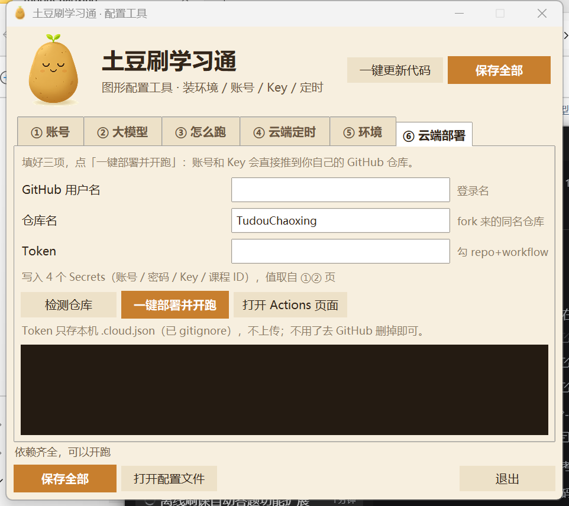
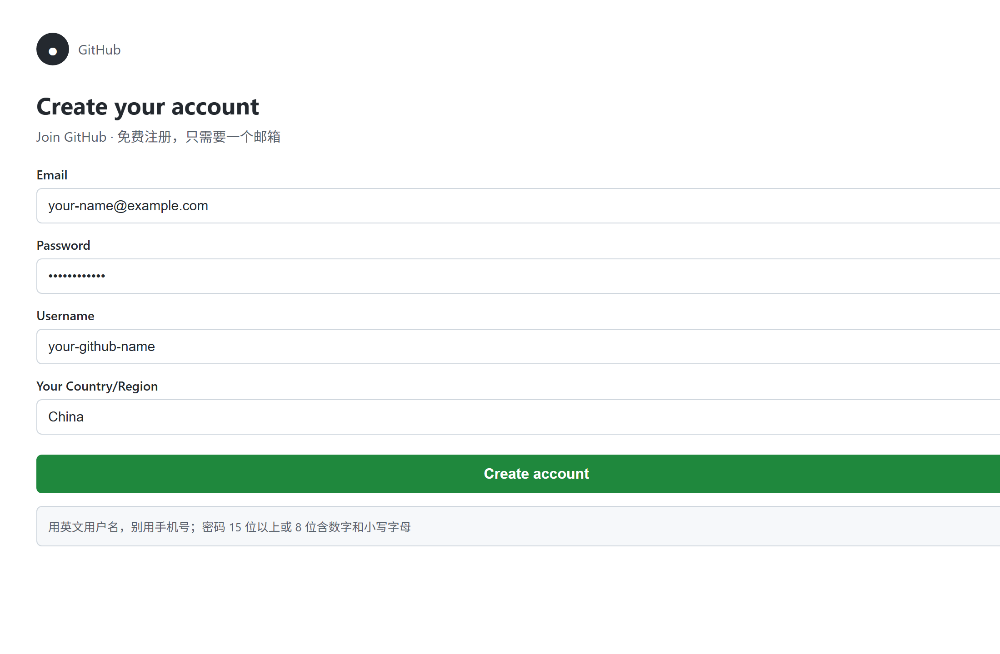
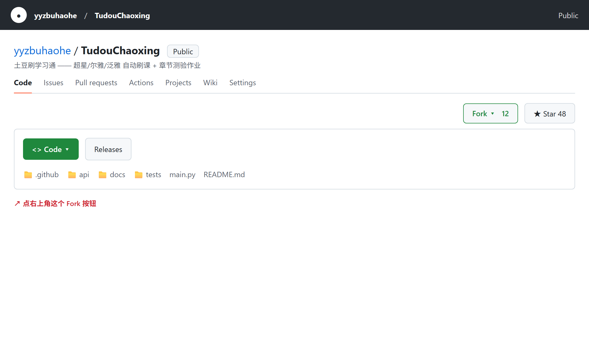
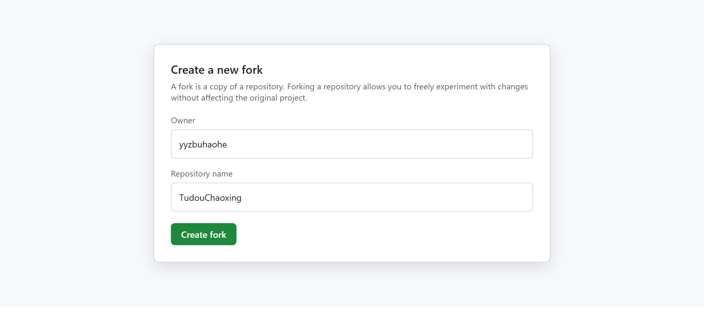
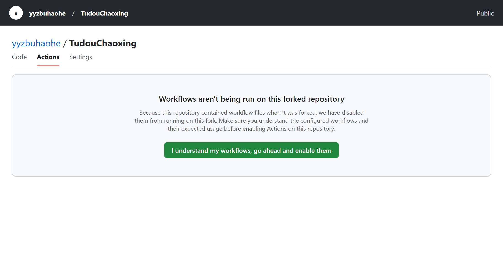
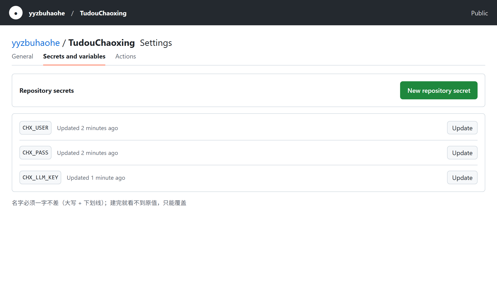
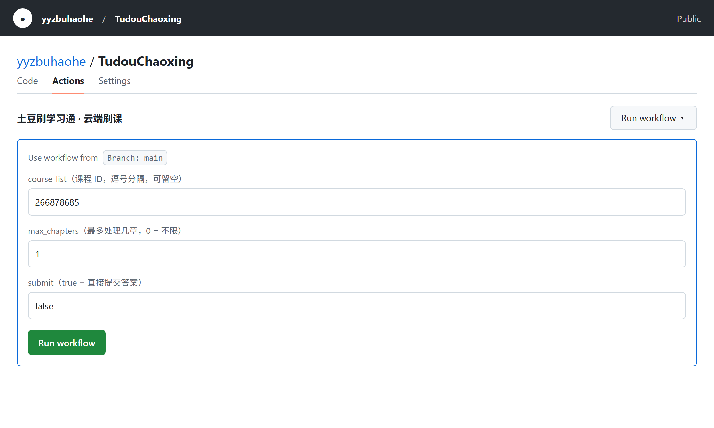
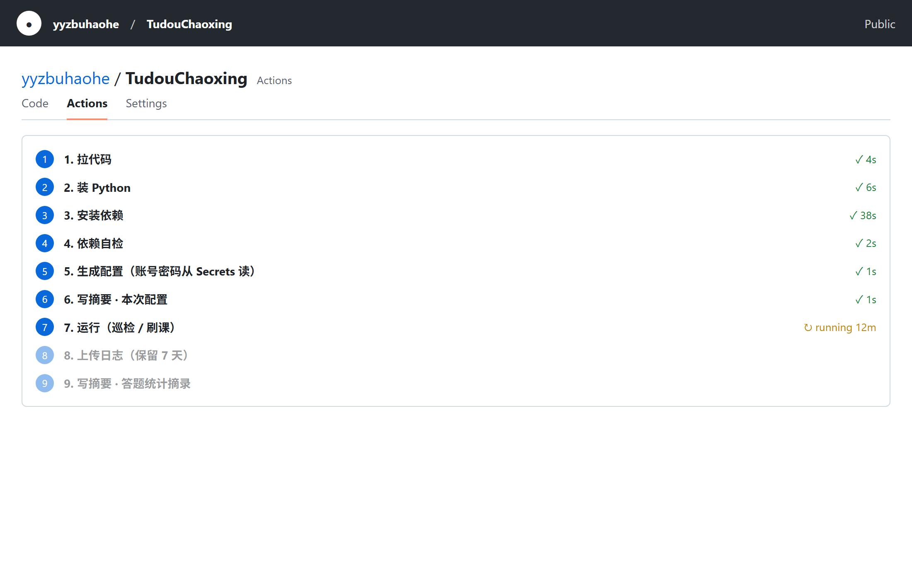
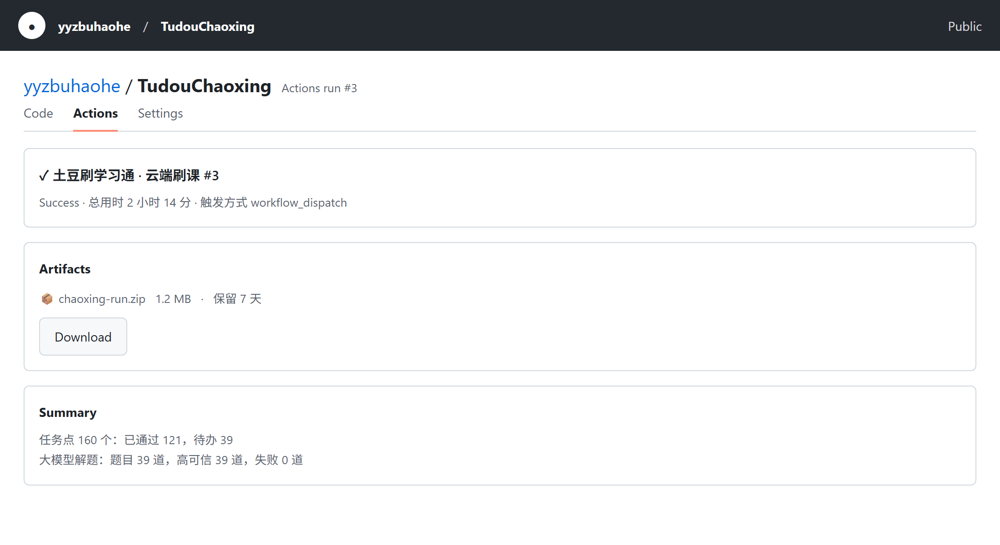

# 土豆刷学习通 · 云端运行教程（GitHub Actions 版）

> 写给**完全没用过 GitHub Actions** 的新生。
> 读完这一份，你能让 GitHub 的服务器替你跑土豆，自己的电脑关着也能刷。
> 仓库：**TudouChaoxing** ｜ 原作者仓库：https://github.com/yyzbuhaohe/TudouChaoxing ｜ 你自己 Fork 后的仓库：https://github.com/your-name/TudouChaoxing ｜ 交流群：**1132675059**
> 
> **文中两个占位写法：** `author` = 原作者账号（打开仓库页面看地址栏第一段就是它）；`your-name` = 你自己注册的 GitHub 用户名。看到 `your-name`，一律替换成你自己的用户名。

---

## 目录

- [0. 摘要卡（先看这 60 秒）](#0-摘要卡先看这-60-秒)
- [开场 · 为什么值得把土豆挪到云上](#开场--为什么值得把土豆挪到云上)
- [第一节 · GitHub Actions 是什么](#第一节--github-actions-是什么给土豆找台不要钱的电脑)
- [第零节 · GitHub 注册一条龙（连账号都没有就从这里开始）](#第零节--github-注册一条龙连账号都没有就从这里开始)
- [第二节 · 注册 + Fork（把土豆搬回自己家）](#第二节--注册--fork把土豆搬回自己家)
- [第三节 · 给土豆搭个大棚（启用 Actions）](#第三节--给土豆搭个大棚启用-actions)
- [第四节 · 配 Secrets（把账号密码塞进保险箱）](#第四节--配-secrets把账号密码塞进保险箱)
- [第五节 · 手动触发第一次](#第五节--手动触发第一次按一下开关)
- [第六节 · 看运行结果](#第六节--看运行结果土豆到底熟没熟)
- [第七节 · 开定时（让它自己每天发芽）](#第七节--开定时让它自己每天发芽)
- [第八节 · 改配置的两种办法](#第八节--改配置的两种办法)
- [第九节 · 额度与省钱](#第九节--额度与省钱)
- [第十节 · 云端翻车现场（16 个真实坑）](#第十节--云端翻车现场16-个真实坑)
- [附录 A · main.yml 完整内容](#附录-a--githubworkflowsmainyml-完整内容)
- [附录 B · make_config.py 关键逻辑](#附录-b--make_configpy-关键逻辑)
- [附录 C · 第一次跑的完整检查清单](#附录-c--第一次跑的完整检查清单)
- [附录 D · 术语表](#附录-d--术语表)
- [结尾 · 出问题了怎么找我们](#结尾--出问题了怎么找我们)

---

## 0. 摘要卡（先看这 60 秒）

| 项目 | 内容 |
| --- | --- |
| **能干什么** | 超星学习通 / 超星尔雅 / 泛雅 自动做：视频任务点、文档任务点、阅读任务点、章节测验、作业。<br>**明确不做考试**（带 exam- 前缀的任务点一个请求都不发，直接放过）。 |
| **要花多久配** | 第一次从头配：**20 到 40 分钟**（注册 5 分钟 + Fork 1 分钟 + 启用 Actions 1 分钟 + 填 6 个 Secret 10 分钟 + 触发试跑 1 分钟 + 等结果 10~30 分钟）。<br>第二次以后：**点三下，1 分钟**。 |
| **需要什么** | ① 一个邮箱（注册 GitHub 用）<br>② 一个 GitHub 账号（免费版够用）<br>③ 学习通手机号 + 密码<br>④ 一个大模型 Key（DeepSeek / 硅基流动 / 中转站都行，**强烈建议有**，没有的话题目会退化成随机作答）<br>⑤ 会复制粘贴、会看网页按钮，就够了 |
| **不需要什么** | 不需要装 Python、不需要懂 Git、不需要会命令行、不需要服务器、不需要一直开着电脑。 |
| **核心原理一句话** | GitHub 白送你一台临时 Linux 电脑，跑完就销毁；你在网页上点一下，它在云端把 `main.py` 跑一遍，日志打包给你下载。 |
| **最大的一笔代价** | 私有仓库每月只有 **2000 分钟**免费额度，刷一整场课可能吃掉几百分分钟；公开仓库不限分钟但代码公开。 |
| **最容易卡住的地方** | Fork 完 Actions 默认是**关着的**，90% 的人死在第三节那个绿色按钮上。 |
| **最危险的一步** | 密码放 Secrets。**千万别**把密码写进 `config.ini` 再提交上去。 |

### 一页流程图（照着走）

```text
注册 GitHub
    ↓
打开 https://github.com/yyzbuhaohe/TudouChaoxing
    ↓
右上角 Fork → Create fork        ← 土豆搬回自己家
    ↓
Actions 标签 → I understand my workflows...（绿色按钮）   ← 90% 的人卡这
    ↓
Settings → Secrets and variables → Actions → New repository secret
    ↓  填 6 个：CHX_USER / CHX_PASS / CHX_COURSE / CHX_LLM_KEY / CHX_LLM_ENDPOINT / CHX_LLM_MODEL
Actions → 土豆刷学习通 · 云端刷课→ Run workflow
    ↓  max_chapters=1、submit=false 先试水
等 3~30 分钟，看 Summary + 下 artifact chaoxing-run
    ↓
满意了 → 去掉 main.yml 里 schedule 的注释 → 每天自动发芽
```

### 三个诚实的前置说明

1. **这不是"装个软件点两下"。** 网页上按钮多、英文多，第一次配会有点懵，所以这份教程写得非常啰嗦，每一步都写"你会看到什么"。别跳读。
2. **第一次一定要小步试跑。** 用 `max_chapters=1` + `submit=false`：只跑一个章节、答完不提交。确认它能登录、能识别任务点、能出答案，再放开跑全量。
3. **云端跑的节奏和你本地跑不一样。** 云端那台机器上没有你电脑里的缓存、没有你的浏览器登录态，一切都是从零登录。第一次跑会比后面慢。

---

## 开场 · 为什么值得把土豆挪到云上

土豆这东西，土里土气，但管用。

在本地跑它的问题很土：**你得开着电脑**。笔记本一合盖，土豆就断气；网一抖，视频进度条卡在 47% 不动；跑一整夜，风扇转得跟拖拉机一样，第二天早上你打开一看——它半夜三点被你妈拔了插排，白跑。

所以第一步该干的事，不是研究它怎么答题，而是**给它换个地方长**：把它挪到 GitHub 的服务器上。土豆在地里，你在被窝里，两不相干。

### 上云到底解决了什么

| 痛点 | 本地跑 | 云端跑 |
| --- | --- | --- |
| 电脑关机 / 合盖 | 立刻断，进度丢失 | **照样跑**，跟你电脑一点关系都没有 |
| 笔记本要不要整夜开着 | 要，风扇响、费电、怕过热 | **不用开机**，关了就走 |
| 断网 / 掉线 | 视频卡住，任务点停在半路 | 机房网络，比家里宽带稳得多 |
| 半夜三点被拔插排 | 白跑 | 拔的是你家插排，不是 GitHub 的 |
| 你人在外面 | 只能干瞪眼 | 手机上点一下就能触发 |
| 跑完在哪看结果 | 自己存的日志文件 | 网页上直接看 Summary，日志打包可下载 |
| 出错排查 | 截图、翻本地文件 | 每一步都有独立日志，红的那一步直接点开看 |
| 账号密码 | 写在本机 config.ini 里 | 放 Secrets，日志里自动打码，跑完随机器销毁 |

一句话：**你不是在"用软件"，你是在"租一台免费的临时电脑"。** 电脑是 GitHub 的，电费是 GitHub 的，你只出账号密码（放在加密的 Secrets 里）。

### 代价也得说清楚（不然到时候你会骂人）

1. **免费额度不是无限。** 私有仓库每月 **2000 分钟** Actions 分钟数，所有 workflow 一起算。刷一整场课可能吃掉几百分分钟，一天跑一次一个月必超。超了当月就不能再跑，等下个月重置。
2. **密码必须放到 Secrets。** 云端机器读不到你本机的东西，账号密码只能通过仓库的 Secrets 传进去。这一步填错一个字母就登录失败，而且你**看不到填进去的原值**，只能覆盖重填。
3. **单次运行有硬上限。** GitHub 单个 job 最多 6 小时。本仓库的 workflow 把 `timeout-minutes` 设成了 **350 分钟**，留 10 分钟给上传日志和写摘要。跑不完就是被砍，不续命。
4. **定时不是闹钟。** GitHub 的定时任务经常晚 5~30 分钟，高峰期晚一小时也有。别指望"凌晨 2:00:00 整点开跑"。
5. **Fork 来的仓库，定时任务默认不跑。** 这是个真实的坑，写在第七节。

### 什么时候**不**该上云

- 你只有一门课、几十个任务点、一晚上就跑完了 → 本地跑更快，云端配 Secrets 的时间够你本地跑两轮。
- 你的仓库是私有的，而且额度已经用掉一大半 → 云端跑一次可能直接打爆额度。
- 你想边跑边盯着看每一步 → 本地跑，日志在眼前滚。

其他情况（网不稳、机子要关、课多、要好几天慢慢啃）→ 上云，值。

---

## 第一节 · GitHub Actions 是什么（给土豆找台不要钱的电脑）

### 1.1 人话版：GitHub 送你一台临时电脑

先把三个词记住，后面全是它们的排列组合：

| 词 | 人话 |
| --- | --- |
| **GitHub** | 一个放代码的网站。你注册个号，就能在上面存东西、公开、让别人复制。 |
| **Actions** | GitHub 附送的一项服务：**你给它一段指令，它开一台临时电脑把你的指令跑完，然后把日志还给你，跑完就把电脑砸了。** |
| **Workflow** | 那段指令本身，写成一个 YAML 文件（本仓库是 `.github/workflows/main.yml`）。 |

所以"用 GitHub Actions 刷课"翻译成人话就是：

> 我把"装 Python、装依赖、生成配置、跑 main.py"这几句话写进一个文件，交给 GitHub；我在网页上点一下，GitHub 就开一台 Ubuntu 的临时电脑，按顺序把这几句话跑完，跑完把日志打包给我，然后把电脑销毁。

那台临时电脑，业内叫 **runner**（跑步机）。它有几个你必须知道的特性：

1. **全新的。** 每次都是干净的 Ubuntu，里面什么都没有，Python 要现装，依赖要现下。所以你会看到"装 Python""安装依赖"这两步每次都在跑。
2. **用完就销毁。** 你的密码、大模型 key 只在这次运行的内存里存在过，跑完随机器一起没了。这也是为什么它比"把密码写进配置提交上去"安全得多。
3. **你没法和它交互。** 它不会弹窗问你"选哪门课"。程序里任何 `input()` 都会永远等下去，直到超时被砍。**这是第十节第 4 条那个大坑的根源。**
4. **免费额度按分钟算。** 私有仓库 2000 分钟/月，公开仓库不限（标准 runner）。

### 1.2 免费额度到底怎么算

| 项 | 规则 |
| --- | --- |
| 私有仓库 | 每月 **2000 分钟**（Free 计划），所有 workflow 共享，1 分钟精度，向上取整到分钟 |
| 公开仓库 | 标准 runner（ubuntu-latest / windows-latest / macos-latest 里的 ubuntu）**不限分钟** |
| 计费倍率 | Ubuntu 1 倍、Windows 2 倍、macOS 10 倍。本仓库跑 `ubuntu-latest`，就是 1 倍，最便宜 |
| 单 job 硬上限 | **6 小时**（360 分钟） |
| 本仓库设的上限 | `timeout-minutes: 350`，也就是跑到 350 分钟就主动收摊，留 10 分钟上传日志 |
| 超额之后 | 当月剩下的日子这个私有仓库的 Actions 直接不给跑，等下个月 1 号重置；公开仓库不受影响 |
| 存储 | artifact 也算存储（有免费额度），本仓库 artifact 只留 **7 天**，自动清 |

粗算一笔账，让你有感觉：

- 一次完整刷课，跑 2 小时 = **120 分钟**。
- 私有仓库 2000 分钟 ÷ 120 ≈ **16 次**。
- 一天跑一次 → 半个月就打爆。
- 所以：**私有仓库别开每日定时；要天天跑就用公开仓库，或者用 `max_chapters` 把每次的量切小。**

### 1.3 本地跑 vs 云端跑，一张表说清

| 对比项 | 本地跑（自己电脑） | 云端跑（GitHub Actions） |
| --- | --- | --- |
| 关机能不能跑 | **不能**，一关就断 | **能**，跟你电脑没关系 |
| 要不要一直开着 | 要，还得防休眠、防合盖、防拔插排 | 不要，网页上点完就能关电脑 |
| 密码放哪 | 本机 `config.ini` 或环境变量 | 仓库 Secrets（加密，日志自动打码） |
| 出错怎么查 | 看终端滚屏、翻本地日志文件 | 网页上每一步独立日志，红的那步点开就能看，还能 grep |
| 环境要不要自己装 | 要，Python + 依赖 + 中文字体 | 不要，workflow 里现装现用 |
| 跑完结果在哪 | 本机 `chaoxing.log` | 网页 Summary + artifact（`chaoxing.log` / `run.log` / `scan.log`，留 7 天） |
| 网络 | 你家宽带，可能抖 | 机房网络，稳 |
| 能不能半夜跑 | 能，但你得一直开着 | 能，而且你不用管 |
| 花费 | 电费 | 私有仓库吃 2000 分钟额度；公开仓库免费 |
| 出问题找谁 | 自己 | 自己 + 群里（群号在最后） |
| 适合谁 | 就一两门课、当晚能跑完 | 课多、要跑好几天、网不稳、电脑要关 |

### 1.4 一个必须建立的心智模型

把整件事想成三层，你就不会乱：

```text
第一层：仓库（你 Fork 出来的 TudouChaoxing）
        └── 里面躺着代码、main.yml、make_config.py
第二层：Secrets（仓库设置里的保险箱）
        └── 手机号 / 密码 / 大模型 key 存这里，只有运行时的机器能读
第三层：一次运行（Run）
        └── GitHub 开一台临时机器 → 拉代码 → 装环境 → 生成 config.ini
            → 跑 main.py → 上传日志 → 销毁机器
```

**每一次点 Run，都是完整重来一遍。** 上次跑完的 `config.ini`、上次的浏览器缓存、上次的答案缓存 `cache.json`，**全都不在了**。这点非常重要，第十节里一半的坑都跟"云端没有记忆"有关。

---

## 配这些东西嫌麻烦？用图形工具（第⑥页能一键推上去）

仓库根目录有个 `一键配置.bat`（Windows 双击）或 `配置工具.pyw`（`python 配置工具.pyw`）。
从这一版开始，**Secrets 和定时都不用去网页上点**，第⑥页直接推：



*图：⑥ 云端部署页 —— 填三项，Secrets、定时、第一次运行一次搞定*

**一次能做完的事**：

| 以前要手点 | 现在 |
| --- | --- |
| 网页上加 3~6 个 Secret | ⑥ 页「一键部署并开跑」，值直接从 ①② 页搬 |
| 本地改完 main.yml 还要 git commit + git push | ⑥ 页顺手用 Contents API 提交上去 |
| 再去 Actions 页手动 Run workflow | 部署完自动触发一次「只刷 1 章」的试水 |

**你只需要准备一样东西**：一个 GitHub Token。

```text
github.com/settings/tokens → Generate new token (classic)
  勾：repo（仓库读写） + workflow（改 .github/workflows 必须勾这个）
  有效期随便，用完可以删
```

拿到 `ghp_` 开头那串，填进 ⑥ 页，点「检测仓库」→「一键部署并开跑」。

**唯一替不了你的一步**：fork 来的仓库，GitHub 默认禁用定时任务。部署成功后去
Actions 页面点一次绿色的 `I understand my workflows, go ahead and enable them`，
否则两条 cron 永远不会触发。这是 GitHub 的安全策略，API 也绕不过。

**只想改定时、不想动 Secrets**：④ 页改完点「保存全部」，再到 ⑥ 页点「一键部署并开跑」，
它发现 Secrets 已经存在就直接覆盖，发现 main.yml 没变就跳过，不会多产生无意义的提交。

不想装 Python 的，直接看下面第零节，在网页上一步步点。

---

## 第零节 · GitHub 注册一条龙（连账号都没有就从这里开始）

> **先解释一个别扭的地方：** 这一节叫「第零节」，是因为它是真正动手的第一步；但它排在第一节后面，因为注册之前你得先知道「注册这个号图什么」，第一节讲的就是那个理由。看完第一节再回来填表单，你心里是有数的。
>
> **已经注册过 GitHub 了？** 整节跳过，直接去第二节的 2.2 小节 Fork。

这一节的假设非常极端：你没注册过 GitHub、不知道它是什么、英文界面看着晕、也不知道 Fork 是什么。**全部从「打开浏览器」开始**，一直讲到「你有一个能用的账号，但里面还是空的」。

### 0.1 一句话讲清 GitHub 是什么

**GitHub 是一个放代码的网站。** 全世界的程序员把代码存在上面，别人可以看、可以复制、可以一起改。注册免费，存公开项目免费，不弹广告。

但它跟你真正有关系的地方不是「存代码」，是它**顺手送的那台临时电脑**：

| 它是什么 | 人话 |
| --- | --- |
| 一个网站 | 网址 `github.com`，注册个号就能用 |
| 一个代码托管处 | 别人的项目整份放在上面，你能一键复制回自己名下 |
| **一台免费临时电脑（Actions）** | 你在网页上点一下，它的服务器开一台 Linux 机器，把项目里写好的步骤跑一遍，跑完把日志还给你，然后把机器删掉 |

**记住这一句就够了：你不是在「用软件」，你是在借 GitHub 的电脑跑一个程序。**

它不是下面这些东西，先把误会掐掉：

| 你可能以为 | 实际上是 |
| --- | --- |
| 网盘（存文件、存电影） | 不是。虽然能存文件，但整套界面是围绕代码设计的 |
| 要充钱才能用 | 注册、公开仓库、公开仓库的 Actions 分钟数都免费 |
| 要会写代码才能注册 | 不用。整份教程只让你复制粘贴、点按钮、填几个框 |
| 注册完必须传点东西上去 | 不用。一个文件不传也能用 |
| 注册完就是一个空仓库，能跑吗 | 不能。仓库里得有土豆的代码，所以下一步是 Fork，不是新建 |

### 0.2 为什么刷课这件事非得有个 GitHub 账号

因为你要借的那台「免费电脑」挂在账号下面。**没账号 = 没电脑。**

| 你要做的事 | 为什么绕不开账号 |
| --- | --- |
| 把项目复制一份到自己名下 | 只有登录了才有 `Fork` 按钮 |
| 存手机号和密码 | 密码放「你自己仓库」的 Secrets 里，没仓库就没 Secrets |
| 点一下让它跑 | `Run workflow` 按钮只出现在你自己仓库的 Actions 页面 |
| 下载跑完的日志 | Artifact 挂在「你这一次运行」下面，属于你的账号 |

一句话：**账号不是形式主义，账号就是那台电脑的钥匙。**

### 0.3 注册前手边备好四样东西

| 备什么 | 具体要求 | 没有会怎样 |
| --- | --- | --- |
| 一个能收信的邮箱 | QQ 邮箱、163、Gmail 都行，**必须当场能打开收信** | 收不到验证邮件，账号卡在「未验证」，后面按钮点不动 |
| 一个密码（先在脑子里想好） | 至少 15 个字符；或者 8 个字符以上且同时含数字和小写字母 | 现场被强度条反复卡住 |
| 一个用户名（先备 2~3 个） | 只能英文、数字、连字符 `-`，不能中文、不能空格 | 想要的被占了，现场乱填就容易填成手机号 |
| 一部能扫二维码的手机（不一定用得上） | 万一遇上强制双因素认证（2FA）要用 | 遇上了没法登录，见 0.9 |

**邮箱怎么选：**

| 邮箱 | 能不能用 | 说明 |
| --- | --- | --- |
| QQ 邮箱 `xxx@qq.com` | 能 | 最常用。验证邮件有时会掉进「垃圾邮件」文件夹 |
| 163 / 126 | 能 | 能收，注意广告邮件混在一起 |
| Gmail | 能 | 最顺，但没有的话不用特意去注册 |
| 学校邮箱 | 能 | 别用快毕业就注销的那种 |
| 临时邮箱 / 一次性邮箱 | 不建议 | GitHub 会拦，而且以后找回账号就靠这个邮箱 |

**密码怎么想：** 用一句你能背下来的长句子最省事，比如 `potato2024grows-fast`（21 个字符，够）。别用你在别处正在用的密码。

### 0.4 打开注册页

浏览器地址栏敲：

```text
https://github.com/signup
```

打开后你会看到这个表单：



*图 1：注册页四个格子，邮箱、密码、用户名、国家/地区*

**你会看到什么：** 一张居中的白色卡片，标题大意 `Welcome to GitHub!`，从上到下四个输入框：`Enter your email` → `Create a password` → `Enter a username` → `Country/Region`（下拉），最下面一个绿色按钮 `Create account`。

**坑：** 如果你打开的是满屏英文、有大标题和插图的主页，说明你打开的是 `github.com` 首页而不是注册页。点右上角 `Sign up`，或者按上面的地址重新敲一遍。

### 0.5 四个格子逐个填

#### 格子 1：Email

填一个**你现在就能打开的邮箱**。这一格唯一的硬要求是：**收得到 GitHub 发来的验证邮件**。

**你会看到什么：** 输入合法邮箱后，输入框右边出现一个绿色小勾；格式不对时是红框加一句 `Email is invalid`。

| 现象 | 原因 | 怎么办 |
| --- | --- | --- |
| 红框，提示 invalid | 多打了空格 / 少了 `@` / 用了中文全角字符 | 删掉重打，注意别在中文输入法下打全角 |
| 绿勾，但提示已被使用 | 这个邮箱已经注册过 GitHub | 直接去登录；或者换一个邮箱注册新号 |
| 绿勾，下面提示要验证 | 正常，继续填下一格 | 不用管 |

#### 格子 2：Password

规则两条，**满足任意一条就行**：

| 规则 | 例子 | 说明 |
| --- | --- | --- |
| 至少 **15 个字符** | `potato2024grows-fast` | 最省事，不用凑数字和小写 |
| 或至少 **8 个字符**，且**同时含数字和小写字母** | `potato2024` | 少一个条件就不让过 |

**你会看到什么：** 输入框下面一条强度条，从红（`Weak`）变黄再变绿（`Strong`）；不满足条件时下面会出现一句英文提示，大意是密码太短或太简单。

**坑：** 别用键盘上顺手滑出来的 `12345678`、`qwertyui`，这类会被直接判成弱密码、按钮点下去没反应。

#### 格子 3：Username

这一格最重要，因为**它会变成你仓库地址的一部分**：

```text
https://github.com/your-name/TudouChaoxing
```

允许和不允许，一张表看完：

| 允许 | 不允许 |
| --- | --- |
| 英文字母（大小写都行） | 中文 |
| 数字 | 空格 |
| 连字符 `-`（不能放开头或结尾） | 下划线 `_`、点 `.`、`@` |

起名建议：

| 建议 | 原因 |
| --- | --- |
| 用英文 + 数字，别用中文 | 中文直接不让填 |
| **别用手机号** | 仓库是要公开的，手机号挂在网址上等于自己投稿给骚扰电话 |
| **别用真名全拼** | 群里一问「谁的仓库」，你不想被认出来 |
| 短、好记、好打 | 后面要在地址栏里反复看它 |
| 见名知意，比如 `potato-runner-01` | 想不出名字时，比一串随机数字好记 |

**你会看到什么：** 一边打字，框下面一边实时判断：绿字 `your-name is available`（能用）／红字 `your-name is not available`（被占了）。

**坑：** 看到红字别急着删掉重来，先在末尾加个 `-01`、`-02` 试试，成功率比重新起名高得多。

#### 格子 4：Country/Region

下拉框选 **China**。

**你会看到什么：** 选完下拉框里就显示 `China`。这一格只影响条款和地区相关功能，选错不影响跑 workflow，但选 China 最省事。

#### 最后：点 Create account

最下面通常有一行 `By creating an account, you agree to the Terms of Service...`，不用逐字读。

**点绿色 `Create account`。**

**你会看到什么：** 按钮进入加载状态，几秒后页面跳到「人机验证」或者「输入邮箱验证码」这一步——就是下面的 0.6。

### 0.6 点完 Create account 之后：Puzzles → 验证邮件

顺序基本固定，三步走完。

#### 第 1 步：Puzzles（拼图 / 转图形的人机验证）

GitHub 会甩一道小题过来，最常见的是「把动物转到正着的方向」（转长颈鹿、转海豚）或者拼图块。

**你会看到什么：** 弹出一个方框，里面一张图 + 一个 `Verify` 按钮（有时是拖拽拼块）。做完点 `Verify`，方框自己关掉。

| 现象 | 怎么办 |
| --- | --- |
| 方框一直转圈，图不出来 | 换 Chrome / Edge；关掉广告拦截插件；关掉代理再试 |
| 图出来了但怎么点都不对 | 慢慢对齐，看清题干；有些题是「点所有包含某物的图」 |
| 反复验证都不给过 | 换个网络（手机热点）再试，机房 / 代理 IP 常被判风险 |

#### 第 2 步：收验证邮件，点里面的链接

题过了之后，GitHub 会往你填的邮箱发一封信，标题大意是 `[GitHub] Please verify your email address`。

**你会看到什么：** 网页上出现一个输入框（有的版本要 8 位数字，有的版本是让你去点邮件里的按钮）。

打开邮箱，找到那封信，然后：

1. 信里有绿色按钮 `Verify email address` → 点它
2. **你会看到什么：** 浏览器打开一个新页面，写 `Your email has been verified` 之类的话
3. 回到 GitHub 标签页（或者登录一次）
4. **你会看到什么：** 右上角出现一个自动生成的像素小人头像——这就成了

#### 第 3 步：邮件没收到，按这个顺序查

| 排查项 | 怎么查 | 说明 |
| --- | --- | --- |
| 垃圾邮件箱 | QQ 邮箱左侧「垃圾邮件」；163 在「垃圾邮件」文件夹 | 十有八九在这儿 |
| 等 2 分钟 | 什么都不做，等 | 投递有延迟，2~10 分钟都算正常 |
| 搜发件人 | 在邮箱里搜 `github` | 有时被归到「订阅邮件」「推广」 |
| 核对邮箱 | 回 GitHub 页面看那一格 | 把 `qq.com` 打成 `qq.con` 的人不少 |
| 重发 | 页面上找 `Resend email` 这类小字链接，点一下 | 点完再等 2 分钟 |
| 换邮箱 | 上面都不行就换一个能收信的邮箱 | 登录后能在账号设置里改邮箱 |

**必须验证邮箱。** 不验证也能登录，但很多按钮会莫名其妙点不动——包括后面要用的 Actions。

### 0.7 注册完它会问你几个问题：全部跳过

验证完邮箱，GitHub 会连着问几屏问题，大意是：

- 你团队里有几个人（`Just me` / `2-5` / ...）
- 你是学生还是老师（`Student` / `Teacher` / `Software engineer` / ...）
- 你想用 GitHub 干什么（多选）
- 你对什么技术感兴趣（多选）

**你会看到什么：** 一屏一屏的单选 / 多选，每屏最下面永远有一个 `Skip personalization` 或 `skip this step` 的链接。

**全部跳过。** 这些问题跟刷课一点关系都没有，选什么都不影响功能。找到 `Skip` 点掉，直到出现正常的 GitHub 首页。

### 0.8 登录之后，界面先只认三个地方

注册完你会看到一个信息量很大的首页。**只需要认三个地方**，其它一律不用管：

| 位置 | 长什么样 | 干什么用 |
| --- | --- | --- |
| 顶栏的搜索框 | 写着 `Type / to search` | 想找任何仓库，把名字粘进去搜 |
| 右上角头像 | 一个像素小人 | 点开有菜单：`Your profile` / `Your repositories` / `Settings` / `Sign out` |
| 左上角的猫图标 | GitHub 的 Octocat | 点它回首页 |

**头像菜单里有两个入口必须记住：**

| 入口 | 点进去你会看到什么 |
| --- | --- |
| `Your repositories` | 你名下所有仓库。**现在还是空的**，Fork 完这里才会出现 `TudouChaoxing` |
| `Settings` | **账号**设置（改密码、改邮箱、配 2FA）。注意：这里面**没有** Secrets——Secrets 在「仓库」的 Settings 里，两个完全不同的页面，第四节会讲 |

**顺手做一件事：** 点进 `Settings` → 左边找 `Emails`，确认你的邮箱后面挂着 `Verified`。有这个词就说明验证成功了。

### 0.9 双因素认证（2FA）：遇上就按提示做，没遇上不用管

GitHub 现在对一部分账号**强制**开启双因素认证。你可能撞上，也可能一路顺畅。

**怎么知道你撞上了：** 登录或点某个按钮时，页面跳到一屏 `Enable two-factor authentication`，或者提示 `Two-factor authentication is required`。

**撞上了就照这三步做：**

1. 手机应用商店装一个 **Authenticator**（Google Authenticator / Microsoft Authenticator / 1Password 都行，免费）
2. 网页上会出现一个**二维码**。手机里的 Authenticator 点「扫描二维码」，对着屏幕扫
   **你会看到什么：** 手机上多出一个条目，写着 `GitHub` 和你的用户名，下面一串每分钟变一次的 **6 位数字**
3. 把当前那 6 位数字填进网页输入框 → `Continue`
   **你会看到什么：** 页面提示成功，并给你一组**恢复码**（recovery codes，一长串一次性数字）

**恢复码一定存好**（截图、抄纸上、丢进自己的记事本）。手机丢了或换手机，靠它救账号。

**没遇到就不用管。** 不用主动去开，它跟跑 workflow 没关系。

### 0.10 注册完没有仓库，是完全正常的

此刻你的 `Your repositories` 页面大概率显示一句空状态，大意是：

```text
You dont have any repositories yet
```

**这不是出错，这就是对的。** 你接下来要做的是把别人的项目整份复制一份到自己名下，那叫 Fork，在第二节。Fork 完这里立刻会多出一个 `TudouChaoxing`。

**别在这一步自己点 `New repository`。** 新建一个空仓库，里面没有土豆的代码，跑不起来任何东西。

### 0.11 第零节自检清单

注册这一段做完，逐条对一遍，**全对才进第二节**：

- [ ] 能用邮箱 + 密码登录 `github.com`
- [ ] 右上角有头像，点头像能看到 `Your repositories`
- [ ] 进 `Settings` → `Emails`，邮箱后面显示 `Verified`
- [ ] 记得自己的用户名，拼写一模一样（下一节的地址里要用）
- [ ] `Your repositories` 是空的（正常，Fork 之后才会有东西）
- [ ] 如果撞上 2FA，二维码已经扫完，6 位数字能算出来
- [ ] 恢复码存好了（撞上 2FA 的情况）

### 0.12 注册页那几句英文，翻译成人话

注册过程中会反复出现这几句，先把意思对上，不至于看着发懵：

| 英文 | 人话 | 要不要理它 |
| --- | --- | --- |
| `Enter your email` | 填邮箱 | 要 |
| `Create a password` | 设密码 | 要 |
| `Enter a username` | 起用户名 | 要 |
| `Country/Region` | 国家/地区 | 选 China |
| `is available` | 这个名字能用 | 继续 |
| `is not available` | 被占了，换一个 | 加个后缀再试 |
| `Create account` | 建账号（最终提交） | 点它 |
| `Verify` | 提交人机验证答案 | 做完题点它 |
| `Please verify your email address` | 请验证你的邮箱 | 去邮箱点链接 |
| `Skip personalization` | 跳过个性化问卷 | 点它 |
| `Your repositories` | 你的仓库列表 | Fork 完来这里看 |
| `Settings` | 设置（账号的 / 仓库的，两个不同页面） | 第四节要用仓库那个 |
| `Verified` | 已验证（邮箱旁边） | 看到就对了 |
| `Two-factor authentication` | 双因素认证（2FA） | 撞上了才做 |

**一个常见误会：** 注册页的 `Sign up` 和 `Sign in` 长得像但完全不同。`Sign up` = 注册新账号；`Sign in` = 登录已有账号。**已经有号的人点错成 `Sign up`，会得到一句「邮箱已被使用」**，不是坏事，说明你早就注册过，去 `Sign in` 登录就行。

到这儿，账号这件事彻底完了。往下走第二节：把土豆搬回自己家。

---
## 第二节 · 注册 + Fork（把土豆搬回自己家）

这一节干两件事：弄个 GitHub 账号；把别人的仓库"复制"一份到你名下。为什么要复制？因为**别人的仓库你只能看，不能改、不能自己跑**。你得复制一份属于自己的，才能在里面加 Secrets、改 workflow、点 Run。

### 2.1 注册（5 分钟，一次性的）

**这一小节是精简版：只给「知道自己在干什么、只想快点填完」的人。** 如果你连 GitHub 是什么都没听说过，去看前面的 [第零节](#第零节--github-注册一条龙连账号都没有就从这里开始)——那一节从「打开浏览器」讲到「验证邮件收到了」，连填错哪个格子怎么改都写了。**已经注册过的，整段跳过，直接看下面 2.2 的 Fork。**

#### 步骤 1：打开注册页

浏览器地址栏敲：

```text
https://github.com/signup
```

**你会看到什么：** 一个居中的白色表单，第一行写着 `Welcome to GitHub!`，下面依次是 `Enter your email` → `Create a password` → `Enter a username`，最下面一个绿色按钮 `Continue` 或者 `Create account`（版本不同文案略有差异）。

**坑：** 如果你看到的是一个满屏英文的营销首页，说明你打开的是 `github.com` 首页而不是 signup 页。点右上角 `Sign up`。

#### 步骤 2：填邮箱

用**能收信的邮箱**（QQ 邮箱、163、Gmail 都行）。这个邮箱后面要收验证码，填错了收不到。

**你会看到什么：** 输入框旁边有个绿色的小勾，表示格式没问题。

#### 步骤 3：设密码

要求：**至少 15 个字符**，或者至少 8 个字符 + 数字 + 小写字母。用一句你能记住的长句子最省事，比如 `potato2024grows-fast`。

**你会看到什么：** 密码强度条从红变绿。

#### 步骤 4：起用户名（username）

这个非常重要，因为你的仓库地址会长这样：

```text
https://github.com/your-name/TudouChaoxing
```

起名建议：

| 建议 | 原因 |
| --- | --- |
| 用英文 + 数字，别用中文 | GitHub 用户名只允许字母数字和连字符，中文直接不让填 |
| **别用手机号** | 你这仓库是要公开的，手机号挂在 URL 上等于自己投稿给骚扰电话 |
| **别用真名全拼** | 群里一问"谁的仓库"，你不想被认出来吧 |
| 短一点、好记 | 后面要在地址栏里反复看它 |

**你会看到什么：** 输入框下面实时出现绿字 `yourname is available`；如果是红字 `is not available`，换一个。

#### 步骤 5：过验证码

GitHub 会给你一道拼图/转图形的题（"把长颈鹿转正"这种）。

**你会看到什么：** 一个弹出的方框，里面有一张图和一个 `Verify` 按钮。做完点 `Verify`，方框自己关掉。

**坑：** 如果验证框一直转圈不出来，换浏览器（Chrome / Edge），或者关掉广告拦截插件、关掉代理再试。

#### 步骤 6：点 Create account，然后验证邮箱

**你会看到什么：** 页面跳到一个"输入邮箱验证码"的框，同时你的邮箱收到一封 `[GitHub] Please verify your email address`，里面有一个 **8 位数字**。

填进去 → 完成。

**不做这步会怎样：** 账号能登，但很多功能（包括触发 workflow）会被限制，你会莫名其妙点不动按钮。**必须验证。**

#### 步骤 7：跳过个性化问卷

GitHub 会问你"你是学生还是老师""你想用 GitHub 干什么""你感兴趣什么"。

**你会看到什么：** 一屏一屏的选择题，最下面永远有个 `Skip personalization` 或者 `skip this step`。

**直接跳过**，别浪费时间。

#### 步骤 8：确认你进去了

**你会看到什么：** 页面左上角是 GitHub 的猫图标，右上角是你的头像（一个自动生成的像素小人）。点右上角头像，菜单里第一行就是你的用户名——记下它，后面要用。

### 2.2 Fork 是什么（人话）

> **Fork = 把别人的仓库整体复制一份到你名下，变成你自己的仓库。**

复制完之后：

- 你有一份**完全独立**的仓库，改动只影响你自己这份，不会影响原作者的。
- 你这份的地址是 `https://github.com/your-name/TudouChaoxing`。
- 你可以在里面加 Secrets、点 Run、改文件——原作者那边看不见也管不着。
- 页面上会显示一行小字 `forked from yyzbuhaohe/TudouChaoxing`，表示它从哪来。

**为什么必须 Fork：** 你没有原作者仓库的写权限，所以加不了 Secrets、点不了 Run。Fork 就是给自己开一块地。

### 2.3 动手 Fork

#### 步骤 1：打开仓库

```text
https://github.com/yyzbuhaohe/TudouChaoxing
```

**你会看到什么：** 页面顶部是仓库名 `author / TudouChaoxing`（带 `Public` 小标签），下面是 README 正文（一大篇中文说明）。

#### 步骤 2：右上角找 Fork 按钮

在仓库名那一行的右边，有一排按钮：`Watch` / `Fork` / `Star`（还有个数字）。

**你会看到什么：** `Fork` 旁边有个小数字，表示有多少人 Fork 过。

按钮具体在哪，看这张图（红框圈住的就是）：



*图 2：仓库首页，右上角 `Watch` / `Fork` / `Star` 那一排里的 `Fork`*

**三个按钮各干什么，别点错：**

| 按钮 | 点了会怎样 | 你需要它吗 |
| --- | --- | --- |
| `Watch` | 变成「订阅这个仓库的通知」，有新动静会发邮件 | 不需要。点了只会让邮箱变吵 |
| `Fork` | 弹出复制页面，把整个仓库复制一份到你名下 | **要的就是它** |
| `Star` | 加个收藏，星数 +1，什么都不复制 | 不需要。**点错了会以为已经复制完，其实地址还是原作者的** |

#### 步骤 3：点 Fork → 进 Create fork 页

**你会看到什么：** 跳到一个新页面，标题是 `Create a new fork`，有两块：

- `Owner`：下拉框，默认是你的用户名，后面跟着 `/`，然后是仓库名 `TudouChaoxing`
- `Copy the main branch only`：**保持勾选**（本仓库只需要 main 分支）

这个页面长这样：



*图 3：`Create a new fork` 页面，`Owner` 已经是你的用户名，`Repository name` 保持 `TudouChaoxing`*

**你会看到什么：** 上半区 `Owner`（下拉，默认你的头像 + `your-name`）+ `/` + `Repository name`（默认 `TudouChaoxing`）；下半区一个 `Copy the main branch only` 的勾选框，默认已经勾上；最下面绿色的 `Create fork`。

**这个页面上一个字都不用改。** 名字别改（改成 `TudouChaoxing-2` 之类不影响运行，但后面所有教程里写的地址都要跟着改，纯给自己添麻烦），勾选框别动，直接点绿色按钮。

#### 步骤 4：点绿色的 `Create fork`

**你会看到什么：** 转几秒圈，然后页面自动跳到 `https://github.com/your-name/TudouChaoxing`，仓库名下面多了一行小字：

```text
forked from yyzbuhaohe/TudouChaoxing
```

看到这行字，Fork 就成了。

#### 步骤 5：三条判据确认 Fork 成功

| 判据 | 怎么看 |
| --- | --- |
| 地址变了 | 地址栏是 `github.com/your-name/TudouChaoxing`，不是 `yyzbuhaohe` |
| 有 forked from | 仓库名下方有一行灰字 `forked from yyzbuhaohe/TudouChaoxing` |
| 顶部多了 Settings | 仓库导航栏出现 `Settings` 标签（别人的仓库没有这个，这是你自己的仓库才有的权限标志） |

三条全中 = 成了。少一条 = 没成，回 2.3 重来。

### 2.4 这一节最常见的四个坑

#### 坑 1：没登录，找不到 Fork 按钮

**现象：** 页面上只有 `Star`，没有 `Fork`。

**原因：** 你还没登录 GitHub，或者登录掉了。

**怎么办：** 右上角点 `Sign in` 登录，刷新页面，Fork 就出现了。

#### 坑 2：Fork 完了，地址还是原作者的

**现象：** 你以为 Fork 了，地址栏还是 `yyzbuhaohe/TudouChaoxing`，点 Settings 也没有。

**原因：** 你可能只是点了 Star，或者点了 Fork 但没点最后的 `Create fork`（那一步容易以为已经完成）。

**怎么办：** 回原作者页面，重新点 `Fork` → `Create fork`，等页面自己跳转。

#### 坑 3：Fork 完想同步上游更新

**现象：** 作者更新了代码，你 Fork 那份还是旧的。

**怎么办：** 你 Fork 出来的仓库页面，仓库名下方那行 `forked from ...` 右边有个 `Sync fork` 按钮，点它 → `Update branch`。

**你会看到什么：** 绿色提示 `Successfully fetched and merged`。**同步只动代码，不动你的 Secrets，也不动你改过的 main.yml**（除非跟上游改的同一行冲突，那会提示你解决）。

#### 坑 4：Fork 出来是私有的？

**现象：** 你担心"Fork 出来是不是公开的，别人能看到我的 Secrets"。

**事实：** Fork 出来的仓库**继承原仓库的可见性**，原仓库是 Public，你 Fork 的就是 Public。**但 Secrets 是完全独立的、只有你自己能看**，别人就算访问你的仓库也看不到任何 Secret 名字和值（连名字都不显示）。

不过要注意：**公开仓库的代码是公开的**。本仓库代码本来就在 GitHub 上公开，所以这不构成额外泄露。真正要保密的是你的手机号、密码、大模型 key——它们只在 Secrets 里，不落代码。

---

### 2.5 Fork 完了，先认一下新家（30 秒导览）

Fork 成功之后你会看到一个陌生的页面。**只要认四个地方**，其它都不用管：

| 位置 | 你会看到什么 | 什么时候用到 |
| --- | --- | --- |
| 仓库名下面那行灰字 | `forked from yyzbuhaohe/TudouChaoxing` | 确认这是你复制来的那份 |
| 文件列表 | `main.py` / `config_template.ini` / `requirements.txt` / `README.md` / 一个 `.github` 文件夹 | 想改配置就来这儿，第八节 |
| 顶部标签条 | `Code` / `Issues` / `Pull requests` / `Actions` / `Projects` / `Wiki` / `Security` / `Insights` / `Settings` | 第三节点 `Actions`，第四节点 `Settings` |
| 右上角那一排 | `Watch` / `Fork` / `Star` | 不用再点，已经 Fork 过了 |

**那个 `.github` 文件夹是整套东西的核心：**

```text
.github/
  workflows/
    main.yml            ← 云端运行的剧本（第九节算额度看的就是它）
    make_config.py      ← 把 Secrets 变成 config.ini 的小脚本
```

**你会看到什么：** 点 `.github` 进去，只有一个 `workflows` 文件夹；再点进去，两个文件：`main.yml` 和 `make_config.py`。**`main.yml` 右边会显示行数（两百多行）**，点它就能在网页上直接读，附录 A 是同一份内容的拷贝。

**两个新手常见错觉：**

1. **「怎么没有 `config.ini`？」** 正常。云端每次运行的时候才用 `make_config.py` 现场生成一份，跑完随机器销毁，**仓库里永远不该有这个文件**。
2. **「README 一大堆中文，是教程吗？」** 是项目自己的说明，比这份文档简略。**以这份文档为准**，两边有出入时看这里。

---

## 第三节 · 给土豆搭个大棚（启用 Actions）

**这一节 30 秒就能做完，但 90% 的人卡在这，然后以为整个教程是骗人的。**

### 3.1 为什么 Fork 完 Actions 是关着的

GitHub 有个安全设计：**从别人那里 Fork 来的仓库，workflow 默认不运行。**

理由（了解就行，不用记）：防止有人 Fork 一个仓库、偷偷改 workflow 去偷别人东西，或者恶意消耗资源。所以 GitHub 强制要求你**手动点一次"我知道我在干什么"**。

这个设计导致的现象就是：你 Fork 完，进 Actions 页面，什么都没有——不是没有 workflow，是**没被批准运行**。

### 3.2 动手

#### 步骤 1：点顶部的 `Actions` 标签

在仓库导航栏上（`Code` / `Issues` / `Pull requests` / `Actions` / `Projects` / `Wiki` / `Security` / `Insights` / `Settings`），点 `Actions`。

#### 步骤 2：看你会看到什么

两种可能，都很正常：

**情况 A（常见）：** 页面中间一个白框，里面一段英文，大意是：

```text
Workflows aren't being run on this forked repository
Because this repository contained workflow files when it was forked,
we have disabled them from running on this fork. Make sure you
understand the configured workflows before enabling them.
```

下面一个**绿色的按钮**：

```text
I understand my workflows, go ahead and enable them
```

**情况 B（少见）：** 左边侧栏已经有 `土豆刷学习通 · 云端刷课` 这一条，说明 Actions 已经启用了（可能你之前点过），直接跳到第四节。

#### 步骤 3：点那个绿色按钮

按钮英文很长，读一遍意思就是"我明白这些工作流是干什么的，让它们跑吧"。

那个绿色按钮长这样（在页面中间那块英文说明下面）：



*图 4：Fork 完第一次进 Actions 页面，中间的 `I understand my workflows, go ahead and enable them`*

**你会看到什么：** 页面正中间一个白框，一段英文说明 + 一个横贯大半个页面宽度的绿色按钮。按钮点下去不用二次确认，点完页面直接刷新。

**你会看到什么：** 页面刷新，左边出现 workflow 列表，第一条就是：

```text
土豆刷学习通 · 云端刷课
.github/workflows/main.yml
```

右边主区域显示一句 `There are no workflow runs yet.`（还没有任何运行记录）。

**看到这两样，就对了。** 这一刻大棚搭好了，土豆有地方长了。

### 3.3 如果没看到那个绿色按钮

按顺序排查：

| 现象 | 原因 | 怎么办 |
| --- | --- | --- |
| Actions 页面完全是空白，连白框都没有 | 你没 Fork 成功，看的是原作者的仓库 | 回第二节，确认地址栏是你的用户名 |
| 有白框但没有按钮 | 页面没加载完 / 浏览器缓存 | Ctrl+F5 强刷；换 Chrome / Edge |
| 左边有 workflow 但按钮是灰的 | 你还在看原仓库的 Actions 页 | 地址栏确认是你的仓库 |
| 点了按钮，左边没出现 workflow | `.github/workflows/main.yml` 在你 Fork 时丢了 | 看仓库根目录有没有 `.github` 文件夹；没有就重新 Fork（勾选 `Copy the main branch only`） |
| 提示 `This workflow has a workflow_dispatch event trigger` 但按钮灰 | 你不在默认分支 | 确认当前分支是 `main`（左上角分支下拉框） |

### 3.3.1 三个坑，单独说清

上面那张表是「按现象查」，下面这三条是**新手一定会撞上的三个**，一个个拆开讲。

#### 坑 A：看不到那个绿色按钮

**现象：** 进了 Actions 页面，干干净净，没有白框，没有绿按钮，左边连 workflow 名字都没有。

**真正原因：Actions 其实已经启用了。** 这个绿色按钮是「一次性」的——你之前点过一次，它就永远不再出现。所以看不到按钮，往往说明**早就启用过了**，不是坏了。

**怎么确认：** 看左边侧栏。

| 左边侧栏长什么样 | 结论 | 下一步 |
| --- | --- | --- |
| 有一条 `土豆刷学习通 · 云端刷课` | 已经启用了 | 直接去第四节配 Secrets |
| 一条都没有，右侧写 `There are no workflow runs yet` 之类 | 可能确实需要点按钮，但没渲染出来 | Ctrl+F5 强刷；换 Chrome / Edge |
| 一条都没有，右上角也没有 `Run workflow` | 你不在自己的仓库，或者 `.github/workflows/main.yml` 丢了 | 看地址栏是不是 `your-name/TudouChaoxing`；不是就回第二节重新 Fork |

**你会看到什么（已经启用的情况）：** 左边那一列有一个条目，条目下面一行小灰字写着 `.github/workflows/main.yml`——看到这行字就说明文件在、workflow 活着。

#### 坑 B：点了没反应

**现象：** 绿色按钮点下去，什么都不发生；或者点了跳到一个登录页。

**原因：登录态掉了。** GitHub 的登录会过期（换设备、清 Cookie、太久没登都会），页面还显示着仓库内容，但按钮背后已经没有身份了。

**怎么办：**

1. 右上角点 `Sign in`，重新登录
   **你会看到什么：** 登录后回到仓库页面，右上角变成你的头像
2. 再进 `Actions` 标签，重新找那个绿色按钮
   **你会看到什么：** 按钮回来了，或者左边已经出现 workflow 条目（说明之前那次其实点成功了，只是页面没刷新）

**另一种「点了没反应」：** 按钮是灰的、鼠标放上去出现一个禁止符号。这多半是网络卡在加载中，等 10 秒再点，或者强刷一次。

#### 坑 C：Fork 完页面是旧的，按钮不在

**现象：** 明明刚 Fork 成功，进 Actions 还是原仓库的样子，或者看不到属于你自己的 workflow。

**原因：** 浏览器把你 Fork 之前看过的那个页面缓存住了，地址变了但内容是旧的。

**怎么办：** 在仓库首页按 **Ctrl+F5**（Mac 是 Cmd+Shift+R）强制刷新。

**你会看到什么：** 页面重新加载，仓库名下面出现 `forked from yyzbuhaohe/TudouChaoxing` 这一行小灰字，右上角出现 `Settings` 标签。**有这两样才说明你看的是自己的仓库。**

**顺序提醒：** Fork 成功 → 刷新一次 → 再进 Actions。这三步别省中间那一步，很多人就是卡在这。

### 3.4 顺便确认 workflow 有"手动触发"这个入口

**这一步很重要，因为如果你的 main.yml 里没有 `workflow_dispatch`，那就永远不会有 Run workflow 按钮，你会一直以为自己点错了地方。**

怎么确认：

1. 点左边的 `土豆刷学习通 · 云端刷课`
2. **你会看到什么：** 右边出现一片工作流详情，右上角有一个灰色按钮 `Run workflow`，旁边有个下拉小箭头。

有 `Run workflow` = 你的 main.yml 里有 `workflow_dispatch:`，正常。

没有 = 你的文件不是本仓库这份（可能 Fork 到别的项目去了）。检查 `.github/workflows/main.yml` 第 40~72 行，应该能看到：

```yaml
on:
  push:
    branches: [ main ]
  workflow_dispatch:
    inputs:
      course_list:
        ...
```

（真实文件就在这个位置，附录 A 有全文，可以逐行对。）

**顺便说个坑：** `Run workflow` 按钮**只有在默认分支（main）上才会出现**。如果你切到别的分支看，按钮就没了——这不是 bug。

---

### 3.5 启用完之后，头 30 秒看这三样

绿色按钮点完，别急着往下一节跑，先确认三件事都在：

| 看哪里 | 应该看到什么 | 看不到说明什么 |
| --- | --- | --- |
| 左边侧栏 | 一条 `土豆刷学习通 · 云端刷课`，下面灰字 `.github/workflows/main.yml` | workflow 文件丢了，回第二节重新 Fork |
| 右边主区域 | `There are no workflow runs yet.`（还没有任何运行记录） | 如果这里已经有别的 workflow 名字，你点的不是本仓库 |
| 右上角 | 灰色按钮 `Run workflow ▾` | 按钮没有 = `main.yml` 里没有 `workflow_dispatch`，看 3.4 |

**你会看到什么：** 左边一条条目，右边一片空白加一句英文，右上角一个带下拉箭头的灰按钮。**这三样同时出现 = 大棚搭好了。**

**为什么强调这 30 秒：** 后面第五节触发的时候，`Run workflow` 按钮就从这儿点。要是这一步没确认，到了第五节你会在页面上瞎找。

---

## 第四节 · 配 Secrets（把账号密码塞进保险箱）

这一节是整份教程里**最需要慢一点**的地方。填错一个字母，后面所有步骤都会失败，而且报错信息不会告诉你"你拼错了"。

### 4.1 Secret 是什么，为什么非要用它

**Secret = 仓库设置里一个加密的小抽屉。** 你往里塞一个名字和一个值，之后 workflow 运行时可以用双花括号包住 secrets 的写法把它读出来。

它的三个特性，决定了它是唯一正确的存密码方式：

| 特性 | 意义 |
| --- | --- |
| **只写不读** | 存进去之后，网页上**永远看不到原值**，只能看到名字和更新时间。填错了只能覆盖重填。 |
| **日志自动打码** | 如果某次运行不小心把密码打印到日志里，GitHub 会把它替换成 `***`。 |
| **只在运行时的机器内存里** | 你的 runner 是临时的，跑完销毁，Secret 不会留在任何磁盘上。 |

**对比一下错误做法：** 有人图省事，直接把手机号密码写进 `config.ini` 然后 commit 到公开仓库。结果：搜索引擎会爬到、别人 Fork 会带走、你删了 commit 历史里还留着。**别干这个。**

本仓库的做法是：密码只放 Secrets → workflow 里让 `make_config.py` 读环境变量 → 在 runner 内存里生成 `config.ini` → 跑完随机器销毁。整个过程中 `config.ini` 不出现在仓库里（`.gitignore` 也挡着它）。

### 4.2 打开设置页

#### 步骤 1：进你的仓库

```text
https://github.com/your-name/TudouChaoxing
```

#### 步骤 2：点仓库导航栏最右边的 `Settings`

**注意：** 是**仓库自身**的 Settings（在 `Insights` 后面那一个），不是右上角你头像菜单里的 Settings（那是账号设置，里面没有 Secrets）。

**你会看到什么：** 左边一长条竖着的菜单：`General` / `Access` / `Code and automation` / `Security` … 中间主区域是仓库名、默认分支这些设置。

#### 步骤 3：左边菜单里找 `Secrets and variables`

在左边菜单往下滚，找到 `Security` 那一组下面的：

```text
Secrets and variables
```

点它左边的箭头展开，会出现两项：

```text
Actions
Codespaces
```

#### 步骤 4：点 `Actions`

**你会看到什么：** 主区域出现标题 `Actions secrets and variables`，下面两个标签页：`Secrets` 和 `Variables`（`Variables` 后面带个 `New` 小标记）。

**我们只用 `Secrets` 标签页。** `Variables` 是明文变量，密码放那儿等于没加密。

#### 步骤 5：点右上角绿色的 `New repository secret`

**你会看到什么：** 跳到一个表单页，两个输入框：

```text
Name *
Secret *
```

`Name` 是名字（大写、下划线），`Secret` 是值。下面一个绿色 `Add secret` 按钮。

**填完之后你会看到：** 回到 Secrets 列表，多了一行，显示你的 Secret 名字和 `Updated now`，值的位置显示一排圆点或干脆什么都不显示。

### 4.2.1 Secret 列表页到底长什么样

配好之后，这个页面会长成这样：



*图 5：Repository secrets 列表，只有名字和更新时间，看不到值*

**你会看到什么：** 一张两列的表。左列是**名字**（`CHX_USER` / `CHX_PASS` / `CHX_LLM_KEY` …），右列是**时间**（`now` / `2 minutes ago` / `yesterday` 这种）。每一行右边只有一个 `Update` 按钮。**值那一栏根本不存在**——不是被藏起来，是页面压根不渲染它。

**这张表只告诉你三件事，别的什么都告诉不了你：**

| 你能看到 | 你看不到 | 意味着 |
| --- | --- | --- |
| 名字拼写对不对 | 值填的是什么 | 名字能对，值只能靠覆盖重填来确认 |
| 什么时候改的 | 改之前是什么 | 怀疑填错就 `Update` 一遍，没有别的验证办法 |
| 一共几行 | 值有多长 | 少一行就是漏填了，第四节 4.3 那张表里必填的两个漏了直接跑挂 |

**关于「改」这件事：** 每个 Secret 右边只有一个按钮 `Update`。点进去是一个空的值输入框，你把新值粘进去、点 `Save secret`，旧值就被覆盖掉了——**没有「查看原值」这个功能，也没有「撤销」**。想删整条，得点进 `Update` 页面拉到最下面找 `Delete secret`。

**你会看到什么（点 `Update` 之后）：** 一个表单页，`Name` 那一格是灰的（不能改名字，只能改值），`Secret` 那一格是空的，下面 `Save secret` + `Delete secret`。

图 5 里只画了 3 行，是因为这三个是**必须有的**：两个账号密码 + 一个大模型 key。你自己配完应该是 6 行（多出 `CHX_COURSE` / `CHX_LLM_ENDPOINT` / `CHX_LLM_MODEL`），**行数不一样是正常的**，别对着图数行数。

### 4.3 六个 Secret 逐个填（照抄这张表）

**一个一个加，加完一个回列表再加下一个。** 别想着一次填完六个。

| 名字（一字不差，全大写） | 填什么 | 示例值 | 必填吗 | 填错的后果 |
| --- | --- | --- | --- | --- |
| `CHX_USER` | 学习通**手机号**（登录用的那个号） | `13800000000` | **必填** | `make_config.py` 直接退出码 1，第 5 步标红，报"缺少必要 Secret：CHX_USER" |
| `CHX_PASS` | 学习通**登录密码**（明文，就填你平时登录用的） | `your_password` | **必填** | 同上，退出码 1，第 5 步标红 |
| `CHX_COURSE` | 默认要刷的**课程 ID**，多个用英文逗号分隔。不填也行 | `2151141,189191` | 选填 | 不填的话，如果手动触发时课程列表也留空，程序会在第 7 步**列出所有课程然后等你输入 → 永远等 → 350 分钟超时被砍** |
| `CHX_LLM_KEY` | 大模型接口的 key（DeepSeek / 硅基流动 / 中转站都行） | `sk-xxxxxxxxxxxxxxxx` | **强烈建议填** | 不填程序**不会崩**，但题库退化成随机作答，正确率没法保证，日志里会出现警告 |
| `CHX_LLM_ENDPOINT` | 大模型接口地址，**必须带 /v1** | `https://api.deepseek.com/v1` | 选填（默认就是 DeepSeek） | 填错 → 第 7 步答题时报 404 / 401，题目全变随机作答 |
| `CHX_LLM_MODEL` | 模型名 | `deepseek-chat` | 选填（默认 `deepseek-chat`） | 填错 → 接口报 model not found，题目全变随机作答 |
| `CHX_DELAY_MIN` | 每章之间随机停顿的最小秒数 | `3`（测验轮建议 `20`） | 选填（默认 3） | 填非数字 → 按默认 3 处理，不会崩 |
| `CHX_DELAY_MAX` | 每章之间随机停顿的最大秒数 | `9`（测验轮建议 `60`） | 选填（默认 9） | min > max → 按 3~9 处理 |
| `CHX_REST_EVERY` | 连刷几章后长休息一次 | `8`（测验轮建议 `5`） | 选填（默认 8，填 0 = 关闭） | 填 0 → 不休息；填非数字 → 按 8 处理 |
| `CHX_REST_MIN` | 长休息最少几秒 | `120`（测验轮建议 `180`） | 选填（默认 120） | min > max → 按 120~300 处理 |
| `CHX_REST_MAX` | 长休息最多几秒 | `300`（测验轮建议 `420`） | 选填（默认 300） | 同上 |

**关于「长休息」为什么值得配：** 超星的风控不是只看"两次请求隔了多久"，还看**你这条账号连续活跃了多长时间**。光靠每章 3~9 秒的停顿，连着刷几十章在服务端看来就是一台机器。`CHX_REST_EVERY=8` + `CHX_REST_MIN=120` / `CHX_REST_MAX=300` 的意思是：每刷完 8 章，真的静默 2~5 分钟一次。慢一点，但被 9010 拦下来的概率会明显低。

**关于 `CHX_SPEED`：** `make_config.py` 里确实支持读 `CHX_SPEED`（视频倍速），**但当前 workflow 的第 5 步没有把它传进去**。所以就算你在 Secrets 里加了 `CHX_SPEED`，它也不会生效——实际倍速固定走脚本里的默认值 `2`。想改倍速只能改 `make_config.py` 里 `speed = pick("CHX_SPEED", default="2")` 那行的默认值，或者走第八节的 A 方案改 `config_template.ini`。这条是真实情况，别照着别处的教程去加 `CHX_SPEED` 然后纳闷为什么没变。

### 4.4 填每个 Secret 的具体动作（以 `CHX_USER` 为例）

1. 点 `New repository secret`
2. `Name` 框里输入：`CHX_USER`
   **你会看到什么：** 框里就显示你输入的字符。它**不会自动变大写、不会自动补下划线**，你输什么就是什么。
3. `Secret` 框里输入你的手机号：`13800000000`
   **你会看到什么：** 内容立刻变成圆点（密码框效果）。
4. 点绿色 `Add secret`
5. **你会看到什么：** 页面跳回列表，出现一行：`CHX_USER` + `Updated now`。
6. 重复 1~5，把 `CHX_PASS` / `CHX_COURSE` / `CHX_LLM_KEY` / `CHX_LLM_ENDPOINT` / `CHX_LLM_MODEL` 全部加完。

**加完之后列表应该正好 6 行，名字按字母序排出来是这样：**

```text
CHX_COURSE
CHX_LLM_ENDPOINT
CHX_LLM_KEY
CHX_LLM_MODEL
CHX_PASS
CHX_USER
```

### 4.5 三个必踩的坑

#### 坑 1：名字大小写敏感，拼错一个字母就白填

`secrets.CHX_USER` 和 `secrets.chx_user` 是**两个不同的东西**。workflow 里写的是大写，你就必须大写。

**最容易拼错的几种：**

| 你以为填的 | 实际填的 | 结果 |
| --- | --- | --- |
| `CHX_USER` | `CHX_USR` | 读不到 → 退出码 1 |
| `CHX_PASS` | `CHX_PASSWORD` | 读不到 → 退出码 1 |
| `CHX_LLM_KEY` | `CHX_LLMKEY` 或 `CHX_LLM_API_KEY` | 读不到 → **不报错**，但题库退化成随机作答（最坑，因为不标红） |
| `CHX_COURSE` | `CHX_COURSES` | 读不到 → 课程列表空 → 第 7 步卡在等输入 |

**怎么办：** 加完回 Secrets 列表，**用眼睛逐个字母对一遍名字**。错了就点那个 Secret 右边的 `Update` 覆盖，或者 `Delete` 后重建。

#### 坑 2：密码里带 `%` 会被 ConfigParser 吃掉

这是本仓库专门写了代码处理的一个坑，值得单独讲。

`main.py` 读配置用的是 `configparser.ConfigParser()`，它**默认开启 `%(name)s` 插值**。所以密码里出现单个 `%`（比如 `ab%cd123`），`ConfigParser` 读到会以为你要引用一个叫 `cd123` 的变量，然后报：

```text
configparser.InterpolationSyntaxError: '%' must be followed by '%' or '(', found: 'cd123'
```

**本仓库怎么处理的：** `make_config.py` 里有 `ini_value()`，写 ini 之前把每个 `%` 换成 `%%`：

```python
def ini_value(raw: str) -> str:
    """写进 ini 的值做最小保护。"""
    return str(raw or "").replace("%", "%%")
```

这样 `ConfigParser` 读出来仍是原来那一个 `%`，密码就对上了。

**你要做的事：什么都不用做。** 直接在 Secrets 里填原始密码（就一个 `%`，别自己写成 `%%`）。

**反向的坑：** 如果你在 Secrets 里手动把密码写成 `ab%%cd123`（以为要转义），脚本又会转一层，最终读出来是 `ab%%cd123`，**密码就错了**。所以：**填原始密码，别自己转义。**

#### 坑 3：建完就看不到原值了

`Secret` 框一提交，值就再也不显示。列表里只有名字。

**你会看到什么：** 点开某个 Secret，只有一个 `Update` 按钮和一个空的值框。

**这意味着：** 你没法"检查一下我填对了没"。**唯一可靠的做法**是覆盖重填一遍（点 `Update`，重新粘贴）。怀疑哪个填错了就直接覆盖，别试图去看。

### 4.6 Secret 相关的高频疑问

**Q：Secret 会不会在我 Fork 别人的仓库时被带走？**
不会。Fork 只复制代码文件，Secrets 是仓库级别的，从不随代码走。

**Q：我改了学习通密码，Secret 要改吗？**
要。`CHX_PASS` 必须覆盖更新，否则第 7 步会报登录失败。

**Q：日志里为什么有些地方是 `***`？**
那是 GitHub 自动给 Secret 值打码。看到 `***` 说明你配置对了，不用管。

**Q：手机号可以放 `Variables`（明文变量）吗？**
技术上可以（`CHX_COURSE` 这种不算秘密的也可以放）。但手机号属于个人信息，建议统一放 Secrets，省得纠结。

**Q：六个 Secret 里哪个绝对不能漏？**
`CHX_USER` 和 `CHX_PASS`。这两个漏了脚本直接 `SystemExit(1)`，第 5 步必然标红，**而且它不会写任何文件**——所以后面每一步都会因为找不到 `config.ini` 连锁失败。

**Q：我把 Secret 名字填对了，为什么日志里还是读不到？**
检查你是不是加到了**别的仓库**（比如加到了原作者的仓库、或者加到了同名的另一个 Fork 上）。Secrets 是仓库级别的，A 仓库的 Secret 在 B 仓库的运行里读不到。

---

### 4.7 填 Secret 的顺序（照这个顺序不返工）

六个 Secret 谁先谁后不影响结果，但按这个顺序填，**中途出错时最容易定位**：

| 顺序 | 名字 | 为什么排这个位置 |
| --- | --- | --- |
| 1 | `CHX_USER` | 最容易填对的一个，先拿它练手，顺便熟悉 `New repository secret` 的流程 |
| 2 | `CHX_PASS` | 和上面成对，填完这两条就已经能跑起来了 |
| 3 | `CHX_LLM_KEY` | 决定答题质量，第三个填，因为长、容易粘错，趁着精神好 |
| 4 | `CHX_COURSE` | 可以留空，但填了能少一次「卡在等输入」的风险 |
| 5 | `CHX_LLM_ENDPOINT` | 注意必须带 `/v1`，最容易漏尾巴 |
| 6 | `CHX_LLM_MODEL` | 有默认值，最后填 |

**每填完一个，都做一次同样的动作：**

1. 点 `Add secret`
   **你会看到什么：** 页面跳回列表，多出一行，名字是你填的那个，时间写 `now`
2. 眼睛对着那一行，**逐字母念一遍名字**
   **你会看到什么：** 如果拼错了，这一行现在还能靠 `Update` 补救；等第一次跑挂了再发现，就要多花 20 分钟

**全部填完的验收方式：** 列表里行数对得上（必填 2 个 + 建议 1 个 + 选填 3 个），名字按字母序排出来是 `CHX_COURSE` / `CHX_LLM_ENDPOINT` / `CHX_LLM_KEY` / `CHX_LLM_MODEL` / `CHX_PASS` / `CHX_USER`。**少一行就去补，别带着缺项往下走。**

**你会看到什么（补完最后一行时）：** 六行整整齐齐，最上面一行时间是 `now`，最下面一行时间可能是 `3 minutes ago`——时间不一样是正常的，它就是记录你什么时候改的。

---

## 第五节 · 手动触发第一次（按一下开关）

### 5.1 先确认你知道"剧本"在哪

整个云端运行的剧本就在这一个文件里：

```text
.github/workflows/main.yml
```

**怎么在网页上看到它：**

1. 进你的仓库首页，点 `Code` 标签
2. 文件列表里找 `.github` 文件夹（点进去）
3. → `workflows` 文件夹（点进去）
4. → 里面有**两个**文件：`main.yml` 和 `make_config.py`

**你会看到什么：** `main.yml` 右边显示行数标记（`228 Lines` 之类）。点它就能在网页上直接读全文，附录 A 是同一份内容的完整拷贝，可以逐行对照。

**为什么先讲这个：** 后面所有的"失败"都能在这份文件里找到原因。第七节改定时要动它，第九节算额度要读它的 `timeout-minutes`，第十节每个坑都对应里面某一行。

### 5.2 打开触发入口

#### 步骤 1：点 `Actions` 标签

**你会看到什么：** 左边一列 workflow，只有一条：

```text
土豆刷学习通 · 云端刷课
```

#### 步骤 2：点左边这条 workflow 的名字

**你会看到什么：** 右边出现详情区，顶部是 workflow 名字，右上角一个灰色按钮：

```text
Run workflow ▾
```

下面一行小字 `This workflow has a workflow_dispatch event trigger.`，再下面是运行历史列表（这时候可能只有历史遗留的一次，或者干脆是空的）。

#### 步骤 3：点 `Run workflow ▾`

**你会看到什么：** 弹出一个白色小面板，从上到下依次是：

```text
Use workflow from
  [ Branch: main ▾ ]

课程 ID，逗号分隔（留空 = 用 secret CHX_COURSE）
  [                                    ]

每门课最多跑几个未完成章节（0 或留空 = 全部）
  [                                    ]

只做章节测验与作业（跳过视频/文档/阅读）
  [ false ▾ ]

只读巡检（只列任务点状态，不刷课不答题）
  [ false ▾ ]

答完是否提交（false = 只保存，你自己去提交）
  [ true ▾ ]

                        [ Run workflow ]   ← 绿色
```

**面板里这五个输入，名字和顺序就是 main.yml 里 `workflow_dispatch.inputs` 的定义，一个字都没改。**

下拉面板实际长这样：



*图 6：`Run workflow ▾` 展开后的表单，最上面是分支，下面依次是课程 ID、章节上限、两个下拉、提交开关*

**你会看到什么：** 一个贴着按钮往下展开的白色小面板。第一行 `Use workflow from` + 分支下拉；往下是一串带中文说明的输入框；最下面一条绿色的 `Run workflow`。面板不会挡住页面，填完直接点。

### 5.2.1 图上三个输入框，对上号

面板上的中文说明和 `main.yml` 里的参数名是两个东西，**必须对上号**，不然改配置的时候你会找不到该改哪个：

| 图上你看到的那行字 | 参数名（写在 main.yml 里） | 变成什么环境变量 | 第一次填什么 |
| --- | --- | --- | --- |
| `课程 ID，逗号分隔（留空 = 用 secret CHX_COURSE）` | `course_list` | `INPUT_COURSE_LIST` | **留空**（第一次留空，让它把课程列表打出来，你才知道 ID） |
| `每门课最多跑几个未完成章节（0 或留空 = 全部）` | `max_chapters` | `INPUT_MAX_CHAPTERS` | **填 `1`**（只跑一个章节，十几分钟出结果） |
| `答完是否提交（false = 只保存，你自己去提交）` | `submit` | `INPUT_SUBMIT` | **选 `false`**（第一次别提交，先看它答得对不对） |

图上还有两个下拉，参数名分别是 `solve_only`（只做章节测验与作业）和 `scan_jobs`（只读巡检），第一次都留默认 `false`，理由写在 5.3 的 ③④ 两条里。

**一句话记法：** 面板里从上往下第 1、2 个文本框对应 `course_list` / `max_chapters`，最下面那个下拉对应 `submit`。**第一次的三个值：空 / 1 / false。**

#### 步骤 4：填参数（第一次照下面填）

| 字段 | 第一次填什么 | 为什么 |
| --- | --- | --- |
| Branch | `main` | 别选别的分支，否则按钮会消失 |
| 课程 ID | **留空**（或填一个你确定的课程 ID） | 留空退到 `CHX_COURSE`；两个都空会卡住（第十节第 4 条） |
| 每门课最多跑几个未完成章节 | `1` | **第一次必填 1**，只跑一个章节，十几分钟就出结果 |
| 只做章节测验与作业 | `false` | 第一次跑全流程，才知道视频/文档/阅读能不能过 |
| 只读巡检 | `false` | 想先"只看不刷"就填 `true`，这个零风险 |
| 答完是否提交 | `false` | **第一次必填 false**，答完只保存，你自己回学习通检查 |

#### 步骤 5：点绿色 `Run workflow`

**你会看到什么（按时间顺序）：**

1. 面板收起
2. 运行历史列表最上面冒出一行，状态是**转圈的黄点**，写着 `Queued` 或 `Requested`
3. 几秒后变成蓝圈 `In progress`，旁边出现运行编号（比如 `#3`）和触发方式 `workflow_dispatch`
4. 大约 15~40 秒后你能点进去，看到 10 个步骤开始一个个变绿

**如果等了 2 分钟还是 Queued：** 正常，排队有时慢。超过 5 分钟还不动，见第十节第 11 条。

### 5.2.2 点完之后的前 10 分钟，一帧一帧看

第一次点 `Run workflow` 之后会有一段折磨人的等待期。知道每一步在等什么，就不会慌：

| 时间 | 你会看到什么 | 这时在干什么 | 要不要管 |
| --- | --- | --- | --- |
| 0 秒 | 面板收起，列表最上面多一行，黄点在转，写 `Queued` | GitHub 在给你分一台机器 | 不用管 |
| 5~60 秒 | 文字变成 `In progress`，左边出现运行编号 `#1` | 机器分到了，开始拉代码 | 不用管 |
| 1~2 分钟 | 点进去，第 1、2 步变绿勾 | 拉代码、装 Python | 不用管 |
| 2~5 分钟 | 第 3 步一直在转，这一步最慢 | `pip install` 装 requests / lxml / ddddocr，慢是正常的 | 别刷新页面 |
| 5~6 分钟 | 第 4、5、6 步几乎瞬间全绿 | 依赖自检、生成 `config.ini`、写摘要 | **这里最容易红**，红了去第四节 |
| 6 分钟以后 | 第 7 步转圈，日志一直在滚 | 真正在刷课 / 答题了 | 点进第 7 步能看到实时日志 |

**几个必须知道的等待行为：**

- **第 3 步转 5 分钟不算卡死。** `ddddocr` 带了模型文件、`lxml` 要编译，第一次装本来就慢。超过 8 分钟还在转，才考虑重跑。
- **第 7 步转 40 分钟也正常。** 它就是那个长跑的步骤，`timeout-minutes: 350` 就是给它留的。
- **页面可以关掉。** 关浏览器不影响云端跑，回头从 Actions 页面点进来还能看。
- **刷新页面不会中断运行。** 断开的是你的浏览器，不是那台机器。

**你会看到什么（第 7 步刚开始的 30 秒内）：** 点开第 7 步，日志最上面会打印一行 `>>> 模式：正常运行…` 或者 `>>> 模式：只读巡检…`。**看到这一行，说明配置读对了、程序真的起来了。** 没看到这一行，往上翻，问题在第 5 步。

**如果 5 分钟还是 `Queued`：** 排队确实可能慢，尤其整点前后。超过 10 分钟不动，看第十节第 11 条。

### 5.3 五个参数逐个说清（默认值 + 什么时候改）

这五个参数是 `workflow_dispatch.inputs` 里定义的，传进容器后变成环境变量 `INPUT_COURSE_LIST` / `INPUT_MAX_CHAPTERS` / `INPUT_SOLVE_ONLY` / `INPUT_SCAN_JOBS` / `INPUT_SUBMIT`，再由 `make_config.py` 写进 `config.ini`。

**再强调一遍优先级：手动触发的输入 > Secrets。** 因为 `make_config.py` 里用的是 `pick("INPUT_X", "CHX_X")`，取第一个非空值，INPUT 在前。

#### ① `course_list`（课程 ID，逗号分隔）

| 项 | 内容 |
| --- | --- |
| 类型 | 文本框（`type: string`） |
| 默认值 | 空（`default: ''`） |
| 填法 | 英文逗号分隔，比如 `2151141,189191,198198` |
| 留空会怎样 | 退到 Secret `CHX_COURSE`；如果 `CHX_COURSE` 也没填 → **程序列出你的所有课程，然后等你敲输入 → 云端没人能输入 → 卡到 350 分钟超时** |
| 什么时候改 | 只想刷其中一两门的时候。**最推荐把它当下唯一的开关**，因为改它不用改代码、不用 commit |

**课程 ID 从哪来？** 第一次留空跑，让程序在第 7 步日志里把课程打出来（`* 课程列表 *` 那一段，格式是 `ID: 2151141 课程名: 高等数学`）。看到 ID 之后回来重跑，把它填进去。

#### ② `max_chapters`（每门课最多跑几个未完成章节）

| 项 | 内容 |
| --- | --- |
| 类型 | 文本框（`type: string`，注意是字符串，不是数字框） |
| 默认值 | 空（`default: ''`） |
| 实际效果 | `make_config.py` 把它转成整数写进 `config.ini` 的 `max_chapters`；**空或 0 = 不限**；填了非数字会打印警告并按 0（不限）处理 |
| 什么时候改 | 第一次试水 `1`；额度快用完 `2` 或 `3`；正式跑留空 |
| 坑 | 填 `1` 指的是"每门课最多处理 1 个**未完成**章节"，已完成的不算数，所以不会卡在第一章干瞪眼 |

#### ③ `solve_only`（只做章节测验与作业）

| 项 | 内容 |
| --- | --- |
| 类型 | 下拉（`type: choice`，选项 `false` / `true`） |
| 默认值 | `false` |
| 填 `true` 的效果 | 跳过视频、文档、阅读，**只做章节测验和作业** |
| 什么时候改 | 视频自己刷完了只剩题 → `true`；想省时间只看答题正确率 → `true`；第一次想看全流程 → `false` |

#### ④ `scan_jobs`（只读巡检）

| 项 | 内容 |
| --- | --- |
| 类型 | 下拉（`type: choice`，`false` / `true`） |
| 默认值 | `false` |
| 填 `true` 的效果 | 只列任务点状态（哪章哪节、做完没），**不发任何学习请求，不刷课、不答题、不提交** |
| 什么时候改 | **第一次最推荐先跑一次 `true`**：拿到所有课程 ID 和剩余任务点，零风险；想确认"上次跑完还剩多少"也用它 |
| 注意 | `true` 时第 7 步跑的是 `python main.py -c config.ini --scan-jobs`，日志写进 `scan.log` 而不是 `run.log` |

#### ⑤ `submit`（答完是否提交）

| 项 | 内容 |
| --- | --- |
| 类型 | 下拉（`type: choice`，`false` / `true`） |
| 默认值 | **`true`** ← 注意，默认是提交！ |
| 填 `false` 的效果 | 答完只保存不提交，你回头自己去学习通检查、改完自己点提交 |
| 什么时候改 | **第一次必须手动改成 `false`**（默认是 true，你要动它）；信任正确率之后改回 `true` |
| 代价 | `false` 有个副作用：某些章节**必须提交章节测验才能解锁下一章**，不提交的话后面章节一直是"未开放"，程序按 `notopen_action = retry` 反复重试然后跳过。长期跑还得 `true` |

### 5.4 `Run workflow` 按钮是灰的点不动

| 现象 | 原因 | 怎么办 |
| --- | --- | --- |
| 按钮整体灰色，鼠标移上去有禁止符号 | 你不在 `main` 分支 | 面板顶部 `Use workflow from` 选 `main` |
| 找不到按钮，只有 `This workflow has a workflow_dispatch event trigger.` 一行字 | main.yml 里没有 `workflow_dispatch` | 核对文件（附录 A），或重新 Fork |
| 按钮在，点了没反应 | 浏览器拦截 / 网络 | 换 Chrome，关广告拦截，刷新重试 |
| 提示 `Workflow does not have 'workflow_dispatch' trigger` | 你 Fork 的是旧版本 | 用 `Sync fork` 同步上游 |
| 点了立刻失败，日志只有 `No event triggers defined in on` | YAML 缩进坏了（你改过文件） | 对比附录 A 的缩进；YAML 只认空格，不认 Tab |
| 按钮显示但点了报 403 | 账号被限制 / 不是仓库 owner | 确认你登录的是自己账号，且是自己 Fork 的那份仓库 |

### 5.5 更省事的触发方式：改 `course_list` 之外什么都别动

新手最容易犯的错是：**第一次就把所有参数都改成"正式跑"的样子**，然后一跑三小时，中途报错还得重来。

**正确的节奏：**

| 轮次 | scan_jobs | max_chapters | submit | 目的 | 预计耗时 |
| --- | --- | --- | --- | --- | --- |
| 第 1 轮 | `true` | 留空 | `false` | 拿课程 ID、看剩余任务点 | 3~6 分钟 |
| 第 2 轮 | `false` | `1` | `false` | 试一个章节，确认能登录、能刷、能答题 | 8~25 分钟 |
| 第 3 轮 | `false` | `2` | `false` | 看答案正确率，回学习通人工检查 | 20~40 分钟 |
| 第 4 轮起 | `false` | 留空 | `true` | 正式放量 | 可能 100~300 分钟 |

### 5.6 第一次跑，正确的期待是什么

- **时长：** `max_chapters=1` 大概 **8~25 分钟**（装依赖 1~3 分钟，登录 20 秒，剩下是刷那个章节的视频）
- **你该看到：** 10 个步骤依次变绿，最后一步的勾
- **你不该期待：** 一次刷完整学期。第一次是试水，只看三件事：能不能登录、能不能识别任务点、答题有没有出答案
- **跑完最重要的一件事：** 去学习通网页上看一眼那个章节，确认它真的动了，而不是"日志说成功、实际没生效"

---

## 第六节 · 看运行结果（土豆到底熟没熟）

跑起来只是开始，**看得懂结果才算会用**。这一节教你把一次运行从头到尾读明白。

### 6.1 找到这一次运行

#### 路径 1：从发起页面看

点完 `Run workflow`，面板收起后，页面下方就是运行历史列表，最新那一条在最上面。

**你会看到什么：**

```text
● 跑一轮                workflow_dispatch     #3    刚刚
```

左边那个圆点就是状态灯：

| 状态灯 | 含义 |
| --- | --- |
| 灰色空心圈 | `Queued`，排队中 |
| 黄色转圈 | `In progress`，正在跑 |
| 绿色勾 | `Success`，跑完了，正常结束 |
| 红色叉 | `Failure`，有步骤报错退出了 |
| 灰色斜杠 | `Cancelled`，被取消（超时、手动取消、或 concurrency 挤掉） |

#### 路径 2：从 Actions 页面看

`Actions` 标签 → 左边选 `土豆刷学习通 · 云端刷课` → 右边就是这张运行列表。

#### 路径 3：从仓库首页看

仓库首页文件列表右上角有个 `Actions` 小标签（橙色点表示有运行），点一下也能到。

#### 步骤：点进某一次运行

点那一行的标题（比如 `跑一轮`）或者编号（`#3`）。

**你会看到什么：** 一个运行详情页，从上到下：

```text
跑一轮 #3
  ● Success
  ───────────────────────────────────────────
  左侧：Jobs 列表
     跑一轮            ← 绿色的勾，就是这个 job
  ───────────────────────────────────────────
  右侧：这个 job 的 10 个步骤，带勾带叉
```

**注意：** 左边的 job 名字是 `跑一轮`（main.yml 里 `jobs.chaoxing.name` 的值），**不是** workflow 名字。别把两个搞混。

### 6.2 十个步骤，一个一个认（真实步骤名）

展开那个 `跑一轮` job，你会看到这 10 行——**名字必须和 main.yml 里 `steps[].name` 完全一致，下面是照抄的：**

| 序号 | 步骤名（一字不差） | 干什么 | 正常耗时 |
| --- | --- | --- | --- |
| 1 | `1. 拉代码` | `actions/checkout@v4` 把你的仓库拉到那台临时机器上 | 2~5 秒 |
| 2 | `2. 装 Python` | `actions/setup-python@v5` 装 Python 3.10，带 pip 缓存 | 5~15 秒（命中缓存）/ 20~40 秒（没命中） |
| 3 | `3. 安装依赖` | `pip install -r requirements.txt` 装 requests / loguru / lxml / openai / ddddocr 这些 | 60~180 秒（ddddocr 和 lxml 是重活） |
| 4 | `4. 依赖自检` | 一行 `python -c "import loguru, requests, bs4, lxml, fontTools"`，少一个包立刻炸 | 1~3 秒 |
| 5 | `5. 生成配置（账号密码从 Secrets 读，用脚本落盘，不打日志）` | 跑 `python .github/workflows/make_config.py`，把 Secrets + inputs 写成 `config.ini` | 1~2 秒 |
| 6 | `6. 写摘要 · 本次配置` | 往 `GITHUB_STEP_SUMMARY` 写一张"本次配置"表 | 1~2 秒 |
| 6.5 | `6.5 恢复重试清单（跨运行保留）` | `actions/cache` 把上一轮被 403 挡下的任务点清单恢复回来，本次优先重试 | 1~3 秒 |
| 7 | `7. 运行（巡检 / 刷课）` | **主体**：`python main.py -c config.ini` 或加 `--scan-jobs`，日志 tee 到 `run.log` / `scan.log` | 几分钟到几小时 |
| 8 | `8. 上传日志（保留 7 天）` | `actions/upload-artifact@v4`，把三个日志打包成 `chaoxing-run` | 5~20 秒 |
| 9 | `9. 写摘要 · 答题统计摘录` | 从 `run.log` / `scan.log` 里 grep 统计行，写进 Summary | 2~5 秒 |

这 10 个步骤在页面上排成左边一列，就是这个样子：



*图 7：一次运行的步骤列表，绿勾是通过，红色叉是失败*

**你会看到什么：** 左边一列竖排的步骤名，每行左边一个图标（转圈 = 正在跑、绿勾 = 过了、红叉 = 挂了、灰圈 = 被跳过），右边是这一步花了几秒到几分钟。**排在最上面的是第 1 步，最下面是第 9 步（中间的 6.5 是后来加的缓存款）。**

**看清两处细节：**

- 第 7 步是**唯一会长跑**的一步。它跑着的时候，旁边有个小转圈，点开能看实时日志。
- 第 8、9 步带 `if: always()`，意思是**就算第 7 步失败也照样执行**——不然你跑挂了连日志都拿不到。

### 6.2.1 哪一步最容易红（按概率排）

9 个步骤里，绝大多数失败集中在三步上。**看到红叉先看是哪一步，直接就知道该翻哪一节。**

| 排名 | 步骤 | 常见红法 | 属于哪类问题 |
| --- | --- | --- | --- |
| 1 | 第 7 步 `7. 运行（巡检 / 刷课）` | 登录失败、卡在等输入直到 350 分钟被砍、接口 403 | 账号密码 / 课程 ID / 网络，第十节第 4、5、15 条 |
| 2 | 第 3 步 `3. 安装依赖` | `pip` 下载超时，或者某个包编译失败 | 网络抖动，重跑一次通常就好 |
| 3 | 第 5 步 `5. 生成配置（…）` | `缺少必要 Secret：CHX_USER` / `CHX_PASS` | Secret 没加或名字拼错，第四节 |

**相对不容易红的三步：** 第 1 步拉代码、第 2 步装 Python、第 4 步依赖自检。这三步红了基本只有一种原因——仓库里的文件不全（Fork 时丢了东西），重新 Fork 一次比修快。

**第 8、9 步红了不影响结论：** 它们是 `if: always()`，负责上传日志和写摘要。真红了说明磁盘或权限出问题，但你的课上没上完，看第 7 步的日志才算数。

**看到红叉的标准动作（三步，不要跳）：**

1. 先看**是哪一步**红了，对着上面这张表判断大类
2. 点开那一步，看日志**最下面 20 行**（错误永远在最后，不在开头）
3. 拿错误关键字去 6.6 那张表里对，或者直接去第十节找对应的坑

**你会看到什么：** 点开红的那一步，日志里会有一行以 `##[error]` 开头，跟着一句人话（比如 `Process completed with exit code 1`）。**那一行就是结论**，上面几百行都是过程。

### 6.3 点开某一步看日志

**操作：** 点步骤名左边的小箭头，或者直接点步骤名。

**你会看到什么：** 展开一大片黑底彩字的日志，最上面是 `Run` 那一行命令回显，下面是输出。

**几个能直接看懂的步骤：**

**第 5 步（生成配置）成功了会看到：**

```text
config.ini 已生成：/home/runner/work/TudouChaoxing/TudouChaoxing/config.ini（账号来自环境变量，未落仓库）
==== 本次配置摘要 ====
  课程：2151141（手动触发的课程列表）
  课程来源：手动触发的课程列表
  章数上限：1（0 = 不限制）
  只做测验：false
  只读巡检：false
  答完提交：false
  大模型：deepseek-chat @ https://api.deepseek.com/v1
  大模型 key：已配置
  倍速：2
======================
```

这段摘要里**没有密码、没有 key**，可以放心截图发群里问人。

**第 5 步失败（漏了 Secret）会看到：**

```text
【生成配置失败】缺少必要 Secret：CHX_PASS。请到 仓库页面 → Settings → Secrets and variables → Actions → New repository secret 里添加 CHX_PASS 后重新运行。
##[error]Process completed with exit code 1.
```

看到这个，直接去补 Secret，不用瞎猜。

**第 5 步成功但少了 key 会看到：**

```text
[警告] 没有配置 CHX_LLM_KEY，题库会退化成随机作答、正确率没法保证。建议去 ... 里加一个 CHX_LLM_KEY。
```

**注意：这行是警告，不是错误，运行不会中断。** 但你的题就是随机答的了。

**第 7 步开头会看到（正常模式）：**

```text
>>> 模式：正常运行（按 config.ini 里的开关刷课/答题）
开始时间：2024-05-20 00:12:31 UTC
```

**第 7 步开头会看到（巡检模式）：**

```text
>>> 模式：只读巡检（--scan-jobs），不发任何学习或提交请求
```

**第 7 步正常结束会看到：**

```text
所有课程学习任务已完成
```

再加一段题库统计（`答题统计` / `覆盖率` / `大模型解题统计` 这些关键字开头的行）。

### 6.4 怎么下 Artifact（三份完整日志）

**位置：** 运行详情页往下滚，**最底部**有一块叫 `Artifacts` 的区域；同一页**最上面**是 `Summary`。两块东西一上一下，在你眼前这张图里都画出来了：



*图 8：运行详情页，上面是 `Summary`，最下面是 `Artifacts` 里的 chaoxing-run*

**你会看到什么：** 页面顶部一块 `Summary` 区域（第 6 步和第 9 步写进去的两张表），往下滚到最底下一块 `Artifacts`，里面一行 `chaoxing-run`，旁边是压缩包大小，右边一个下载图标。

**为什么 7 天之后就没了：** 因为 `main.yml` 里第 8 步写死了 `retention-days: 7`。GitHub 的 artifact 是**存储**，占存储配额，所以每个包都自带保质期，到第 8 天由 GitHub 自动删除。**这是设计，不是故障。** 想长期留证据只有一条路：下载 zip 存到自己电脑里。

| 你看到的状态 | 实际含义 | 怎么办 |
| --- | --- | --- |
| `chaoxing-run` 正常一行，带大小 | 有日志，能下 | 点它下载 |
| 一行都没有，或者写着 expired | 过了 7 天，被自动清了 | 没有办法恢复，下次跑完立刻下载 |
| 有这一行但大小很小（几 KB） | 第 7 步没真正跑起来，日志是空的 | 先看第几点红了，再看 6.7 |
| 页面提示 `No files were found with the provided path` | 三个日志一个都没生成 | 第 7 步没启动，或 `if-no-files-found` 触发了警告 |

**你会看到什么：**

```text
Artifacts
  chaoxing-run                     ← 点这个下载
```

点它，浏览器下载一个 `chaoxing-run.zip`，解开里面是：

```text
chaoxing.log    ← 程序自己的日志（loguru 写的）
run.log         ← 正常运行那次的完整 stdout（不含巡检）
scan.log        ← 巡检模式那次的完整 stdout（不含正常跑）
```

**注意：**

- 一次运行里，`run.log` 和 `scan.log` **只会有一个存在**，取决于你当时填的 `scan_jobs`。另一个找不到是正常的。
- 如果第 7 步压根没启动（比如第 3 步装依赖就炸了），三个文件都可能是空的，这时 artifact 会因为 `if-no-files-found: warn` **上传一个空包或者干脆没有**，页面只给一条黄色警告，不会报错。**别以为"下载成功"就代表"跑成功了"。**
- **只保留 7 天**（`retention-days: 7`）。第 8 天点下载会提示已过期。要留证据，下载下来存本地。

### 6.4.1 zip 下载完怎么用

下载到的 `chaoxing-run.zip` 解开就三个文件，用途完全不同，别看到 `.log` 就乱翻：

| 文件 | 谁写的 | 什么时候看它 |
| --- | --- | --- |
| `chaoxing.log` | 程序里的 loguru | 想看结构化的运行记录、带时间戳的每一件事 |
| `run.log` | 第 7 步的 `tee` | 正常运行那一次的完整屏幕输出（`scan_jobs=false` 时才有） |
| `scan.log` | 第 7 步的 `tee` | 巡检那一次的完整屏幕输出（`scan_jobs=true` 时才有） |

**打开的姿势：** 用记事本 / VS Code 都行，**别用 Excel**（会把一行日志拆成好几列）。想搜关键字，VS Code 里 `Ctrl+F` 比记事本快。

**你会看到什么：** `chaoxing.log` 每行开头是时间戳加日志级别；`run.log` 是纯屏幕输出、没有时间戳前缀，但内容最全，包含那些 `答题统计` 行。

**一个实用动作：** 觉得这次跑得奇怪，把 `run.log`（或 `scan.log`）整个发到群里，比截十张图有用——**它里面没有密码、没有 key**，Secret 值早就被 GitHub 打成 `***` 了。

**最后提醒一次时间：** zip 只活 7 天。跑完看到结果顺手就下，别拖到下周。

### 6.5 怎么看 Summary（不用下载）

**位置：** 运行详情页的**最上面**（有时候要往上滚），有一块 `Summary`。

**你会看到什么：** 两张表格，是第 6 步和第 9 步写进去的。

**第一张：本次配置摘要**

| 项目 | 值 |
| --- | --- |
| 课程 | 2151141（来源：手动触发的课程列表） |
| 每门课章节上限 | 1（0 或空 = 全部） |
| 只做测验与作业 | false |
| 只读巡检（不刷课不答题） | false |
| 答完是否提交 | false |
| 大模型 | deepseek-chat @ https://api.deepseek.com/v1 |
| 大模型 key | 已配置 |
| 触发方式 | workflow_dispatch |

**第二张：答题统计摘录**

| 项目 | 值 |
| --- | --- |
| 运行结论 | success / failure |
| 摘录来源 | run.log |
| 完整日志 | Actions 页面底部的 artifact chaoxing-run（保留 7 天） |

下面还会跟一段 `text` 代码块，内容是 grep 出来的统计行（最多 20 行），比如：

```text
答题统计: 共 12 题, 已答 12, 覆盖率 100.0%
大模型解题统计: 调用 36 次, 失败 0, 缓存命中 8
```

**如果那块显示：**

```text
日志 run.log 里没有统计行：本次可能没走到答题（比如只读巡检），或者中途退出了。
```

说明这次没答题（或者半路挂了），去看第 7 步日志。

**如果那块显示：**

```text
没有生成 run.log：运行那一步可能没起来，先看上面失败步骤的日志。
```

说明第 7 步根本没执行到——往上找第一个红色的步骤。

### 6.5.1 这两张表，各自用来看什么

`Summary` 上的两张表不是摆设，它们回答两个不同的问题：

| 表 | 回答什么问题 | 出问题时先看它 |
| --- | --- | --- |
| 本次配置摘要（第 6 步写的） | **这次到底按什么参数跑的？** | 怀疑「我明明填了 1，怎么跑了 40 分钟」→ 看这里的「每门课章节上限」 |
| 答题统计摘录（第 9 步写的） | **这次到底答了多少题、覆盖率多少？** | 怀疑「它是不是没答题」→ 看这里的「运行结论」和下面那段统计行 |

**为什么先看 Summary 再下 Artifact：** Summary 是网页直读，一秒就出来，能秒杀一半的疑问。**下载 zip 是最后手段**，不是第一动作。

**三个高频对照：**

| 你心里的疑问 | Summary 里看哪一格 | 结论 |
| --- | --- | --- |
| 我填的课程 ID 生效了吗 | 「课程」后面括号里的来源 | 写「手动触发的课程列表」= 你填的生效了；写「Secret CHX_COURSE」= 你留空了，用的是 Secret |
| 为什么只跑了一个章节 | 「每门课章节上限」 | 写 `1` 就是你自己的设置，不是 bug |
| 为什么没提交 | 「答完是否提交」 | 写 `false` 就是你自己的设置 |

**你会看到什么：** 页面最上面一块区域，两张表格上下排，每张表两三行，右边一列是值。下面跟一段灰底的 `text` 代码块，里面是几行统计。**这一整块可以截图发群里问人，因为里面没有密码、没有 key。**

### 6.6 日志里怎么搜成功 / 失败

浏览器里看日志，用 `Ctrl+F` 搜关键字。按重要性排：

**成功的信号（搜这些）：**

| 搜什么 | 命中说明 |
| --- | --- |
| `登录成功` | 账号密码对上了 |
| `课程列表过滤完毕` | 课程 ID 匹配到了，后面会跟一个数字（课程数） |
| `所有课程学习任务已完成` | 全流程跑完，最硬的成功判据 |
| `答题统计` | 走过答题环节，后面跟正确率 |
| `覆盖率` | 覆盖率数字，低于 0.8 会触发"不提交"的保护 |
| `大模型解题统计` | 大模型真的被调用了（没有这行说明 key 没生效或在用缓存） |

**失败的信号（搜这些）：**

| 搜什么 | 含义 | 去哪一节看 |
| --- | --- | --- |
| `error` / `错误:` | 程序抛出异常，后面跟 `类型: 内容` 和完整 traceback | 第十节 |
| `ModuleNotFoundError` | 依赖没装上 | 第 3 条 |
| `LoginError` | 登录失败（密码错 / 账号被限 / 要验证码） | 第 5 条 |
| `InterpolationSyntaxError` | 密码里的 `%` 没转义好 | 第 5 条 |
| `InputFormatError` | 课程列表输入格式问题 | 第 4 条 |
| `跳过考试任务点` | **不是错误**，是它在放过考试 | —— |
| `未开放` | 章节没解锁（多半是上一章测验没提交） | 第 14 条 |
| `The operation was canceled` | 超时或手动取消 | 第 4 / 11 条 |

### 6.6.1 日志里那几个数字怎么读

第 7 步日志里最常出现三个数字，读对了才知道这次到底成了几成：

| 日志里的样子 | 含义 | 什么样的数字算正常 |
| --- | --- | --- |
| `课程列表过滤完毕, 当前课程任务数量: 12` | 这门课还剩 12 个没做完的任务点 | 大于 0 说明有活干；等于 0 说明这门课已完成，或 ID 没匹配上 |
| `答题统计: 共 12 题, 已答 12, 覆盖率 100.0%` | 12 道题全答了，覆盖率 100% | 覆盖率低于 `0.8` 时程序会触发保护、**不提交** |
| `大模型解题统计: 调用 36 次, 失败 0, 缓存命中 8` | 调用大模型 36 次，0 次失败，8 次命中缓存 | `失败` 大于 0 说明接口或 key 有问题；没有这一行说明 key 没生效 |

**三个反直觉的地方：**

1. **`任务数量: 0` 不等于出错。** 它只是说这门课没剩活儿了。如果你确定还有章节没刷，多半是课程 ID 填错、匹配到了另一门已完成的课。
2. **覆盖率 100% 不等于全对。** 覆盖率是「答没答」，不是「答对没」。答得对不对，回学习通看分数。
3. **`缓存命中 8` 是好事。** 同一道题第二次出现时直接读缓存、不重复调接口，跑得更快也更省。

**你会看到什么：** 这三个数字不挨着出现，散在第 7 步日志的不同位置。用 `Ctrl+F` 分别搜 `任务数量` / `答题统计` / `大模型解题统计`，三次就能把它们捞出来。

### 6.7 三种"看起来成功但其实是失败"的情况

1. **绿灯但没干活。** 比如第 7 步跑完只花 40 秒，日志里 `课程列表过滤完毕, 当前课程任务数量: 0`。说明这门课已经没任务点了，或者课程 ID 填错了匹配不到（匹配不到会退回"全部课程"，但如果全部课程都已完成，也是 0）。
2. **绿灯但全是随机答案。** 日志里有 `[警告] 没有配置 CHX_LLM_KEY`。程序不会崩，但题是瞎答的。
3. **绿灯但没提交。** 因为你填了 `submit=false`。这不是 bug，是设计：只保存，让你自己去看。**别以为跑完就万事大吉，回学习通检查一遍。**

---

### 6.8 手机上也能操作（应急用，不推荐）

人在外面、电脑不在手边，又必须点一下让它跑——手机能救急，但**只救急**。

**能做什么：**

| 能做的事 | 手机浏览器行不行 | 说明 |
| --- | --- | --- |
| 打开仓库、看代码 | 行 | 页面会自动切成窄屏布局 |
| Fork | **行**，但按钮位置不同 | 在仓库首页**顶部**，不在右上角那一排 |
| 启用 Actions、点绿色按钮 | 行 | 按钮一样在页面中间，宽度会铺满屏 |
| 加 / 改 Secrets | 行 | 表单会变成竖排，输入框窄，**粘错一个字看不出来** |
| `Run workflow` 触发 | 行 | 下拉面板会占满屏幕，滚到底点绿色按钮 |
| 看 Summary、下 Artifact | 行 | 下载的 zip 在手机的下载目录里，得自己找 |
| 改 `main.yml` | **不建议** | 手机上的代码编辑器会吃掉缩进，YAML 一缩进错就 `Invalid workflow file` |

**Fork 按钮在手机上在哪：** 仓库首页顶部，仓库名下面那一排，会显示成 `Watch` / `Fork` / `Star` 三个并排的小块，**`Fork` 在中间**。点它 → 跳到 `Create a new fork` 页 → 滚到底点绿色 `Create fork`。

**你会看到什么：** 手机浏览器上，桌面端右侧那一列全被挤到下面去了，仓库文件列表在中间，`Actions` 标签在文件列表上方一条横向滚动的标签条里，**要左右滑才看得到 `Settings`**。

**手机上最容易翻车的两件事：**

1. **粘 Secret 值。** 手机复制粘贴容易带上空格或者换行，粘完看不出来。要么用手机自带的「纯文本粘贴」，要么别在手机上配 Secret。
2. **改 workflow 文件。** 手机键盘的自动缩进 + 自动纠错会把 YAML 弄坏。真要改，用电脑。

**一句话：手机适合「点一下让它跑」和「看结果」，不适合「第一次配置」。** 第一次配 Secrets 和改文件，找台电脑。

---

## 第七节 · 开定时（让它自己每天发芽）

前面几节都是"你点一下它跑一次"。这一节让它**到点自己跑**——你把电脑关了、手机扔一边、人在睡觉，土豆自己在地里长。

### 7.1 定时任务写在哪

写在 `main.yml` 的 `on:` 段里。**本仓库默认是关着的**，就藏在这两行注释里（文件第 36~37 行）：

```yaml
#   schedule:
#     - cron: '0 0 * * *'   # UTC 00:00 = 北京时间 08:00
```

**为什么默认关着：** 私有仓库每月只有 2000 分钟额度，定时每天跑一次必然打爆。仓库作者故意把它注释掉了，等你自己决定。

### 7.2 在网页上改（不用装任何东西）

#### 步骤 1：打开文件

仓库首页 → `.github` → `workflows` → 点 `main.yml`

**你会看到什么：** 网页版代码阅读器，右上角有三个图标：一个铅笔（Edit this file）、一个复制、一个下载。

#### 步骤 2：点铅笔图标（Edit this file）

**你会看到什么：** 变成网页编辑器，左边行号，右边代码，可以像记事本一样改。

#### 步骤 3：找到那两行，把 `#` 去掉

原文件第 36~37 行长这样：

```yaml
#   schedule:
#     - cron: '0 0 * * *'   # UTC 00:00 = 北京时间 08:00
```

**改成（注意缩进，`schedule:` 要和 `push:` 对齐，`- cron:` 再缩两格）：**

```yaml
  schedule:
    - cron: '0 0 * * *'   # UTC 00:00 = 北京时间 08:00
```

**整体效果必须是这样：**

```yaml
on:
  push:
    branches: [ main ]
  workflow_dispatch:
    inputs:
      course_list:
        description: '课程 ID，逗号分隔（留空 = 用 secret CHX_COURSE）'
        required: false
        type: string
        default: ''
      # ... 中间四个 input 省略 ...
  schedule:
    - cron: '0 0 * * *'   # UTC 00:00 = 北京时间 08:00
```

**注意：`schedule` 是 `on:` 的直接子键，和 `push:` / `workflow_dispatch:` 平级，缩进 2 个空格。** 缩进错了整份 YAML 就废，运行会立刻失败并提示 `Invalid workflow file`。

#### 步骤 4：点右上角 `Commit changes...`

**你会看到什么：** 弹窗标题 `Commit changes`，可以填提交说明（默认 `Update main.yml`），下面两个选项：`Commit directly to the main branch`（默认选中）和 `Create a new branch for this commit and start a pull request`。

**保持默认，点绿色 `Commit changes`。**

#### 步骤 5：确认生效

**你会看到什么：**

1. 页面跳回文件视图，顶部绿色横幅 `Changes committed successfully`
2. 因为 `main.yml` 里还配了 `push: branches: [ main ]`，这次 commit **本身就会触发一次运行**
3. 去 `Actions` 页面能看到一条 `push` 触发的新运行
4. 定时生效的证据是：`Actions` 列表里之后会出现触发方式为 `Scheduled` 的记录

**如果 YAML 改坏了：** commit 之后运行会立刻失败，日志第一行就是 `Invalid workflow file` 加行号和列号。回去对照缩进重改。

### 7.3 cron 到底怎么写（UTC 与北京时间换算）

GitHub 的 cron **只认 UTC**，北京时间是 **UTC + 8**。所以：

> **北京时间 = UTC + 8 小时**
> 想在北京时间 H 点跑 → cron 里小时写 `H - 8`；如果 H < 8，就写 `H - 8 + 24`（等于前一天）。

#### 换算表（直接抄）

| 想在北京时间跑 | cron 写 | 说明 |
| --- | --- | --- |
| 每天 00:00 | `0 16 * * *` | 北京 0 点 = UTC 前一天 16 点 |
| 每天 01:00 | `0 17 * * *` | |
| **每天 02:00** | **`0 18 * * *`** | **本教程推荐的"凌晨 2 点"** |
| 每天 03:00 | `0 19 * * *` | |
| 每天 06:00 | `0 22 * * *` | |
| 每天 08:00 | `0 0 * * *` | 仓库文件注释里给的就是这个 |
| 每天 12:00 | `0 4 * * *` | |
| 每天 20:00 | `0 12 * * *` | |
| 每天 22:00 | `0 14 * * *` | 仓库文件注释里给的例子 |
| 每 6 小时一次 | `0 */6 * * *` | 一天 4 次，额度杀手，慎用 |
| 每周一 02:00 | `0 18 * * 1` | 最后一位 1 = 周一（0 是周日） |

#### cron 五位的含义

```text
┌───────────── 分钟 (0-59)
│ ┌─────────── 小时 (0-23, UTC)
│ │ ┌───────── 日 (1-31)
│ │ │ ┌─────── 月 (1-12)
│ │ │ │ ┌───── 星期 (0-6, 0 = 周日)
│ │ │ │ │
0 1 8 * * *
```

常见写法：

| 写法 | 意思 |
| --- | --- |
| `0 18 * * *` | 每天 UTC 18:00（北京 02:00） |
| `30 18 * * *` | 每天 UTC 18:30（北京 02:30） |
| `0 18 * * 1-5` | 周一到周五 UTC 18:00（北京 02:00），周末不跑 |
| `0 */8 * * *` | 每 8 小时一次（UTC 0 点 / 8 点 / 16 点） |

### 7.4 完整的"每天凌晨 2 点跑"的例子

把 `main.yml` 改成下面这样，就是**每天北京时间凌晨 2 点自动跑一次**：

```yaml
on:
  push:
    branches: [ main ]
  workflow_dispatch:
    inputs:
      course_list:
        description: '课程 ID，逗号分隔（留空 = 用 secret CHX_COURSE）'
        required: false
        type: string
        default: ''
      max_chapters:
        description: '每门课最多跑几个未完成章节（0 或留空 = 全部）'
        required: false
        type: string
        default: ''
      solve_only:
        description: '只做章节测验与作业（跳过视频/文档/阅读）'
        required: false
        type: choice
        default: 'false'
        options: ['false', 'true']
      scan_jobs:
        description: '只读巡检（只列任务点状态，不刷课不答题）'
        required: false
        type: choice
        default: 'false'
        options: ['false', 'true']
      submit:
        description: '答完是否提交（false = 只保存，你自己去提交）'
        required: false
        type: choice
        default: 'true'
        options: ['false', 'true']
  schedule:
    # UTC 18:00 = 北京时间 次日 02:00
    - cron: '0 18 * * *'
```

**必须知道：定时触发时没有 inputs。** 所以这五个 `workflow_dispatch.inputs` 全是空或默认值，`make_config.py` 拿到的是：

| 环境变量 | 定时触发时的值 | 最终效果 |
| --- | --- | --- |
| `INPUT_COURSE_LIST` | 空 | 退到 Secret `CHX_COURSE`；两个都空就会卡在等输入 |
| `INPUT_MAX_CHAPTERS` | 空 | 变成 `0`，不限章节 |
| `INPUT_SOLVE_ONLY` | 空 | 变成 `false`，视频文档阅读全都刷 |
| `INPUT_SCAN_JOBS` | 空 | 变成 `false`，真的会刷 |
| `INPUT_SUBMIT` | 空 | 变成 **`true`**，答完直接提交 |

**这是本教程最重要的一句话之一：定时跑的默认行为是"全量刷 + 答完直接提交"。** 想定时跑但只保存不提交，在 main.yml 的 `env:` 里加一行 `CHX_SUBMIT: 'false'`（`make_config.py` 支持这个回退键），或者直接改脚本里的默认值。

### 7.5 定时的三个坑（都会真实咬人）

#### 坑 1：60 天没动静，定时自动停

GitHub 规定：**公开仓库如果 60 天内没有任何提交活动，定时任务会被自动禁用。**

**你会看到什么：** 某天开始再也没有 `Scheduled` 运行；workflow 页面顶部有一条黄色提示：

```text
This workflow was disabled because the repository has not had any activity in the last 60 days.
```

**怎么恢复：** 点提示旁边的 `Enable workflow`，或者随便改一下文件 commit 一次（改动本身就是"活动"）。

**怎么预防：** 每 1~2 个月上去点一次 `Run workflow`，或者改个注释 commit 一下。别笑，真的会停。

#### 坑 2：定时不准，晚 5 分钟到 1 小时都算正常

GitHub 的 schedule 在高峰期排队严重，官方文档自己就写了"高负载时可能延迟"。**你可能看到凌晨 2 点该跑的任务，2:47 才开始。**

**这意味着：**

- 别在 2:00 和 3:00 安排两件互相依赖的事
- 别以为"到点没跑"就是坏了，先等 1 小时
- 别指望它准点抢东西，秒级精度做不到

#### 坑 3：Fork 来的仓库，定时默认不跑（最气人）

这条是真实的：**Fork 出来的仓库，就算你解锁了 schedule 注释，定时也可能一直不触发。**

原因有两层：

1. Fork 来的仓库 workflow 默认禁用（第三节那个绿色按钮），**没点过就什么都不会跑**，包括定时。
2. GitHub 对 Fork 仓库的 schedule 有额外保守策略：需要有活动、需要 workflow 被显式启用，且 **schedule 只在默认分支（main）上生效**。

**排查顺序：**

| 检查项 | 怎么查 |
| --- | --- |
| Actions 启用了吗 | 看第三节那个绿色按钮点过没 |
| 是不是 main 分支 | 分支下拉框确认是 `main`，schedule 在非默认分支不生效 |
| 60 天规则 | workflow 页顶部有没有 "disabled due to inactivity" 提示 |
| 缩进对不对 | 文件里 `schedule:` 必须缩进 2 空格，和 `push:` 平级 |
| 到底注册上没有 | `Actions` 里看有没有任何一条 `Scheduled` 触发的记录（不是 `push`、不是 `workflow_dispatch`） |
| 时间算错没 | 你是按 UTC 算的还是北京时间算的？北京凌晨 2 点 = UTC 18 点（前一天） |

**最省事的替代方案：** 定时死活不跑就别较劲，改成"每天上班路上手机上点一下 `Run workflow`"。效果一样，还不用改文件。

### 7.6 想关掉定时

两件事选一件：

- 把 `schedule:` 那两行重新加回 `#`，commit。
- 或者去 `Actions` 页面，选中 workflow，右上角 `...` 菜单 → `Disable workflow`。

**你会看到什么（Disable 之后）：** workflow 列表里整条变灰，之后 push 和定时都不触发，`Run workflow` 按钮也点不动。要恢复就点 `Enable workflow`。

### 7.7 两轮刷法：先刷视频，隔几小时再做测验（推荐）

**为什么要分两轮：** 超星的风控不是看"你刷得快"，而是看**一轮里同时在干几件事**。一边上报视频播放进度、一边取测验卷、一边交答案，请求形态最杂，最容易触发图形验证码；被拦住以后整轮就废了，还得人工去解锁。把一轮拆成两个动作单纯的轮次，每轮的请求形态都很整齐，风控概率最低。

**仓库里已经配好了两条 cron，各管一轮：**

```yaml
  schedule:
    - cron: '0 17 * * *'   # 北京 01:00，视频轮
    - cron: '0 23 * * *'   # 北京 07:00，测验轮
```

| cron | 北京时间 | 这一轮干什么 | 传给 `main.py` 的参数 |
| --- | --- | --- | --- |
| `0 17 * * *` | 01:00 | 只刷视频 / 文档 / 阅读，测验一个都不碰 | `--video-only` |
| `0 23 * * *` | 07:00 | 只做章节测验与作业，视频全跳过 | `--solve-only` |

**它是怎么分流的：** 定时触发时 GitHub 没有 inputs，只能靠 `github.event.schedule` 认出是哪条 cron 唤醒的。「6. 计算本次模式」这一步把它翻译成一个环境变量：

```text
'0 17 * * *' → RUN_MODE=video
'0 23 * * *' → RUN_MODE=quiz
其它（push / 手动）→ RUN_MODE=inputs.run_mode（默认 all）
```

「7. 运行」那一步再按 `RUN_MODE` 决定加不加 `--video-only` / `--solve-only`。**两条 cron 互不干扰**：视频轮跑到 350 分钟上限被砍掉也没关系，测验轮照样七点开始。

**手动触发时怎么选 `run_mode`：**

| 你想干的事 | `run_mode` 选 |
| --- | --- |
| 想一次把视频和测验都跑完（默认，最省事） | `all` |
| 今天只想把视频刷完，测验明天再说 | `video` |
| 视频已经自己看完了，只差测验 | `quiz` |

> 三个选项对应的就是命令行上的 `--video-only` / `--solve-only`，和原来的 `solve_only` 下拉是同一件事的两种入口；同时填了以 `run_mode` + 命令行参数为准。两个模式互斥，视频优先。

**摘要里能核对：** 每次跑完的「本次配置摘要」表格里多了一行「本次模式」，值就是这次的 `RUN_MODE`；对不上说明 cron 或 inputs 没按预期生效。

---

## 第八节 · 改配置的两种办法

跑起来之后你迟早要改东西：换个课程、加个模型、只做测验、调正确率。这一节说清**能改什么、改在哪、谁盖住谁**。

### 8.1 先搞清楚：云端那份 `config.ini` 到底从哪来

这是个必须记住的事实：

> **云端每次运行都会从零生成一份新的 `config.ini`，你不会有机会去编辑它。**

生成流程全在第 5 步：

```text
第 5 步：python .github/workflows/make_config.py
        ├── 读环境变量（Secrets + inputs）
        ├── 按脚本里的字面量模板拼出一份 ini 文本
        └── 写成 ./config.ini（在 runner 的临时磁盘上，跑完就没了）
```

**三个必须知道的事实：**

1. **`make_config.py` 不读 `config_template.ini`。** 我核对了脚本全文（附录 B 有逐段说明）：它拼 ini 用的是脚本里写死的 `lines = [...]`，**没有任何一行去打开 `config_template.ini`**。所以你在网页上改 `config_template.ini`，对云端运行**没有任何影响**——它连读都不读。
2. **`config.ini` 不会留在仓库里。** 它在 runner 上生成，runner 跑完销毁；`.gitignore` 也把 `config.ini` 排除了。
3. **你上次跑完改的东西，下次运行全都没了。** 云端没有记忆。

理解这三条，后面的"两种办法"就不会用错。

### 8.2 办法 A：改仓库里的文件，然后 commit

**适用场景：改"写死在脚本里的默认值"**——投票次数、置信度、覆盖率门槛、倍速默认值。

#### A-1 改 `make_config.py` 的字面量（云端真的会生效）

这些值在 `make_config.py` 里硬编码进 ini 文本，环境变量管不到：

| 配置项 | 现在写死的值 | 大致第几行 | 改大了会怎样 |
| --- | --- | --- | --- |
| `notopen_action` | `retry` | 148 | CI 里没人能回答，别改成 `ask`（会卡死） |
| `provider` | `TikuLLM` | 152 | 别动；漏了题库会被静默停用，全变随机作答 |
| `votes` | `3` | 158 | 越大越准、越慢、越贵 |
| `confidence` | `0.67` | 160 | 调到 0.8 更严，低于阈值的题会升级重问 |
| `temperature` | `0.6` | 161 | 越低越稳定 |
| `max_escalations` | `2` | 162 | 置信度不够时额外问几轮 |
| `min_interval_seconds` | `1` | 163 | 接口限流时调大 |
| `cache_enabled` | `true` | 164 | 云端缓存不跨运行，作用有限 |
| `cover_rate` | `0.8` | 168 | 覆盖率低于这个就不提交，防乱答 |
| `speed` | `pick("CHX_SPEED", default="2")` | 115 | 改这里的 `"2"` 就能改倍速 |

**操作：**

1. 仓库首页 → `.github` → `workflows` → `make_config.py`
2. 右上角铅笔图标 → 改数字
3. `Commit changes` → 默认分支 → 提交

**你会看到什么：** 绿色 `Changes committed successfully` 横幅。**不会有运行被触发**——本仓库的 push 触发已经关掉，改文件不会顺手跑一轮。

**风险：** 这个文件是公开的，你改了什么别人都看得见。**但里面绝不能出现密码和 key**（本来也没有，密码来自环境变量）。

#### A-2 改 `config_template.ini`（只影响本地跑，云端无效）

真实情况说清楚：

| 使用场景 | 改 `config_template.ini` 有用吗 |
| --- | --- |
| 自己电脑上 `copy config_template.ini config.ini` 再跑 | **有用**，这是它的设计用途 |
| 用 Dockerfile 构建镜像 | **有用**，Dockerfile 第 11 行会 `cp config_template.ini /config/config.ini` |
| **GitHub Actions 云端跑** | **没用**，`make_config.py` 不读它 |

**所以：只在云端跑的话，别浪费时间改 `config_template.ini`。** 想让云端用上这些改动，改 `make_config.py`（见 A-1）。

#### A-3 改 `main.yml` 本身

这个真的会影响云端（它就是剧本）：

| 想干什么 | 改哪 |
| --- | --- |
| 开定时 | 去掉第 36~37 行 `schedule` 的注释（第七节） |
| 改超时上限 | `timeout-minutes: 350` → 别的数字（硬上限 360） |
| 改 Python 版本 | `python-version: '3.10'` |
| 加环境变量（比如强制不提交） | `env:` 段加 `CHX_SUBMIT: 'false'` |
| 改日志保留天数 | `retention-days: 7` → 最多 90 |
| 多传一个 Secret 进去 | 第 5 步 `env:` 加一行，并在 `make_config.py` 里 `pick` 它 |

**⚠️ 改 main.yml 最大的风险是缩进。** YAML 只认空格，Tab 会导致 `Invalid workflow file`。改完先搜一遍你动过的地方，确认没有被编辑器换成 Tab。

### 8.3 办法 B：全用 Secrets + 触发参数（推荐）

**为什么推荐：**

| 理由 | 说明 |
| --- | --- |
| 不碰代码 | 不用改文件、不用 commit、不怕缩进错 |
| 改动即时生效 | 下次运行就生效，不用等构建 |
| 不在公开仓库留痕 | 课程 ID、模型名放 Secrets，别人看不到 |
| 出错好回滚 | 点 `Update` 覆盖一下就回来了 |

**做法：**

| 想改的东西 | 放哪 |
| --- | --- |
| 默认课程 | Secret `CHX_COURSE`，或触发时填 `course_list` |
| 大模型 key / 接口 / 模型 | Secrets `CHX_LLM_KEY` / `CHX_LLM_ENDPOINT` / `CHX_LLM_MODEL` |
| 这次跑几章 | 触发时填 `max_chapters` |
| 这次只做测验 | 触发时选 `solve_only = true` |
| 这次只看不刷 | 触发时选 `scan_jobs = true` |
| 这次答完不提 | 触发时选 `submit = false` |

**这就是"每天怎么用"的标准姿势：什么都不改，只点 Run workflow 填参数。**

### 8.4 真实优先级（读代码读出来的，不是猜的）

我把 `make_config.py` 和 `main.py` 的相关行都读了，真实优先级是**四层**，从高到低：

```text
第 1 层：命令行参数（main.py 的 --scan-jobs / --solve-only / --max-chapters）
        ↑ 由 workflow 第 7 步决定要不要加
第 2 层：手动触发的 inputs（INPUT_COURSE_LIST / INPUT_MAX_CHAPTERS / INPUT_SOLVE_ONLY
        / INPUT_SCAN_JOBS / INPUT_SUBMIT）
        ↑ make_config.py 里 pick() 的第一个参数
第 3 层：Secrets（CHX_USER / CHX_PASS / CHX_COURSE / CHX_LLM_KEY / CHX_LLM_ENDPOINT
        / CHX_LLM_MODEL；另外脚本还认 CHX_SPEED / CHX_MAX_CHAPTERS / CHX_SOLVE_ONLY
        / CHX_SCAN_JOBS / CHX_SUBMIT，但 workflow 只传了前六个）
        ↑ pick() 的第二个参数
第 4 层：make_config.py 里写死的字面量（provider / votes / confidence / cover_rate /
        notopen_action / speed 的默认值 ...）
```

**证据一：`make_config.py` 第 105~119 行**

```python
# 课程：手动触发时填的 inputs.course_list 优先，留空才用 secret CHX_COURSE
course_list = pick("INPUT_COURSE_LIST", "CHX_COURSE")

max_chapters = to_int(pick("INPUT_MAX_CHAPTERS", "CHX_MAX_CHAPTERS"), 0)
solve_only = to_bool(pick("INPUT_SOLVE_ONLY", "CHX_SOLVE_ONLY"), False)
scan_jobs = to_bool(pick("INPUT_SCAN_JOBS", "CHX_SCAN_JOBS"), False)
submit = to_bool(pick("INPUT_SUBMIT", "CHX_SUBMIT"), True)
speed = pick("CHX_SPEED", default="2")
```

**证据二：`pick()` 的实现（第 50~56 行）——按顺序返回第一个非空值**

```python
def pick(*names: str, default: str = "") -> str:
    for name in names:
        value = env(name)
        if value:
            return value
    return default
```

**注意"非空"这两个字：** 判断是 `if value`，空串算空。所以触发面板里留空 = 退到 Secrets = 再退到默认值。这也是"留空就是用默认"的原因。

**证据三：第 1 层怎么盖住第 2、3 层（`main.py` 第 150~172 行）**

```python
if args.config:
    common_config, tiku_config, notification_config = load_config_from_file(args.config)
    if getattr(args, "scan_jobs", False):
        common_config["scan_jobs"] = True
    ...            # solve_only 同理
        common_config["max_chapters"] = int(args.max_chapters)
```

给了 `-c config.ini` 之后，命令行上带的开关会**再盖一次**文件里的值。

**这里有个真实的坑，值得单独说。** workflow 第 7 步是这么判断的：

```bash
if [ "${INPUT_SCAN_JOBS}" = "true" ]; then
  python main.py -c config.ini --scan-jobs 2>&1 | tee scan.log
else
  python main.py -c config.ini 2>&1 | tee run.log
fi
```

它看的是**环境变量 `INPUT_SCAN_JOBS`**，不是 `config.ini` 里的 `scan_jobs`。所以如果你只在 Secrets 里塞了 `CHX_SCAN_JOBS=true`（触发面板没选 true）：

- `make_config.py` 会把 `scan_jobs = true` 写进 `config.ini`
- `main.py` 读到它，**确实会进巡检模式**
- 但第 7 步判断走了 else 分支，日志写进 `run.log`
- 第 9 步摘要也按 `INPUT_SCAN_JOBS` 判断，去 `run.log` 里 grep

**结论：巡检一律在触发面板里选 `scan_jobs = true`，别只靠 Secret。** 行为一致，日志命名也对。

### 8.5 五种典型组合（照抄）

| 场景 | 触发面板怎么填 | 会发生什么 |
| --- | --- | --- |
| 第一次摸底 | `scan_jobs=true`，其余默认 | 拿到课程 ID 和剩余任务点，零风险 |
| 试水一个章节 | `max_chapters=1`、`submit=false` | 看能不能登录、能不能答题 |
| 正式通宵跑 | 全留空 | 走 Secrets + 脚本默认：全量刷、答完提交 |
| 只剩测验了 | `solve_only=true`、`submit=true` | 跳过视频/文档/阅读 |
| 额度紧张 | `max_chapters=2`、`solve_only=true` | 把一次的量切小 |

---

## 第九节 · 额度与省钱

这一节不长，但**不看会哭**。很多人第一次配好，开心地点了三次全量运行，半个月后发现 Actions 不能用了。

### 9.1 免费额度的硬规则

| 项 | 规则 |
| --- | --- |
| 私有仓库 | Free 计划 **2000 分钟/月**，所有 workflow 共享，按分钟计，向上取整 |
| 公开仓库 | 标准 runner **不限分钟**（GitHub 官方政策），但单次仍受 6 小时限制 |
| 计费倍率 | Ubuntu ×1、Windows ×2、macOS ×10。本仓库用 `ubuntu-latest`，最便宜的一档 |
| 单 job 硬上限 | **6 小时 = 360 分钟** |
| 本仓库自设上限 | `timeout-minutes: 350`（留 10 分钟给上传日志和写摘要） |
| 超额之后 | 私有仓库当月剩余日子不能跑（公开仓库不受影响），等下月 1 号重置 |
| artifact 存储 | 也算存储额度，本仓库只留 7 天，到期自动清 |

### 9.2 单次到底跑多久（真实估算）

| 场景 | 耗时 | 主要花在哪 |
| --- | --- | --- |
| 只读巡检（`scan_jobs=true`） | **3~6 分钟** | 装依赖 1~3 分钟 + 逐章列任务点 |
| 一个章节（`max_chapters=1`） | **8~25 分钟** | 装依赖 + 刷那一章的视频 |
| 只做测验（`solve_only=true`） | **5~20 分钟** | 装依赖 + 答题（每题投票 3 次，每次 2~5 秒） |
| 一门课全量 | **40~150 分钟** | 视频时长决定，2 倍速下约等于视频总时长的一半 |
| 三门课全量 | **150~350 分钟** | 很容易顶到 350 分钟上限被砍 |

**粗算公式：**

```text
单次分钟数 ≈ 3（装依赖） + 视频总时长 ÷ 2（2 倍速） + 题目数 × 8 秒（投票 + 缓存）
```

**最容易翻车的估算：** 你以为"就一门课"，但那门课有 40 个视频、每个 20 分钟。40 × 20 ÷ 2 = 400 分钟——**一次就顶爆 350 分钟上限，还吃掉私有仓库 1/5 的月额度。**

### 9.3 私有 vs 公开，怎么选

| | 私有仓库 | 公开仓库 |
| --- | --- | --- |
| Actions 分钟 | 2000/月，超了停 | **不限**（标准 runner） |
| 代码可见性 | 只有你能看 | **全世界能看** |
| 密码安全 | Secrets 加密，安全 | Secrets 加密，同样安全 |
| 定时任务 | 每天跑很容易超额 | 随便跑 |
| 60 天规则 | 同样适用 | 同样适用 |
| 适合谁 | 跑几天、不想公开 | 要长期白嫖算力 |

**权衡的真相：**

- **公开仓库不会泄露你的密码。** Secrets 不随代码公开，日志还打码。公开的只是**代码本身**——而这个项目的代码本来就在 GitHub 上公开（你 Fork 的就是公开仓库）。
- **公开仓库唯一暴露的是"你在用这个工具"。** 你的用户名挂在仓库上，别人搜项目名能看到。
- 所以：**在意"别人知道我刷课"→ 私有；在意"额度"→ 公开。** 两个都要，就私有 + 控量。

### 9.4 三招控成本（按效果排序）

#### 第 1 招：`max_chapters` 切小

一次只跑 1~2 个未完成章节。跑 10 次 10 分钟和跑 1 次 100 分钟，**分钟数一样**，但：

- 中途失败不会白跑一场
- 你随时能停
- 单次不容易顶到 350 分钟上限

**这条不省钱，但省命。**

#### 第 2 招：`solve_only=true` 跳过视频

视频是最大的时间黑洞（占 70%~90% 的运行时间）。视频你自己挂着刷完，云端只做题：

```text
全量：一门课 90 分钟
只做题：同一门课 8 分钟
```

**这条是真省钱，省 10 倍。**

#### 第 3 招：只在需要时手动触发，别开每日定时

私有仓库 + 每天定时 = 30 次 × 60 分钟 = 1800 分钟，**刚好卡在 2000 边缘，随便一次跑长点就超。**

**结论：私有仓库最多一周跑 1~2 次，或者干脆手动。**

### 9.5 怎么查我这个月用了多少

1. 点右上角头像 → `Settings`（**账号**设置，不是仓库设置）
2. 左边菜单 → `Billing and plans`
3. → `Plans and usage`
4. **你会看到什么：** 一张 `Usage this month` 卡片，里面有 `GitHub Actions` 一行，显示已用分钟数 / 总额度，还有一个进度条

**没有这张卡片？** 说明你是公开仓库 unlimited 的情况，或者当月还没用过。

### 9.6 额度用完之后会怎样

| 现象 | 说明 |
| --- | --- |
| 点 `Run workflow` 后立刻 `Failure` | 日志里写 `The job was not started because your account has exceeded its spending limit` 之类 |
| 运行列表里状态长期 `Queued` 不动 | 也可能，但更常见是直接失败 |
| 公开仓库 | 不受影响，照跑 |

**唯一的解法：等下个月 1 号（UTC）重置，或者把仓库转公开。**

---

### 9.7 一个月跑几次最划算（直接算给你看）

假设一次完整刷课跑 **120 分钟**（1.2 节的口径），私有仓库的 2000 分钟额度能撑几次：

| 跑法 | 单次分钟数 | 一个月能跑几次 | 结论 |
| --- | --- | --- | --- |
| 整场放开跑（`max_chapters` 留空） | 约 120 | 约 16 次 | 每天一次必超，半个月就废 |
| 每门课切 2 章（`max_chapters=2`） | 约 40 | 约 50 次 | 每天一次还剩一半，推荐 |
| 只做测验与作业（`solve_only=true`） | 约 25 | 约 80 次 | 视频自己刷的情况下最省 |
| 只读巡检（`scan_jobs=true`） | 约 8 | 约 250 次 | 白嫖级，随便跑 |

**三种典型用法，挑一个照抄：**

| 你的情况 | 建议配置 | 一个月大概吃掉 |
| --- | --- | --- |
| 就两门课，一周内搞定 | 手动触发，`max_chapters` 留空，跑 2~3 次 | 300 分钟左右 |
| 课多，想每天啃一点 | 手动触发 + `max_chapters=2`，一天一次 | 1200 分钟左右 |
| 天天要跑，还想开定时 | **换公开仓库**（分钟数不限），或者只跑 `solve_only=true` | 0 分钟（公开仓库） |

**一个容易被忽略的成本：** 失败的重跑也算分钟数。第 3 步装依赖炸了、第 7 步卡到超时被砍，这些时间照样从 2000 分钟里扣。**所以第一次一定用小参数试跑**，别一上来就整场放开。

**你会看到什么（查账时）：** 头像 → `Settings` → 左边 `Billing and plans` → `Usage this month`，里面有一行 `GitHub Actions` 加一个分钟数。**这个数字是所有仓库加起来的**，不是你 Fork 的这个单独的。

---

## 第十节 · 云端翻车现场（16 个真实坑）

这一节按"你会怎么炸"排的。**每条都对应 main.yml 里真实存在的一行**，不是编的。看的时候对号入座，别通读。

---

### 坑 1：Actions 页面什么都没有 / 按钮点不了

**现象**

进 `Actions` 标签，页面中部一个白框，写着：

```text
Workflows aren't being run on this forked repository
```

或者左边列表空空，右边 `Run workflow` 是灰的。

**根因**

Fork 来的仓库，workflow 默认被 GitHub 禁用。**这是设计，不是 bug。**

**修法**

1. `Actions` 标签页
2. 找那个绿色按钮 `I understand my workflows, go ahead and enable them`
3. 点它
4. 刷新，左边出现 `土豆刷学习通 · 云端刷课`

**对应 main.yml：** 全局（workflow 是否启用，与文件内容无关）。

---

### 坑 2：没有 `Run workflow` 按钮，永远没法手动触发

**现象**

Actions 页面能看到 workflow，但右上角只有 `This workflow has a ... trigger` 一行字，**没有 `Run workflow` 按钮**。

**根因**

你仓库里的 `main.yml` 的 `on:` 段里没有 `workflow_dispatch:`。常见于：Fork 到了别的项目、或者你自己把那段删了。

**修法**

1. 打开 `.github/workflows/main.yml`
2. 确认第 40~43 行长这样：

```yaml
on:
  push:
    branches: [ main ]
  workflow_dispatch:
```

3. 缺了就补上；补完 `Commit changes`
4. **还要确认你在 `main` 分支上**——`workflow_dispatch` 的按钮只在默认分支出现

**对应 main.yml：** 第 40 行 `on:`、第 43 行 `workflow_dispatch:`。

---

### 坑 3：`ModuleNotFoundError: No module named 'xxx'`

**现象**

第 3 步或第 7 步标红，日志里：

```text
ModuleNotFoundError: No module named 'loguru'
```

或者

```text
ModuleNotFoundError: No module named 'ddddocr'
```

**根因**

三种可能：

1. `requirements.txt` 里某个包没写（改了代码没加依赖）
2. `pip install` 那步失败了但被容忍（少见，pip 默认失败会红）
3. **第 5 步之后才装依赖**——不可能，顺序写死了

**修法**

1. **先看第 4 步 `4. 依赖自检`。** 它就是干这个的：`python -c "import loguru, requests, bs4, lxml, fontTools"`，少一个立刻炸在第 4 步，不用等第 7 步跑十分钟才发现。
2. 如果炸在第 4 步，往上点开第 3 步 `3. 安装依赖`，看 `pip install -r requirements.txt` 的完整输出，找 `ERROR:` 那一行。
3. `ddddocr==1.5.6` 是最容易出问题的一个（要编译、依赖 onnxruntime），报错通常是版本或 Python 版本不匹配。确认 `2. 装 Python` 装的是 `3.10`。
4. 如果你自己加了新 import 但没加依赖：改 `requirements.txt`，commit。

**对应 main.yml：** 第 98~112 行（第 2、3、4 步）。

---

### 坑 4：跑到第 7 步不动了，一直到 350 分钟被砍（最经典的坑）

**现象**

- 第 7 步 `7. 运行（巡检 / 刷课）` 一直是蓝圈转，日志停在：

```text
* 课程列表 *
ID: 2151141 课程名: 高等数学
ID: 189191 课程名: 大学英语
****************************
请输入想要学习的课程列表,以逗号分隔,例: 2151141,189191,198198
```

- 然后一直等，等到 350 分钟，运行变 `Cancelled`，日志末尾：

```text
The operation was canceled.
```

**根因**

`main.py` 里 `filter_courses()` 的逻辑（第 488~501 行）：

```python
def filter_courses(all_course, course_list):
    if not course_list:
        # 手动输入要学习的课程ID列表
        print("*" * 10 + "课程列表" + "*" * 10)
        for course in all_course:
            print(f"ID: {course['courseId']} 课程名: {course['title']}")
        print("*" * 28)
        try:
            course_list = input(...).split(",")
```

**`course_list` 为空 → 它调 `input()` 等人敲键盘。** 云端那台机器没人，标准输入永远不会来，于是它一直等到 job 超时。

**两条触发路径（都真会发生）：**

| 路径 | 条件 |
| --- | --- |
| A | 触发面板 `course_list` 留空，且 Secret `CHX_COURSE` 没配 |
| B | 你填了课程 ID，但一个都匹配不上（ID 打错一个字）→ 不报错，直接 `course_task = all_course` 去刷全部课程；如果全部课程都已无任务点，反而很快结束 |

**修法（按推荐顺序）**

1. **填 Secret `CHX_COURSE`**：Settings → Secrets and variables → Actions → 新建 `CHX_COURSE`，值填课程 ID（逗号分隔）。这样任何触发方式都有兜底。
2. **或者每次触发都填 `course_list`**，一次都别留空。
3. 课程 ID 从哪找：先跑一次 `scan_jobs=true`（不刷课），日志里就有 `ID: xxx 课程名: yyy` 的完整列表。
4. **想避免以后误触：** 在 main.yml 的 `env:` 里加一个必填检查，或者给 `workflow_dispatch` 的 `course_list` 设 `required: true`（但这样定时跑就没法用了，自己权衡）。

**顺带一个省钱点：** 被超时砍掉的那 350 分钟**照样计入额度**。所以这个坑是真花钱的。

**对应 main.yml：** 第 173~184 行（第 7 步）、第 79 行 `timeout-minutes: 350`。

---

### 坑 5：密码带 `%` → `InterpolationSyntaxError`

**现象**

第 7 步一启动就红，日志：

```text
configparser.InterpolationSyntaxError: '%' must be followed by '%' or '(', found: 'cd123'
```

或者类似：

```text
configparser.InterpolationDepthError: Recursion in value interpolation
```

**根因**

`main.py` 用 `configparser.ConfigParser()` 读配置，默认开启 `%(name)s` 插值。密码里的单个 `%` 被当成插值语法。

**三层可能的成因：**

| 成因 | 说明 |
| --- | --- |
| a) 你在 Secrets 里**手动转义**了 | 把密码写成 `ab%%cd123`，脚本再转一层，读出来变成了 `ab%%cd123`，实际密码不对（通常是登录失败而不是这个报错） |
| b) 你的密码里有 `%(` 这种组合 | 极端情况，转成 `%%` 之后仍然被识别 |
| c) 你改了 `make_config.py`，把 `ini_value()` 删了或改了 | 最常见 |

**修法**

1. **先确认 Secrets 里填的是原始密码**（一个 `%` 就一个 `%`，不要写成 `%%`）。点 `Update` 覆盖重填。
2. **确认 `make_config.py` 里 `ini_value()` 还在**（第 81~88 行）：

```python
def ini_value(raw: str) -> str:
    return str(raw or "").replace("%", "%%")
```

并且每一处写 ini 的地方都套了它（`username` / `password` / `course_list` / `speed` / `llm_key` / `llm_endpoint` / `llm_model`）。
3. **注意 README 里那句老话：** "云端 config.ini 要把 `%` 写成两个 `%%`"——那句针对的是**手写 config.ini** 的场合。走本仓库的 workflow 时，转义由 `make_config.py` 自动完成，**你不要手动转义**。两处都转 = 密码错。

**对应 main.yml：** 第 114~124 行（第 5 步）；`make_config.py` 第 81~88 行。

---

### 坑 6：Secret 名字拼错，但只有"必修项"会报错

**现象**

- `CHX_USER` / `CHX_PASS` 拼错 → 第 5 步标红：

```text
【生成配置失败】缺少必要 Secret：CHX_PASS。请到 仓库页面 → Settings → Secrets and variables → Actions → New repository secret 里添加 CHX_PASS 后重新运行。
##[error]Process completed with exit code 1.
```

- `CHX_LLM_KEY` 拼错 → **不报错**，第 5 步只有一行黄字警告：

```text
[警告] 没有配置 CHX_LLM_KEY，题库会退化成随机作答、正确率没法保证。
```

- `CHX_COURSE` 拼错 → 不报错，直接跌进坑 4（卡在 `input()`）

**根因**

`make_config.py` 只对 `CHX_USER` / `CHX_PASS` 做强制校验（第 93~103 行 `missing` 检查），其它键只 `pick` 一下，读不到就用默认值或空。

**修法**

1. 打开 Secrets 列表，**逐字对**这六个名字：
   `CHX_USER` / `CHX_PASS` / `CHX_COURSE` / `CHX_LLM_KEY` / `CHX_LLM_ENDPOINT` / `CHX_LLM_MODEL`
2. 大小写！`chx_user` ≠ `CHX_USER`
3. 下划线！`CHX-USER`、`CHX USER` 都不行
4. **别多打空格**：`CHX_USER ` 后面带个空格，在 GitHub 里会存成带空格的名字，永远匹配不上
5. 改完回 Actions 重新 `Run workflow`

**自查口诀：** 只有两种 Secret 会在日志里喊出来（`CHX_USER` / `CHX_PASS`），其余四个填错了全是**静默退化**。所以那四个加完要对着表念一遍。

**对应 main.yml：** 第 116~122 行（第 5 步 `env` 块）。

---

### 坑 7：日志里中文变方块 / 乱码

**现象**

- 日志里出现 `????` 或一堆 `````` 方块
- 或者题干显示成乱码（学习通字体加密）

**根因分两种，别搞混：**

| 类型 | 表现 | 原因 |
| --- | --- | --- |
| A. 终端编码 | 日志里所有中文都乱 | 输出流编码不是 UTF-8 |
| B. 字体加密 | 只有**题干**乱，其它中文正常 | 学习通的题目字体加密，要靠 `fontTools` 解 |

**A 类的修法（云端基本已经解决）**

main.yml 里已经设了：

```yaml
env:
  PYTHONIOENCODING: utf-8
  PYTHONUNBUFFERED: '1'
```

`PYTHONIOENCODING=utf-8` 保证 stdout 走 UTF-8；`PYTHONUNBUFFERED=1` 保证日志实时刷出来（不然你看着像卡死）。**如果你把这两行删了，中文就会乱，而且日志会攒很久才一次性吐出来。**

**B 类的修法**

1. 确认第 4 步 `4. 依赖自检` 里有 `fontTools`（真的在，`python -c "import loguru, requests, bs4, lxml, fontTools"`）
2. 如果第 4 步过了但题干还是方块，那是题库返回问题，不是编码问题——去看第 7 步日志里答案有没有正常出来

**对应 main.yml：** 第 84~86 行（`env`）、第 112 行（第 4 步）。

---

### 坑 8：Artifact 过期了，日志下不了

**现象**

点 `Artifacts` 里的 `chaoxing-run`，提示：

```text
This artifact has expired.
```

**根因**

main.yml 里写死了 `retention-days: 7`。**7 天后自动删，谁也没法恢复。**

**修法**

1. **要留的证据，跑完当天下载。** 下载的是 `chaoxing-run.zip`，里面三个日志文件。
2. 想留更久：改 `retention-days: 7` → 最多 `90`，commit。**注意这会占你存储额度。**
3. 丢了怎么办：Summary 里那两段摘要还在（Summary 跟着运行记录存着，不跟着 artifact 过期），至少能看到"跑了什么配置、答了多少题"。

**对应 main.yml：** 第 186~196 行（第 8 步）。

---

### 坑 9：定时任务到点不跑

**现象**

开了 `schedule`，等到第二天早上，`Actions` 里没有任何 `Scheduled` 记录。

**根因（按出现频率排）**

| 序 | 原因 | 判据 |
| --- | --- | --- |
| 1 | Fork 仓库 Actions 没启用 | 第三节那个绿色按钮没点 |
| 2 | 60 天无活动，被自动禁用 | workflow 页顶部黄色提示 |
| 3 | 不在默认分支 | 分支不是 `main` |
| 4 | YAML 缩进错，文件没被识别 | 页面顶部报 `Invalid workflow file` |
| 5 | cron 时间算错（UTC vs 北京） | 你以为 2 点跑，其实排到了 10 点 |
| 6 | 就是延迟了 | 高峰期晚 5~60 分钟很常见 |

**修法**

1. 先看 workflow 页顶部有没有黄色/红色提示条，有就按提示点 `Enable workflow`
2. 确认 `schedule:` 缩进 2 空格、和 `push:` 平级
3. 手动点一次 `Run workflow`，确认 workflow 本身能跑（排除"能用但定时不触发"）
4. 等够 1 小时再判断"没跑"
5. 实在不行：**放弃定时，改手动。**

**对应 main.yml：** 第 36~37 行（被注释的 `schedule`）、第 40~43 行。

---

### 坑 10：额度用完，点了就跑不起来

**现象**

点 `Run workflow` 后几秒变红，日志：

```text
The job was not started because your account has exceeded its spending limit
```

或者运行一直 `Queued` 不动。

**根因**

私有仓库当月 2000 分钟用完了。

**修法**

1. 去 `Billing and plans` → `Plans and usage` 看已用分钟（第九节 9.5）
2. 本月剩余日子：**只能等**，或者把仓库转公开（`Settings` → 最底部 `Danger Zone` → `Change visibility` → `Make public`）
3. 下个月开始：把 `max_chapters` 调小、`solve_only=true`、关掉每日定时

**对应 main.yml：** 不涉及文件，是账号额度。

---

### 坑 11：两次运行挤在一起，第二次一直排队

**现象**

第一次还在跑（可能已经跑了两小时），你又点了一次 `Run workflow`。第二次的状态显示：

```text
Waiting for pending jobs
```

一直等着，直到第一次跑完才开始。

**根因**

main.yml 里写了：

```yaml
concurrency:
  group: chaoxing-run
  cancel-in-progress: false
```

含义：**同一个 group（`chaoxing-run`）同一时间只允许一个运行；新的不取消旧的，排队等。**

**为什么这么设计：** 取消会留下半截的答题状态（题目答了一半没提交），下次跑可能错乱。宁可排队。

**修法**

1. 正常情况：**等它排队，别管**。排队时间不计入你的 Actions 分钟（只有真正跑起来才计）。
2. 想强行取消前一个：进那次运行，右上角 `Cancel workflow`。**代价是这次跑的答题状态作废。**
3. 想允许并发：把 `cancel-in-progress` 改成 `true`（新的顶掉旧的），或者删掉整个 `concurrency` 块。**不建议**，两次同时刷同一门课会互相打架。

**对应 main.yml：** 第 81~83 行。

---

### 坑 12：`Resource not accessible by integration` / 权限不足

**现象**

第 8 步 `8. 上传日志（保留 7 天）` 标红：

```text
Error: Resource not accessible by integration
```

**根因**

仓库的 `Workflow permissions` 被设成了 `Read repository contents permission`（只读），而某些操作（包括部分 artifact 上传路径、以及未来如果要写 release / 注释 PR）需要写权限。

**修法**

1. 仓库 `Settings` → 左边 `Actions` → `General`
2. 往下滚到 `Workflow permissions`
3. 选 `Read and write permissions`（默认通常是这个；如果是 `Read repository contents` 就切过来）
4. 点 `Save`
5. 重新 `Run workflow`

**你会看到什么：** 保存后顶部绿色 `Settings saved` 提示。下一次运行第 8 步就绿了。

**补充：** 本 workflow 没有 `permissions:` 段，用的是仓库默认的 `GITHUB_TOKEN` 权限。所以调仓库设置就能解决，不用改文件。

**对应 main.yml：** 第 186~196 行（第 8 步）。

---

### 坑 13：`submit` 默认是 `true`，第一次就把答案交了

**现象**

你第一次跑，什么都没改，跑完回学习通一看——**章节测验已经提交了，分数不好看。**

**根因**

main.yml 里 `submit` 这个 input 的默认值是 `'true'`：

```yaml
      submit:
        description: '答完是否提交（false = 只保存，你自己去提交）'
        required: false
        type: choice
        default: 'true'
        options: ['false', 'true']
```

**而且定时触发时没有 inputs，`make_config.py` 里 `to_bool(..., True)` 的默认也是 `true`。** 所以"什么都不填"= **会提交**。

**修法**

1. 第一次跑：**手动在下拉框里选 `false`**（默认显示 `true`，你要动它）
2. 定时跑想默认不提交：在 main.yml 的 `env:` 段加一行：

```yaml
      CHX_SUBMIT: 'false'
```

这样 `make_config.py` 的 `pick("INPUT_SUBMIT", "CHX_SUBMIT")` 会退到 `CHX_SUBMIT`（`to_bool` 认字符串 `'false'`）。
3. 已经交了怎么办：学习通里部分测验允许重做取最高分，自己去看；不允许的就认了。

**对应 main.yml：** 第 67~72 行（input 定义）、第 92 行（`INPUT_SUBMIT` 透传）。

---

### 坑 14：`submit=false` 导致章节一直"未开放"，后面全跳

**现象**

日志里反复出现：

```text
章节 xxx 未开放
```

然后一直重试、跳过，最后 `所有课程学习任务已完成`——但学习通里进度几乎没变。

**根因**

学习通有些章节**必须提交章节测验才能解锁下一章**。你 `submit=false`，测验永远停在"已保存未提交"，下面的章节永远打不开。而 main.yml 里写死了：

```yaml
notopen_action = retry
```

（`make_config.py` 第 148 行），意思是"未开放就重试"，重试几轮还是没开放就跳过。

**修法**

1. 短期：把 `submit` 改成 `true`，让它自己提交解锁
2. 中期：手动去学习通把卡住的那一章测验交了，再跑
3. 长期：接受"整门课按章节顺序推进"，别指望跳着刷

**这不是 bug，是学习通的前置解锁机制。** 谁都没法绕过。

**对应 main.yml：** 第 67~72 行（`submit`）、`make_config.py` 第 148 行。

---

### 坑 15：网络被挡（登录失败 / 接口 403 / 请求超时）

**现象**

- 第 7 步很快红，日志：

```text
错误: LoginError: 登录失败
```

- 或者：

```text
requests.exceptions.ConnectionError: HTTPSConnectionPool(host='passport2.chaoxing.com', port=443): Max retries exceeded
```

- 或者大模型那侧报 `401` / `403` / `404`

**根因**

1. **runner 在国外。** GitHub 的 `ubuntu-latest` 跑在微软 Azure 的机房（美国/欧洲为主）。超星的部分接口对境外 IP 有风控/限流，可能出现登录要验证码、接口 403、连接被重置。
2. **密码错 / 账号要短信验证。** 换了设备登录时，学习通可能要求验证码——云端没人能收，直接失败。
3. **大模型 endpoint 填错。** 少了 `/v1`、多了斜杠、写成了网页地址，都会 404。

**修法**

| 情况 | 做法 |
| --- | --- |
| 登录失败，本地能登 | 先在本地跑一次，确认账号密码没错；云端隔 30 分钟再试（避开风控）；把 `CHX_PASS` 覆盖重填 |
| 要短信验证码 | 云端没法处理。先在本地/浏览器登录一次，让设备"信任"，再跑云端 |
| 接口 403 / 连接重置 | 降低频率（别一天跑五次）；把 `max_chapters` 调小；换时段（北京时间凌晨人少） |
| 大模型 401 | key 错了或过期，重填 `CHX_LLM_KEY` |
| 大模型 404 | `endpoint` 少了 `/v1`。DeepSeek 是 `https://api.deepseek.com/v1`，硅基流动是 `https://api.siliconflow.cn/v1` |
| 大模型超时 | `endpoint` 不通或限流；换 `CHX_LLM_MODEL` 到更快的模型 |

**兜底：** 如果云端怎么都登不上，**这个项目本来就能本地跑**（见 `docs/本地安装教程.md`）。云端不是唯一方案。

**对应 main.yml：** 第 173~184 行（第 7 步）。

---

### 坑 16：YAML 缩进 / Tab → `Invalid workflow file`

**现象**

commit 完 `main.yml`，运行立刻失败，或者在 Actions 页面顶部看到红色：

```text
Invalid workflow file
You have an error in your yaml syntax on line 43
```

**根因**

YAML 只认空格，**Tab 会直接报错**；缩进层级错了也会报错。最常见的三个位置：

1. 加 `schedule:` 时缩进没和 `push:` 对齐
2. 改 `env:` 时多缩/少缩了两格
3. 复制粘贴时把 Tab 带进去了

**修法**

1. 看报错里的行号，去那一行上下三行内找缩进
2. 对照附录 A 的原文，**逐字符比空格数**
3. 网页编辑器里 Tab 会显示成一个很宽的空白，容易看出来；本地编辑器可以开"显示空白字符"
4. 不确定就 `Ctrl+A` 全选删掉，把附录 A 的内容整段粘回去

**对应 main.yml：** 全文。

---

### 一页速查表

| # | 症状关键词 | 一句话修法 |
| --- | --- | --- |
| 1 | Workflows aren't being run / 按钮灰 | 点绿色 Enable 按钮 |
| 2 | 没有 Run workflow | 补 `workflow_dispatch:`，确认在 main 分支 |
| 3 | ModuleNotFoundError | 看第 4 步依赖自检，改 requirements.txt |
| 4 | 卡住不动直到超时 | 填 `course_list` 或 Secret `CHX_COURSE` |
| 5 | InterpolationSyntaxError | Secrets 填原始密码，别手写 `%%` |
| 6 | 缺少必要 Secret | 逐字对六个名字的大小写 |
| 7 | 中文乱码 / 方块 | 保留 `PYTHONIOENCODING: utf-8` |
| 8 | artifact 过期 | 跑完当天下载，或改 `retention-days` |
| 9 | 定时不跑 | 启用 Actions / 看 60 天规则 / 核对缩进 |
| 10 | 额度用完 | 等月初，或转公开仓库 |
| 11 | Waiting for pending jobs | 等，或取消前一个（会作废状态） |
| 12 | Resource not accessible | Settings → Actions → General → Read and write |
| 13 | 第一次就提交了 | `submit` 默认 true，手动选 false |
| 14 | 章节未开放一直跳 | 改成 `submit=true` 解锁 |
| 15 | 登录失败 / 403 / 超时 | 换时段、降频、核对 endpoint，必要时本地跑 |
| 16 | Invalid workflow file | 修缩进，别用 Tab |

---

## 附录 A · `.github/workflows/main.yml` 完整内容

下面是 `.github/workflows/main.yml` 的**完整原文**，照抄就能用（四反引号包起来，因为文件里有三反引号）：

````yaml
name: 土豆刷学习通 · 云端刷课

# ============================================================
# 一、三步开跑（照做就行）
#   1. 加 Secrets：仓库页面 → Settings → Secrets and variables → Actions
#      → New repository secret
#        必填  CHX_USER           手机号
#        必填  CHX_PASS           密码
#        建议  CHX_LLM_KEY        大模型 key（不填会退化成随机作答）
#        选填  CHX_LLM_ENDPOINT   默认 https://api.deepseek.com/v1
#        选填  CHX_LLM_MODEL      默认 deepseek-chat
#        选填  CHX_COURSE         默认课程 ID（手动触发时课程列表留空才用它）
#      账号密码和 key 只放在 Secrets 里，正文任何地方都不出现明文。
#   2. 触发：仓库 → Actions → 左边选本工作流 → 右边 Run workflow
#        课程 ID          逗号分隔，留空 = 用 secret CHX_COURSE
#        每门课章节上限    0 或留空 = 全部（想小步试跑就填 1 或 2）
#        只做测验与作业    true 时跳过视频/文档/阅读
#        只读巡检          true 时只列任务点状态，不刷课不答题不提交
#        答完是否提交      false = 只保存，你回头自己提交
#   3. 跑完在本次运行的 Artifacts 里下 chaoxing-run（chaoxing.log / run.log /
#      scan.log，保留 7 天）；页面上还能直接看「配置摘要」和「答题统计摘录」。
#
# 二、额度（新手最容易踩的坑，先看一眼）
#   * 私有仓库：GitHub 免费 2000 分钟/月，所有 workflow 一起算；
#     单次运行上限 6 小时，本工作流 timeout 设 350 分钟留余量。
#     刷一次整场就可能吃掉几百分分钟，一天跑一次一个月必超额度。
#   * 公开仓库：Actions 分钟数不限（标准 runner 免费），但单次仍是 6 小时上限。
#   * 所以默认只给「push 到 main」和「手动触发」，schedule 是注释掉的。
#
# 三、想定时跑（默认关闭，要用就把下面两行注释去掉）
#   cron 用 UTC 写，北京时间 = UTC + 8：
#     '0 16 * * *'  → 北京时间 每天 00:00
#     '0 0 * * *'   → 北京时间 每天 08:00
#     '0 14 * * *'  → 北京时间 每天 22:00
#   提醒：私有仓库定时跑很容易超 2000 分钟免费额度；公开仓库可忽略这条。
#   下面这条已经打开了：每天 UTC 17:00 = 北京时间次日 01:00 开始，
#   单次最长 350 分钟（约 6 小时），跑不完第二天接着刷，进度在服务器上。
# ============================================================

on:
  # push 触发已关闭：每次 push 都跑满 6 小时太浪费，只保留定时 + 手动
  schedule:
    - cron: '0 17 * * *'   # UTC 17:00 = 北京时间 01:00，每次最多刷 350 分钟
  workflow_dispatch:
    inputs:
      course_list:
        description: '课程 ID，逗号分隔（留空 = 用 secret CHX_COURSE）'
        required: false
        type: string
        default: ''
      max_chapters:
        description: '每门课最多跑几个未完成章节（0 或留空 = 全部）'
        required: false
        type: string
        default: ''
      solve_only:
        description: '只做章节测验与作业（跳过视频/文档/阅读）'
        required: false
        type: choice
        default: 'false'
        options: ['false', 'true']
      scan_jobs:
        description: '只读巡检（只列任务点状态，不刷课不答题）'
        required: false
        type: choice
        default: 'false'
        options: ['false', 'true']
      submit:
        description: '答完是否提交（false = 只保存，你自己去提交）'
        required: false
        type: choice
        default: 'true'
        options: ['false', 'true']

jobs:
  chaoxing:
    name: 跑一轮
    runs-on: ubuntu-latest
    # 单次最多 350 分钟：GitHub 硬上限 6 小时，留 10 分钟给上传日志和写摘要
    timeout-minutes: 350
    # 同一时间只允许跑一个，不打断已经在跑的那个（取消会留下半截的答题状态）
    concurrency:
      group: chaoxing-run
      cancel-in-progress: false
    env:
      PYTHONIOENCODING: utf-8
      PYTHONUNBUFFERED: '1'
      # inputs 透传给 make_config.py，脚本里 INPUT_* 优先于 Secrets
      INPUT_COURSE_LIST: ${{ inputs.course_list }}
      INPUT_MAX_CHAPTERS: ${{ inputs.max_chapters }}
      INPUT_SOLVE_ONLY: ${{ inputs.solve_only }}
      INPUT_SCAN_JOBS: ${{ inputs.scan_jobs }}
      INPUT_SUBMIT: ${{ inputs.submit }}

    steps:
      - name: 1. 拉代码
        uses: actions/checkout@v4

      - name: 2. 装 Python
        uses: actions/setup-python@v5
        with:
          python-version: '3.10'
          cache: 'pip'          # 命中后装依赖从几分钟变几十秒

      - name: 3. 安装依赖
        run: |
          python -m pip install --upgrade pip
          pip install -r requirements.txt

      - name: 4. 依赖自检
        # 少装一个包，后面跑十分钟才报错，不如这里先炸
        run: |
          python -c "import loguru, requests, bs4, lxml, fontTools; print('deps ok')"

      - name: 5. 生成配置（账号密码从 Secrets 读，用脚本落盘，不打日志）
        # 不用 heredoc 直接写，避免密码被 Actions 日志回显
        env:
          CHX_USER: ${{ secrets.CHX_USER }}
          CHX_PASS: ${{ secrets.CHX_PASS }}
          CHX_COURSE: ${{ secrets.CHX_COURSE }}
          CHX_LLM_KEY: ${{ secrets.CHX_LLM_KEY }}
          CHX_LLM_ENDPOINT: ${{ secrets.CHX_LLM_ENDPOINT }}
          CHX_LLM_MODEL: ${{ secrets.CHX_LLM_MODEL }}
        run: |
          python .github/workflows/make_config.py

      - name: 6. 写摘要 · 本次配置
        env:
          CHX_COURSE: ${{ secrets.CHX_COURSE }}
          CHX_LLM_KEY: ${{ secrets.CHX_LLM_KEY }}
          CHX_LLM_ENDPOINT: ${{ secrets.CHX_LLM_ENDPOINT }}
          CHX_LLM_MODEL: ${{ secrets.CHX_LLM_MODEL }}
        run: |
          # inputs 优先：手动填了课程就用它，否则退到 secret CHX_COURSE
          if [ -n "${INPUT_COURSE_LIST}" ]; then
            COURSE="${INPUT_COURSE_LIST}"
            COURSE_FROM="手动触发的课程列表"
          elif [ -n "${CHX_COURSE}" ]; then
            COURSE="${CHX_COURSE}"
            COURSE_FROM="secret CHX_COURSE"
          else
            COURSE="（未指定，程序会列出全部课程）"
            COURSE_FROM="都没填"
          fi
          MAX_CH="${INPUT_MAX_CHAPTERS:-0}"
          SOLVE="${INPUT_SOLVE_ONLY:-false}"
          SCAN="${INPUT_SCAN_JOBS:-false}"
          SUBMIT="${INPUT_SUBMIT:-true}"
          MODEL="${CHX_LLM_MODEL:-deepseek-chat}"
          ENDPOINT="${CHX_LLM_ENDPOINT:-https://api.deepseek.com/v1}"
          if [ -n "${CHX_LLM_KEY}" ]; then
            KEY_STATE="已配置"
          else
            KEY_STATE="未配置（会退化成随机作答，正确率不保证）"
          fi
          {
            echo "## 本次配置摘要"
            echo ""
            echo "| 项目 | 值 |"
            echo "| --- | --- |"
            echo "| 课程 | ${COURSE}（来源：${COURSE_FROM}） |"
            echo "| 每门课章节上限 | ${MAX_CH}（0 或空 = 全部） |"
            echo "| 只做测验与作业 | ${SOLVE} |"
            echo "| 只读巡检（不刷课不答题） | ${SCAN} |"
            echo "| 答完是否提交 | ${SUBMIT} |"
            echo "| 大模型 | ${MODEL} @ ${ENDPOINT} |"
            echo "| 大模型 key | ${KEY_STATE} |"
            echo "| 触发方式 | ${GITHUB_EVENT_NAME} |"
            echo ""
            echo "> 摘要只写配置项，密码和 key 一律不打印。"
            echo ""
          } >> "$GITHUB_STEP_SUMMARY"

      - name: 6.5 恢复重试清单（跨运行保留）
        uses: actions/cache@v4
        with:
          path: retry_pending.json
          key: retry-pending-${{ github.run_id }}
          restore-keys: |
            retry-pending-

      - name: 7. 运行（巡检 / 刷课）
        run: |
          # pipefail：python 挂了也要让这一步标红，别让 tee 把退出码吃掉
          set -o pipefail
          echo "开始时间：$(date -u '+%Y-%m-%d %H:%M:%S UTC')"
          if [ "${INPUT_SCAN_JOBS}" = "true" ]; then
            echo ">>> 模式：只读巡检（--scan-jobs），不发任何学习或提交请求"
            python main.py -c config.ini --scan-jobs 2>&1 | tee scan.log
          else
            echo ">>> 模式：正常运行（按 config.ini 里的开关刷课/答题）"
            python main.py -c config.ini 2>&1 | tee run.log
          fi

      - name: 8. 上传日志（保留 7 天）
        if: always()
        uses: actions/upload-artifact@v4
        with:
          name: chaoxing-run
          retention-days: 7
          if-no-files-found: warn
          path: |
            chaoxing.log
            run.log
            scan.log

      - name: 9. 写摘要 · 答题统计摘录
        if: always()
        run: |
          if [ "${INPUT_SCAN_JOBS}" = "true" ]; then
            LOG=scan.log
          else
            LOG=run.log
          fi
          {
            echo "## 答题统计摘录"
            echo ""
            echo "| 项目 | 值 |"
            echo "| --- | --- |"
            echo "| 运行结论 | ${{ job.status }} |"
            echo "| 摘录来源 | ${LOG} |"
            echo "| 完整日志 | Actions 页面底部的 artifact chaoxing-run（保留 7 天） |"
            echo ""
            if [ -f "${LOG}" ]; then
              EXCERPT="$(grep -E '答题统计|覆盖率|大模型解题统计' "${LOG}" | tail -n 20 || true)"
              if [ -n "${EXCERPT}" ]; then
                echo '```text'
                printf '%s\n' "${EXCERPT}"
                echo '```'
              else
                echo "日志 ${LOG} 里没有统计行：本次可能没走到答题（比如只读巡检），或者中途退出了。"
              fi
            else
              echo "没有生成 ${LOG}：运行那一步可能没起来，先看上面失败步骤的日志。"
            fi
            echo ""
          } >> "$GITHUB_STEP_SUMMARY"
````


## 附录 B · `make_config.py` 关键逻辑

这个脚本 203 行，是"Secrets → config.ini"的转换器。它在第 5 步被调用，跑完就结束。**它是云端配置的唯一入口**，所以值得看懂。

### B.1 它做了什么（一句话）

读环境变量 → 拼一份 ini 文本 → 写 `config.ini` → 打印一份不含密码的摘要。

### B.2 关键常量（第 28~30 行）

```python
DEFAULT_CONFIG_PATH = "config.ini"
DEFAULT_ENDPOINT = "https://api.deepseek.com/v1"
DEFAULT_MODEL = "deepseek-chat"
```

**含义：** 不填 `CHX_LLM_ENDPOINT` 就是 DeepSeek 官方接口；不填 `CHX_LLM_MODEL` 就是 `deepseek-chat`。

### B.3 开关归一化表（第 32~35 行）

```python
_TRUE_VALUES = {"1", "true", "yes", "on", "y", "t"}
_FALSE_VALUES = {"0", "false", "no", "off", "n", "f"}
```

**含义：** `true` / `1` / `yes` / `on` 都算开；`false` / `0` / `no` / `off` 都算关。**认不出来的值走默认**（不报错）。

**这条对你很重要：** 你可以放心在 `CHX_SUBMIT` 里写 `0` 表示不提交，脚本认识。但触发面板的 choice 只给 `true`/`false` 两个选项，所以面板上只能选这两个。

### B.4 `env()` / `pick()` —— 优先级就是这两行（第 42~56 行）

```python
def env(name: str, default: str = "") -> str:
    value = os.environ.get(name)
    if value is None:
        return default
    return value.strip()

def pick(*names: str, default: str = "") -> str:
    for name in names:
        value = env(name)
        if value:
            return value
    return default
```

三个行为要点：

1. `env()` 会 `.strip()`，**首尾空格自动去掉**——所以 Secret 后面多打空格不会害死你（但名字里的空格不行）。
2. `pick()` 按顺序找，第一个非空就返回 → **INPUT_* 在前 = 手动触发优先**。
3. 全空才用 `default`。

### B.5 四类转换函数

| 函数 | 行 | 作用 | 出错时 |
| --- | --- | --- | --- |
| `to_bool(raw, default)` | 59~66 | 归一成 `'true'`/`'false'` | 认不出用默认 |
| `to_int(raw, default)` | 69~78 | 转整数（章节上限） | 打印警告，返回默认（0 = 不限） |
| `ini_value(raw)` | 81~88 | 把 `%` 转成 `%%` | —— 这是防 `ConfigParser` 插值报错的 |
| `build_config()` | 91~186 | 拼正文 + 摘要 | 缺 `CHX_USER`/`CHX_PASS` 时 `SystemExit(1)` |

### B.6 缺账号密码时的行为（第 93~103 行）

```python
missing = [name for name in ("CHX_USER", "CHX_PASS") if not env(name)]
if missing:
    print(f"【生成配置失败】缺少必要 Secret：{', '.join(missing)}。...", file=sys.stderr)
    raise SystemExit(1)
```

**关键点：`raise SystemExit(1)` 在写文件之前。** 所以失败时**一份 `config.ini` 都不会生成**，第 7 步会因为找不到配置而连锁失败。看到第 5 步红，就看这句提示，它会把缺哪个名字念给你听。

### B.7 生成的 config.ini 长什么样（真实结构）

脚本拼出来的 ini 分两段：

```ini
[common]
username = ...        ; 来自 CHX_USER
password = ...        ; 来自 CHX_PASS（% 已转义成 %%）
course_list = ...     ; INPUT_COURSE_LIST 或 CHX_COURSE
speed = 2             ; CHX_SPEED，workflow 没传，所以是默认 2
solve_only = false
max_chapters = 0
scan_jobs = false
notopen_action = retry

[tiku]
provider = TikuLLM
endpoint = https://api.deepseek.com/v1
key = ...
model = deepseek-chat
votes = 3
confidence = 0.67
temperature = 0.6
max_escalations = 2
min_interval_seconds = 1
cache_enabled = true
submit = true
cover_rate = 0.8
tokens =
true_list = 正确,对,√,是
false_list = 错误,错,×,否,不对,不正确
```

**字段与 Secret / input 的对应表：**

| config.ini 字段 | 来源（优先级从高到低） |
| --- | --- |
| `username` | `CHX_USER` |
| `password` | `CHX_PASS` |
| `course_list` | `INPUT_COURSE_LIST` → `CHX_COURSE` |
| `speed` | `CHX_SPEED` → 默认 `2`（workflow 没传这个环境变量） |
| `solve_only` | `INPUT_SOLVE_ONLY` → `CHX_SOLVE_ONLY` → `false` |
| `max_chapters` | `INPUT_MAX_CHAPTERS` → `CHX_MAX_CHAPTERS` → `0` |
| `scan_jobs` | `INPUT_SCAN_JOBS` → `CHX_SCAN_JOBS` → `false` |
| `submit` | `INPUT_SUBMIT` → `CHX_SUBMIT` → **`true`** |
| `endpoint` | `CHX_LLM_ENDPOINT` → `https://api.deepseek.com/v1` |
| `key` | `CHX_LLM_KEY` → 空 |
| `model` | `CHX_LLM_MODEL` → `deepseek-chat` |
| 其余（votes / confidence / cover_rate / notopen_action / provider） | **脚本字面量，改不了只能改代码** |

### B.8 它的退出码（你在日志里能看到的）

| 退出码 | 含义 | 第 5 步颜色 |
| --- | --- | --- |
| `0` | 生成成功（没 key 也是 0，只是警告） | 绿 |
| `1` | 缺 `CHX_USER` 或 `CHX_PASS`，**没写任何文件** | 红 |

**这条区分很重要：** 第 5 步绿 + 有 `[警告] 没有配置 CHX_LLM_KEY` = **配置生成成功，但答题会随机**。第 5 步红 = 连配置都没生成。

### B.9 本地也能用（想验证配置的话）

```powershell
$env:CHX_USER="13800000000"
$env:CHX_PASS="your_password"
$env:CHX_LLM_KEY="sk-xxxxxxxxxxxxxxxx"
python .github/workflows/make_config.py
```

**你会看到什么：** 当前目录多出一个 `config.ini`，终端打印那份摘要。

**注意：** 本地生成的 `config.ini` 里有明文密码，`.gitignore` 已经挡着它了，**别手动提交**。

---

## 附录 C · 第一次跑的完整检查清单

照着打勾。**任何一条没打勾就往下走，都会在某个地方卡住**，而且卡住的地方通常离真正的原因很远。

### C.1 账号与仓库（6 条）

- [ ] 有 GitHub 账号，且**邮箱已验证**（收过 8 位验证码并填了）
- [ ] 打开 `Actions` 页面能看到 workflow 列表，不是一片空白
- [ ] 仓库地址是 `https://github.com/your-name/TudouChaoxing`，**不是 `yyzbuhaohe/TudouChaoxing`**
- [ ] 仓库名下方有 `forked from yyzbuhaohe/TudouChaoxing` 一行小字
- [ ] 仓库导航栏有 `Settings` 标签（说明是你自己的仓库，有写权限）
- [ ] 当前分支是 `main`（左上角分支下拉框确认）

### C.2 启用 Actions（3 条）

- [ ] 点过那个绿色按钮 `I understand my workflows, go ahead and enable them`
- [ ] 左侧列表出现 `土豆刷学习通 · 云端刷课`
- [ ] 右上角能看到 `Run workflow ▾` 按钮（不是灰的死按钮）

### C.3 Secrets（8 条）

- [ ] 进的是**仓库**的 `Settings`（不是账号的 Settings）
- [ ] 路径是 `Settings` → `Secrets and variables` → `Actions` → `Secrets` 标签页
- [ ] `CHX_USER` 已加，值是你的学习通手机号（例：`13800000000`）
- [ ] `CHX_PASS` 已加，值是**原始密码**（带 `%` 也不用自己转义）
- [ ] `CHX_LLM_KEY` 已加（例：`sk-xxxxxxxxxxxxxxxx`），不加也能跑但会随机作答
- [ ] `CHX_LLM_ENDPOINT` 已加且**带 `/v1`**（例：`https://api.deepseek.com/v1`）
- [ ] `CHX_LLM_MODEL` 已加（例：`deepseek-chat`）
- [ ] `CHX_COURSE` 已加（或者你决定每次都在触发面板里填课程 ID）
- [ ] 六个名字**逐字**对过一遍：全大写、下划线、前后没空格

### C.4 第一次触发（5 条）

- [ ] `Use workflow from` 选的是 `main`
- [ ] 第一次跑的是 `scan_jobs = true`（只读巡检，零风险）
- [ ] 或者退一步：`max_chapters = 1`、`submit = false`
- [ ] **`submit` 不是 `true`**（它的默认值就是 true，你必须手动改）
- [ ] 点了绿色 `Run workflow` 之后，列表里出现了新的运行记录

### C.5 跑起来之后（4 条）

- [ ] 第 `1. 拉代码` 到 `4. 依赖自检` 四步全绿（1~3 分钟）
- [ ] 第 `5. 生成配置（...）` 绿了，日志里有 `config.ini 已生成`
- [ ] 第 `5.` 步的摘要里 `大模型 key` 显示 `已配置`（不是"未配置"）
- [ ] 第 `7. 运行（巡检 / 刷课）` 的日志开头是 `>>> 模式：...`，跟你选的模式一致

### C.6 跑完之后（5 条）

- [ ] `Summary` 里有两张表：本次配置摘要、答题统计摘录
- [ ] 摘要里的 `触发方式` 是 `workflow_dispatch`（手动）或 `schedule` / `push`
- [ ] 底部 `Artifacts` → `chaoxing-run` 能下载，解压后至少有一个日志文件
- [ ] 日志里能搜到 `登录成功`
- [ ] 日志里能搜到 `所有课程学习任务已完成`（或者至少走到你预期的阶段）

### C.7 收尾与长期（4 条）

- [ ] 去学习通网页确认：任务点真的变了（**别只看日志**）
- [ ] 拿到的课程 ID 已记下来 / 已填进 `CHX_COURSE`
- [ ] 知道去哪看本月 Actions 用量（`Billing and plans` → `Plans and usage`）
- [ ] 决定要不要开定时；要开就先算一遍额度（第九节 9.2）

### C.8 出问题时的自查顺序

按这个顺序查，别跳：

1. **第 5 步红了吗？** → 红 = Secret 问题（坑 6、坑 5）
2. **第 3/4 步红了吗？** → 红 = 依赖问题（坑 3）
3. **第 7 步卡住不动？** → `course_list` 空 + `input()` 等待（坑 4）
4. **第 7 步红？** → 搜 `错误:` 后面的类型名（坑 5、坑 15）
5. **全绿但没效果？** → `submit` 是 false / 章节未开放（坑 13、坑 14）
6. **根本没跑起来？** → Actions 没启用 / 额度 / 权限（坑 1、坑 10、坑 12）

---

## 附录 D · 术语表

| 词 | 大白话 | 在这个教程里对应什么 |
| --- | --- | --- |
| **GitHub** | 放代码的网站，附带一堆免费服务 | 你注册账号、Fork 仓库的地方 |
| **仓库（Repository / Repo）** | 一个项目文件夹，连带它的历史记录 | 你的 `TudouChaoxing` |
| **Fork** | 把别人的仓库整体复制一份到自己名下，之后各改各的 | 第二节干的事 |
| **上游（Upstream）** | 你 Fork 的那个原仓库 | `yyzbuhaohe/TudouChaoxing` |
| **Sync fork** | 把上游的新提交同步到你这份 | 作者更新代码后点它 |
| **Actions** | GitHub 的"免费临时电脑"服务：给指令，它跑，跑完销毁 | 整个云端运行的基础 |
| **Workflow** | 一份描述"跑什么、怎么跑"的 YAML 文件 | `.github/workflows/main.yml` |
| **Job** | workflow 里的一组步骤，跑在一台机器上 | 本仓库只有一个 job：`跑一轮` |
| **Step（步骤）** | job 里的一小步，可以是命令，也可以是别人写好的 action | 那 10 个带编号的步骤（含一个 6.5） |
| **runner** | 真正执行的那台临时机器 | `ubuntu-latest`，跑完销毁 |
| **Artifact** | 运行结束后打包上传的文件 | `chaoxing-run`（三个日志，留 7 天） |
| **Secrets** | 仓库里加密存储的名字-值对，运行时才解密，日志自动打码 | `CHX_USER` / `CHX_PASS` / `CHX_LLM_KEY` 等 |
| **Variables** | 和 Secrets 长得很像，但是**明文**，不该放密码 | 本教程不用它 |
| **input** | 手动触发时让你填的参数 | `course_list` / `max_chapters` / `solve_only` / `scan_jobs` / `submit` |
| **workflow_dispatch** | 让 workflow 支持"网页上点一下就跑"的那个触发器 | 有它才有 `Run workflow` 按钮 |
| **push 触发** | 往仓库推代码就自动跑 | **本仓库已关闭**（一次跑 6 小时太费，只留定时和手动） |
| **schedule** | 定时触发 | **已开启**：每天 UTC 17:00（北京 01:00），第七节讲怎么改 |
| **cron** | 定时表达式，五位：分 时 日 月 周 | `0 18 * * *` = 每天 UTC 18 点 |
| **UTC** | 世界标准时间，北京时间 = UTC + 8 | 北京凌晨 2 点 = UTC 18 点（前一天） |
| **timeout-minutes** | 这个 job 最多跑多少分钟，超了强杀 | 本仓库 350（GitHub 硬上限 360） |
| **concurrency** | 并发控制：同一组同时只跑一个 | `chaoxing-run`，新的排队 |
| **GITHUB_STEP_SUMMARY** | 一个特殊文件，往里写 Markdown 会显示在运行页面顶部 | 那两张摘要表 |
| **GITHUB_TOKEN** | 运行时自动注入的临时令牌，权限由仓库设置决定 | `Workflow permissions` 那里调 |
| **workflow permissions** | 仓库设置里给 GITHUB_TOKEN 的权限档位 | 只读 / 读写 |
| **secret 打码** | GitHub 自动把 Secret 值在日志里换成 `***` | 你在日志里看到星号就是这个 |
| **artifact 过期** | 到 `retention-days` 天数后自动删除 | 本仓库 7 天 |
| **依赖（dependencies）** | 程序运行需要的第三方库 | `requirements.txt` 里那些 |
| **pip** | Python 的包安装工具 | 第 3 步用它装依赖 |
| **exit code** | 程序的退出码，0 = 成功，非 0 = 失败 | 第 5 步缺 Secret 时是 1 |
| **tee** | 一边输出到屏幕一边写文件 | 第 7 步用它同时打日志和存 `run.log` |
| **pipefail** | 管道里任何一个命令失败就让整条失败 | 第 7 步 `set -o pipefail`，防 tee 吃掉退出码 |
| **任务点** | 学习通里每一节下面要求完成的东西（视频/文档/阅读/测验） | 土豆刷的就是这个 |
| **TikuLLM** | 本项目的答题引擎，接 OpenAI 兼容接口，多轮投票 + 置信度 + 题库兜底 | `make_config.py` 里写死 `provider = TikuLLM` |
| **投票（votes）** | 同一道题问模型 3 次，按多数决定 | `votes = 3` |
| **置信度（confidence）** | 票数占比达到多少才算"可信"，不到就升级重问 | `confidence = 0.67` |
| **覆盖率（cover_rate）** | 一张测验里答出来的比例，低于 0.8 就不提交 | 防乱答的保护 |
| **考试任务点（exam-）** | 带 `exam-` 前缀的任务点 | **土豆明确不做**，一个请求都不发，日志里留 `跳过考试任务点` |

---

## 结尾 · 出问题了怎么找我们

配完了还是炸？按这个顺序做，能省很多来回：

1. **先看第十节的速查表**，对号入座。16 条覆盖了 95% 的情况。
2. **还不行，把这三样发群里**（别发密码）：
   - 那次运行的链接（`https://github.com/your-name/TudouChaoxing/actions/runs/xxxxx`）
   - 第 5 步的日志（那段 `==== 本次配置摘要 ====` 全文，**里面没有密码**）
   - 第 7 步**最后 30 行**日志（红字的 traceback 最有用）
3. **永远不要发的：** 手机号、密码、大模型 key、`config.ini` 全文、Secrets 截图。

**官方 QQ 交流群：1132675059**

项目地址：https://github.com/yyzbuhaohe/TudouChaoxing

土豆在地里，你在被窝里。收成见。