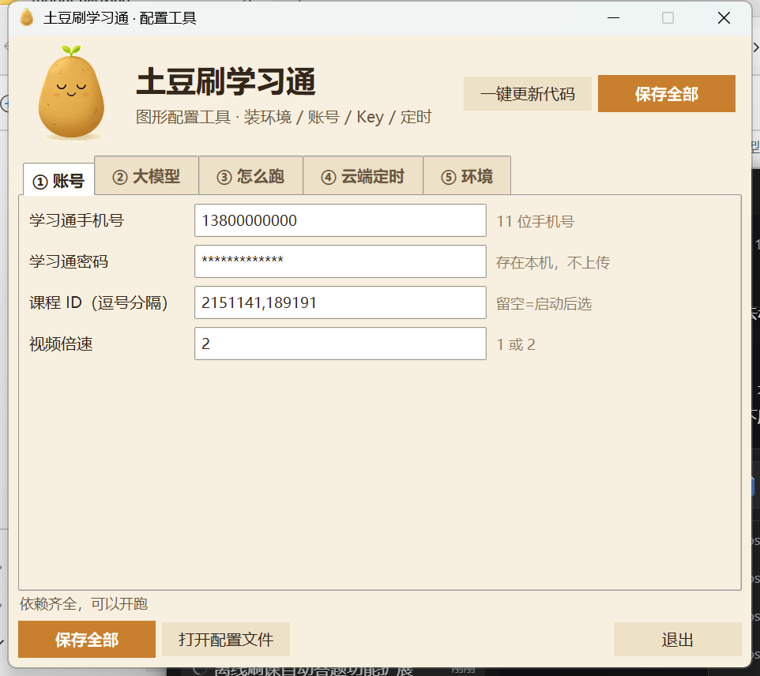
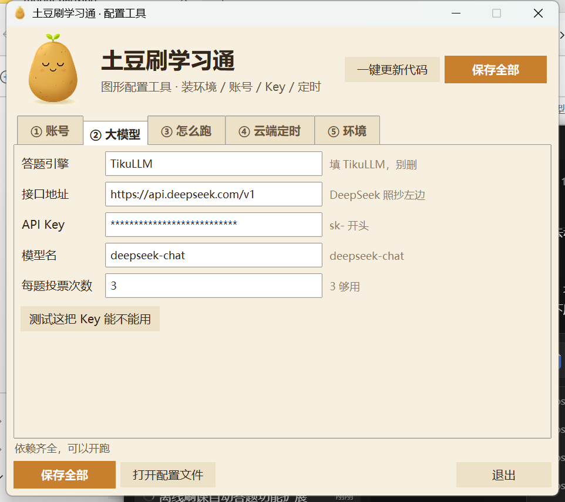
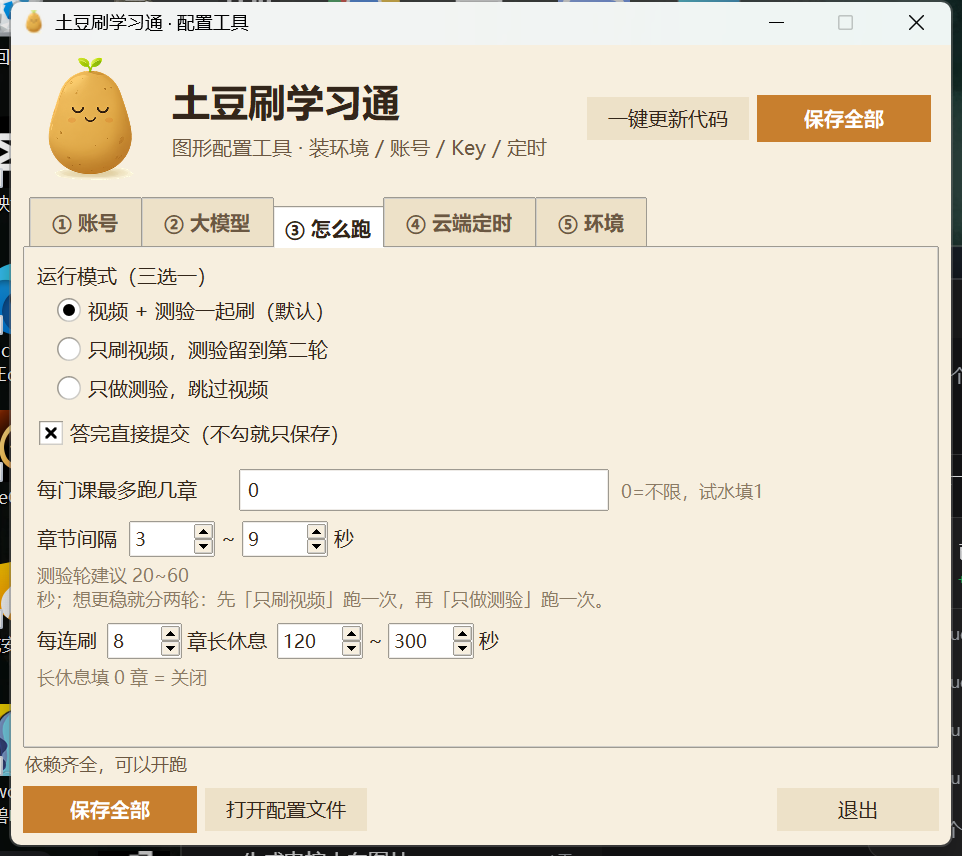
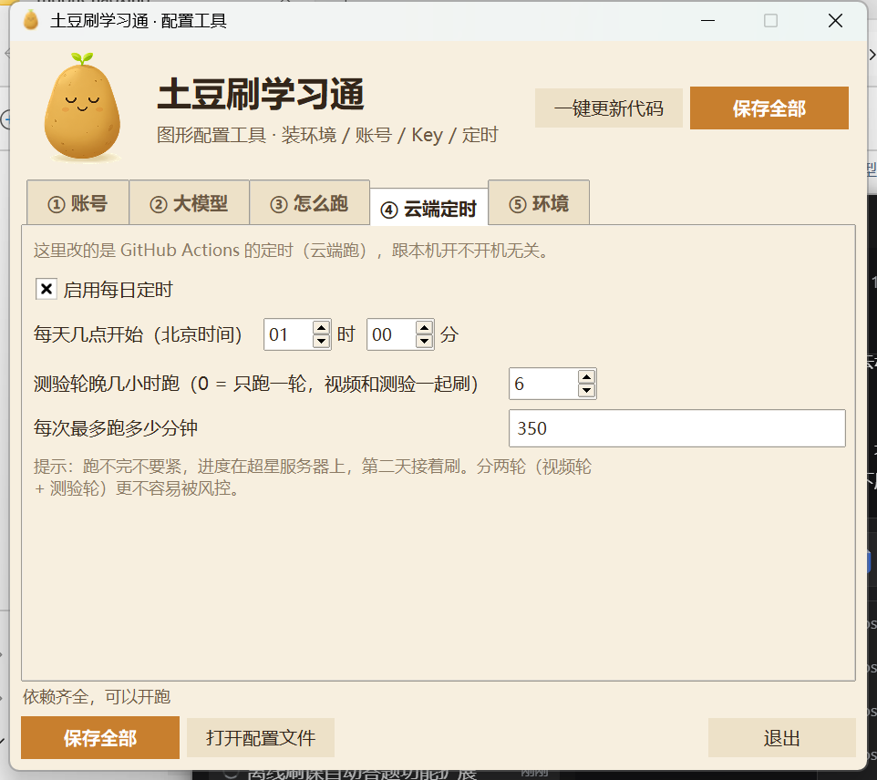
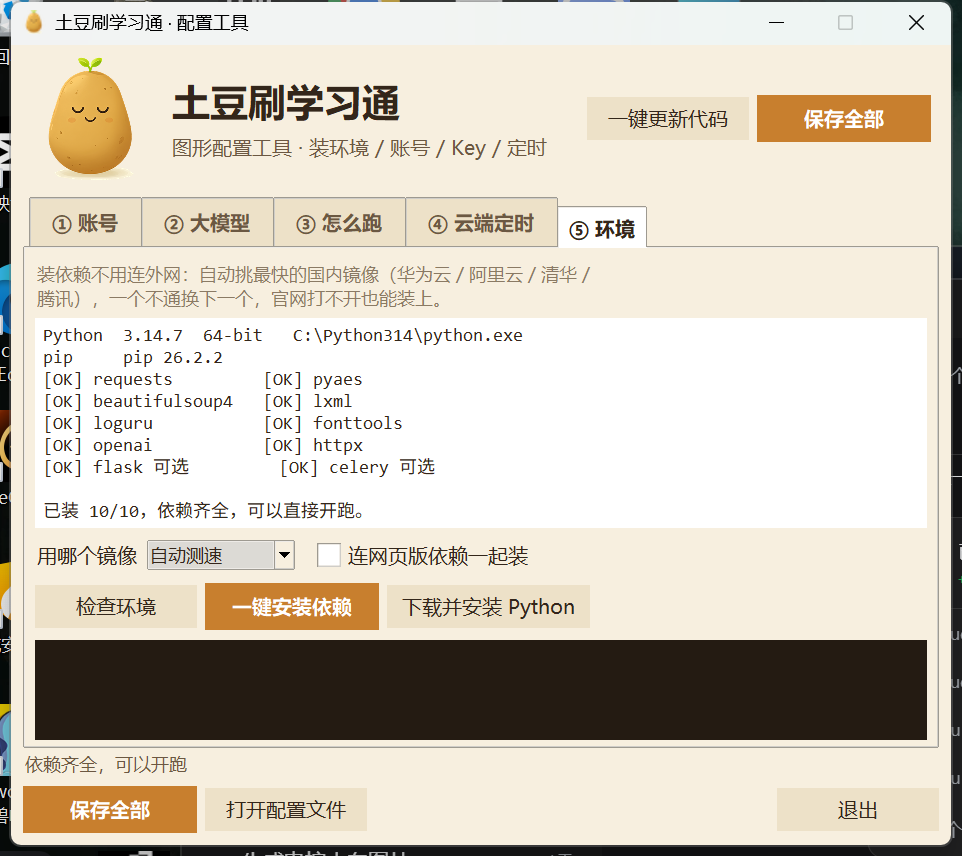
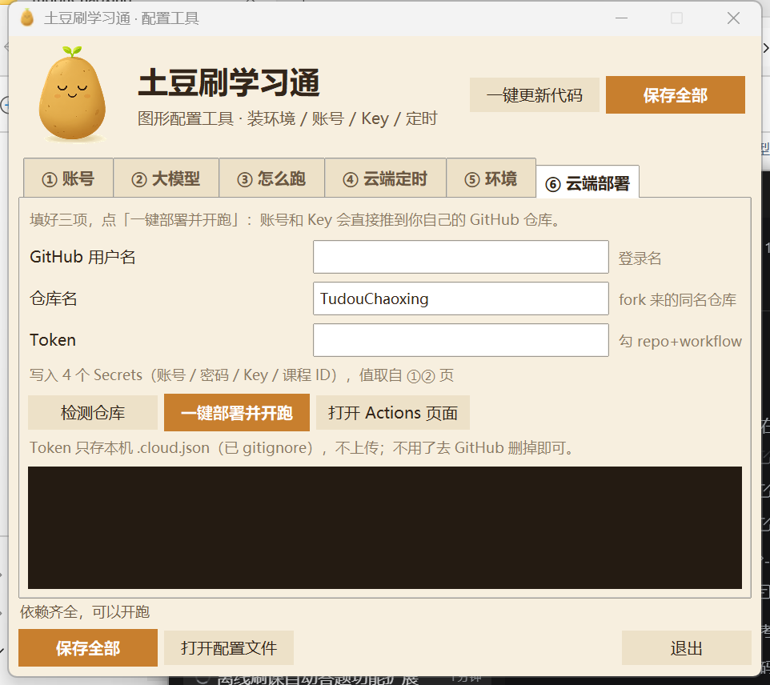
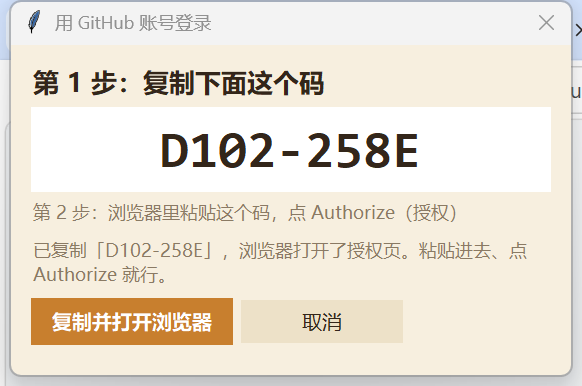

# 土豆刷学习通 · 本地安装教程（零基础版）

> 写给**完全没用过 GitHub、没装过 Python、看见黑框就紧张**的人。
> 系统：Windows 10 / 11（少数 Mac 在每节末尾单独标出）。
> 全程只有三件事：**点鼠标、复制一行字、粘贴到黑框里按回车**。
> 预计 **20 分钟**（Python 装得慢一点也就 30 分钟）。

**项目地址（记住这一个就够）**：<https://github.com/yyzbuhaohe/TudouChaoxing>
**官方 QQ 交流群**：**1132675059**（卡住了去群里问，问之前先看第八节）

---

## 目录

- [0. 先看这一屏：能带你做到什么](#0-先看这一屏能带你做到什么)
- [1. 土豆开场：这玩意儿到底是什么](#1-土豆开场这玩意儿到底是什么)
- [2. 第一节 · 把 Python 种进电脑里](#2-第一节-把-python-种进电脑里)
- [3. 第二节 · 把土豆的代码拿到本地](#3-第二节-把土豆的代码拿到本地)
- [4. 第三节 · 给土豆装零件（依赖）](#4-第三节-给土豆装零件依赖)
- [5. 第四节 · 弄一个 API Key（土豆的脑子）](#5-第四节-弄一个-api-key土豆的脑子)
- [6. 第五节 · 填配置 config.ini（给土豆上户口）](#6-第五节-填配置-configini给土豆上户口)
- [7. 第六节 · 试跑第一章（先削一片尝尝）](#7-第六节-试跑第一章先削一片尝尝)
- [8. 第七节 · 正式开刷（一锅端）](#8-第七节-正式开刷一锅端)
- [9. 第八节 · 土豆翻车现场（18 个坑）](#9-第八节-土豆翻车现场18-个坑)
- [10. 第九节 · 安全与隐私（5 条，别跳）](#10-第九节-安全与隐私5-条别跳)
- [11. 附录 A · 命令速查表](#11-附录-a-命令速查表)
- [12. 附录 B · 参数与配置项总表](#12-附录-b-参数与配置项总表)
- [13. 附录 C · 目录结构](#13-附录-c-目录结构)
- [14. 附录 D · 自检清单（打勾用）](#14-附录-d-自检清单打勾用)
- [15. 结尾 · 收成与群](#15-结尾-收成与群)

---

## 0. 先看这一屏：能带你做到什么

### 0.1 二十分钟之后你会拥有什么

一条能自己跑的命令行，它会把下面这些活干完：

| 会干 | 具体是什么 |
| --- | --- |
| 视频任务点 | 按学习通的进度上报机制把视频"看完"，支持 1～2 倍速 |
| 文档任务点 | 打开即完成，不用你点 |
| 阅读任务点 | 同上，翻完就算 |
| 章节测验 / 作业 | 取卷 → 读题 → 大模型现场做 → 投票 → 保存或提交 |
| 告诉你还剩什么 | 一条只读命令，逐章列出每个任务点做没做 |
| 已经做完的不重做 | 看过的视频、交过的测验，自动跳过 |

**它不做的**：考试。带 `exam-` 前缀的考试任务点，程序一个请求都不发，也不会替你交卷。这条是写死在代码里的（`main.py` 里 `if job_id.startswith("exam-")` 直接跳过），不是配置能改的。

### 0.2 你需要准备的东西

| # | 东西 | 怎么算"有了" | 缺了怎么办 |
| --- | --- | --- | --- |
| 1 | 一台 Windows 10 / 11 电脑 | 能上网、能装软件、有 2GB 空闲硬盘 | 借一台 |
| 2 | 学习通账号 | 手机号 + 密码，浏览器能登进去 | 先手动登一次 `https://i.chaoxing.com/`，确认密码没记错 |
| 3 | 20 块以内的 API 余额 | 一串 `sk-` 开头的字符 + 账户里有钱 | 第四节手把手教你开，充 10 块够跑几十门课 |
| 4 | 20 分钟不被打断 | 装 Python 那步要等进度条 | 挑个不着急的时间 |

**不用准备的**：不用会编程、不用懂环境变量、不用装 VS Code、不用买服务器。真的。

**你会看到什么（走完全程之后）**：一个黑框，敲两行命令，屏幕上开始滚这种字——

```text
登录成功...
开始任务: 1.2习近平党建思想的核心要义.mp4, 总时长: 425秒
任务完成: 1.2习近平党建思想的核心要义.mp4
章节检测题库覆盖率： 100%
保存答题成功 -> success!
所有课程学习任务已完成
```

就这些。没有界面、没有按钮，土豆就是这么土。

### 0.3 整个流程长这样（先看一眼地图，免得迷路）

```
装 Python  →  下代码  →  装依赖  →  弄 Key  →  填配置  →  试跑一章  →  正式跑
（第一节）   （第二节）  （第三节） （第四节） （第五节） （第六节）  （第七节）
```

七个步骤，顺序不能调。**哪一步报错就停在哪一步**，去第八节搜报错里的关键词。

### 0.4 三条贯穿全文的规矩（现在记住，后面少踩坑）

1. **黑框（命令行）里只认粘贴，不认手打。** 本教程所有命令你都**复制整行**再粘进去，别自己敲，敲错一个空格就是一个报错。
2. **路径里不要有中文、不要有空格。** 后面会反复强调，因为这是新手翻车第一名。
3. **看到红字别关窗口。** 红字最后一行才是真正的原因，截图或者复制那一行去第八节对照。

**这一节做完你会得到**：知道自己要干什么、缺什么。

---

## 1. 土豆开场：这玩意儿到底是什么

土豆这东西，土里土气的，埋着不出声，但浇水浇够了它自己就把活干完了。

**土豆刷学习通**（仓库名 `TudouChaoxing`）就是这么一个东西：它不长在桌面上、没有漂亮界面，就是一颗埋在命令行里的土豆。你把它种下去（装好、填好配置），它就开始一棵一棵地把课啃完——**视频啃完、文档啃完、阅读啃完、章节测验啃完**，啃完给你剩一堆已经发芽的任务点。

它**只管地里的活，不管考场**：考试不碰。

它靠什么答题？不是背题库。题库那玩意儿过期比牛奶还快，老师改一个字就全废。它用的是**大模型现场做题**：把题目发给 DeepSeek 这类模型，一道题问 3 遍，3 遍答案投票，票数占比够高才算"这题我有把握"；没把握就再多问几轮；实在没把握，宁可只保存不提交，也不替你乱交。

这部分在配置里叫：

```
provider=TikuLLM
```

**这行字是整份配置里最不能删的一行。** 删了会怎样？土豆就不长脑子了——所有题变成 ABCD 随机摇，摇完覆盖率不够，只保存不提交，等于白跑。第五节会用一整小节讲这一行。

现在，正事开始。

**你会看到什么（它干活时的样子）**：屏幕上每隔一会儿冒一行带时间戳的字，章节名一个接一个往下走；视频那几行之间会安静几分钟（它在"看"视频，不是在睡觉）；碰到测验会连着刷出几行"答题统计"和"覆盖率"。

**这一节做完你会得到**：知道自己在装什么，以及为什么答题要花钱。

---

## 2. 第一节 · 把 Python 种进电脑里

**这一章做完你会得到**：一条能跑通的 `python` 命令。在黑框里敲它，会打印出版本号。

### 2.1 先搞清楚"Python"是什么（30 秒）

Python 是一门编程语言，也是**运行这个项目的发动机**。`main.py` 就是一段 Python 代码，电脑上没装 Python，双击它只会弹一个"用什么程序打开"的窗口——那就是没发动机。

装 Python 就跟你装 QQ 一样：下载、双击、下一步。只有**一个勾**必须打，下面 2.3 会重点盯着它。

### 2.2 装哪个版本：**3.12**（别装最新的）

打开浏览器，地址栏粘这一行，回车：

```text
https://www.python.org/downloads/release/python-31210/
```

**你会看到什么**：一个英文页面，上面一大段发布说明（看不懂，正常）。**滚到页面最下面**，有一张表叫 `Files`，一行一行列着各种安装包。

**找这一行**：

```text
Windows installer (64-bit)
```

**点它**，下载一个 `python-3.12.10-amd64.exe`，25MB 左右。

| 你的电脑 | 选哪个 |
| --- | --- |
| 64 位 Windows（现在 99% 都是） | `Windows installer (64-bit)` |
| 32 位老机器 | `Windows installer (32-bit)` |

不确定自己是几位？`Win + R` → 输 `msinfo32` → 回车，看"系统类型"那一行，写着 `x64-based PC` 就是 64 位。

> **为什么推荐 3.12 而不是最新的 3.14？** 3.14 太新，部分第三方库（比如 `onnxruntime` 那一系）还没出安装包，`pip install` 时可能报"找不到匹配的版本"。**3.12 最稳，3.13 也行；真装了 3.14 也能跑**——真报错了，进第八节按报错关键词找。

### 2.3 安装（重点在这一步的勾）

**在哪操作**：双击刚下载的 `python-3.12.10-amd64.exe`。

**你会看到什么**：一个安装窗口，最下面有两个复选框：

```text
[ ] Install launcher for all users (recommended)
[ ] Add python.exe to PATH
```

**现在做这个动作**：把 **`Add python.exe to PATH`** 那个小方框点一下，让它出现对勾 ☑。

```text
[ ] Install launcher for all users (recommended)
[✓] Add python.exe to PATH          ← 必须是这样
```

> ### ⚠️ 这一勾是全文第一大坑
>
> **`Add python.exe to PATH` 没勾 = 后面每一步都会失败**，报的错是：
>
> ```text
> 'python' 不是内部或外部命令，也不是可运行的程序或批处理文件。
> ```
>
> 翻译成人话：黑框知道你说的是 python，但不知道 python 装在哪儿。这个勾就是告诉 Windows"记住它的门牌号"。
>
> 已经装完发现没勾？别重装系统，别卸载重来，去 **2.5** 补救，两分钟。

勾好之后，点窗口上方的 **`Install Now`**。

**你会看到什么**：进度条走 1～3 分钟，最后出现：

```text
Setup was successful
```

底下有个 `Close` 按钮，**点它**。

### 2.4 验证：让黑框亲口告诉你"装好了"

**在哪操作**：键盘按 `Win + R`（Win 键 = 左下角有窗户图标那个键，在 Ctrl 和 Alt 之间）。

**你会看到什么**：屏幕左下角弹出一个小窗口，标题"运行"，里面一个输入框。

**输入什么**（这里可以手打，只有三个字母）：

```text
cmd
```

按回车。

**你会看到什么**：一个黑底白字的窗口弹出来，最后一行大概是这样（用户名是你的名字）：

```text
Microsoft Windows [版本 10.0.19045.xxxx]
(c) Microsoft Corporation。保留所有权利。

C:\Users\你的用户名>
```

这个黑框从此就叫**命令行**。后面所有"输入什么"，都是往这个黑框里粘。

**输入什么**：

```powershell
python --version
```

按回车。

**你会看到什么（成功，就长这样）**：

```text
Python 3.12.10
```

看到这行，第一节过关，去第二节。

**你会看到什么（三种失败）**：

| 你看到的 | 意思 | 去哪修 |
| --- | --- | --- |
| `'python' 不是内部或外部命令，也不是可运行的程序或批处理文件。` | PATH 没配好 | 2.5 情况 A |
| 直接弹出了**微软商店**，里面是 Python 页面 | Windows 有个假的 python 占位符 | 2.5 情况 B |
| `Python 3.14.x` | 你装成最新版了 | 2.6 |

### 2.5 补救：没勾 PATH 怎么办（两种，各自两分钟）

#### 情况 A：黑框说"不是内部或外部命令"

1. **在哪操作**：按 `Win` 键，直接输入 `环境变量`。
2. **你会看到什么**：搜索结果里有 **`编辑系统环境变量`**，点它。
3. **你会看到什么**：一个叫"系统属性"的窗口，右下角有个按钮 **`环境变量(N)...`**，点它。
4. **你会看到什么**：上下两个白框，上面叫"用户变量"，下面叫"系统变量"。
5. **在哪操作**：在**上面**那个框里找到 `Path`，单击选中，点 **`编辑`**。
6. **你会看到什么**：一个列表窗口，右边有 `新建`、`编辑`、`删除` 按钮。
7. **输入什么**：点 **`新建`**，粘贴这一行（把"你的用户名"换成你自己的）：

```text
C:\Users\你的用户名\AppData\Local\Programs\Python\Python312\
```

   再点一次 **`新建`**，粘贴：

```text
C:\Users\你的用户名\AppData\Local\Programs\Python\Python312\Scripts\
```

8. 一路点 **`确定`**，把三个窗口全关掉。
9. **最后这步最关键**：把刚才那个黑框**关掉**（右上角 ×），重新 `Win + R` → `cmd` 开一个**新的**。
10. 再敲 `python --version`，这次应该出 `Python 3.12.10`。

> 第 9 步是 90% 的人以为"改了没用"的原因：**环境变量只对新开的黑框生效**，老窗口里还是旧地图。

不知道 `Python312` 这个文件夹名对不对？打开文件资源管理器，地址栏粘这一行回车，看看里面文件夹到底叫什么（3.13 就是 `Python313`）：

```text
%LOCALAPPDATA%\Programs\Python
```

#### 情况 B：弹出了微软商店

这是 Windows 的"应用执行别名"在捣鬼——系统里有个假 `python.exe` 占位符，你一敲 python 它就替你去开商店。

1. **在哪操作**：按 `Win`，输入 `应用执行别名`，点搜索结果里的 **`管理应用执行别名`**。
2. **你会看到什么**：一列带开关的条目，其中有 `python.exe` 和 `python3.exe`。
3. **在哪操作**：把这两个开关都**关掉**（点一下，变成灰色）。
4. 关掉旧黑框，重新开一个，敲 `python --version`。

关掉别名后如果变成"不是内部或外部命令"，说明 PATH 也没配，接着做情况 A 的第 2～10 步。

### 2.6 装成 3.14 了怎么办

敲 `python --version` 出来 `Python 3.14.x`，说明你装的是最新版。两条路：

1. **省事**：回 2.2 下 3.12，安装时选 `Customize installation`，装完之后用 `py -3.12` 这条命令专门调 3.12（后面所有 `python` 都换成 `py -3.12`）。
2. **干净**：设置 → 应用 → 找到 Python 3.14 → 卸载，再装 3.12。

### 2.7 顺手确认 pip 也在（5 秒）

pip 是 Python 的"装零件工具"，第三节全靠它。同一个黑框里敲：

```powershell
python -m pip --version
```

**你会看到什么**：

```text
pip 24.3.1 from C:\Users\你的用户名\AppData\Local\Programs\Python\Python312\Lib\site-packages\pip (python 3.12)
```

版本号不重要，**只要没报错就行**。

### 2.8 Mac 用户（少数）

1. 打开"终端"（`Command + 空格`，输 `终端`，回车）。
2. 先看有没有：敲 `python3 --version`。有 `Python 3.12.x` 就跳到第二节。
3. 没有就装：粘这一行回车，按提示输开机密码（输的时候屏幕不显示字符，正常）：

```bash
brew install python@3.12
```

**你会看到什么**：一堆 `==>` 开头的行，最后 `Summary`。

> Mac 上没有 `python` 这个命令，全篇的 `python` 你都要写成 `python3`，`pip` 写成 `pip3`。其余照抄。

**下一步**：发动机装好了，去拿土豆。

---

## 3. 第二节 · 把土豆的代码拿到本地

**这一章做完你会得到**：电脑上一个叫 `D:\TudouChaoxing` 的文件夹，打开就能看见 `main.py`。

有两条路，**第一次强烈建议走 A（下 ZIP）**。B 路要装 Git，多一个软件、多三个步骤，除非你以后想天天更新代码，否则第一批不用碰。

### 3.1 先说清楚路径：为什么要 `D:\TudouChaoxing`

土豆的代码要放在一个地方，然后你在黑框里"走进去"操作它。这一步能不能顺利，全看路径长什么样。

**✅ 好的路径（就这样用）**：

```text
D:\TudouChaoxing
```

**❌ 坏的路径（别这么干）**：

```text
C:\Users\张三\桌面\新建文件夹\TudouChaoxing-main        ← 中文 + 空格 + 桌面
C:\Program Files\TudouChaoxing                            ← 要管理员权限
C:\Users\张三\OneDrive\桌面\TudouChaoxing               ← 云同步会锁文件
```

为什么这几个不能用，说具体点：

| 路径里有 | 会出什么事 | 报错长什么样 |
| --- | --- | --- |
| 空格 | 黑框把路径从空格处切成两段，后半段当成"另一个参数" | `系统找不到指定的路径。` |
| 中文 | `lxml`、`onnxruntime` 这些带原生动态库的包加载 dll 时对非 ASCII 路径不稳 | `OSError: [WinError 126] 找不到指定的模块。` |
| 桌面 / OneDrive | 你跑程序写日志，同步进程同时读它，文件被占 | `PermissionError: [Errno 13] Permission denied: 'chaoxing.log'` |
| 太深 + 太长 | 路径超过 260 字符，Windows 拒绝写入 | `文件名或扩展名太长` |

> 顺带说一句：作者本机的开发目录是 `D:\ai place\fat fish work place\repos\TudouChaoxing`——有空格也有中文。那是**开发用**的，他自己知道每次都要加引号、知道哪些报错是路径引起的。**你别学。** 新手就用 `D:\TudouChaoxing`，干净、短、不被同步、不用加引号。

### 3.2 方法 A：下载 ZIP（推荐，两步）

#### 第 1 步：打开项目页面

**在哪操作**：浏览器地址栏，粘这一行，回车：

```text
https://github.com/yyzbuhaohe/TudouChaoxing
```

**你会看到什么**：一个英文界面（GitHub 就是这长相），中间列着一堆文件：`api`、`docs`、`resource`、`tests`、`tools`、`main.py`、`requirements.txt`……右上偏中位置有一个**绿色的按钮**，写着：

```text
<> Code ▾
```

**打不开 / 一直转圈？** 这是国内网络的常态，不是你的问题。按顺序试：

| 办法 | 怎么做 |
| --- | --- |
| 换网络 | 手机开热点，电脑连热点，再打开 |
| 多刷两次 | 有时就是慢，等 30 秒、按 `F5` |
| 加镜像前缀 | 地址改成 `https://ghproxy.net/https://github.com/yyzbuhaohe/TudouChaoxing` |

#### 第 2 步：下 ZIP

**在哪操作**：点那个绿色 **`<> Code ▾`** 按钮。

**你会看到什么**：弹下来一个小菜单，最下面一项：

```text
Download ZIP
```

**在哪操作**：点 `Download ZIP`。

**你会看到什么**：浏览器右下角开始下载一个文件，名字形如：

```text
TudouChaoxing-main.zip
```

大小几 MB，几秒下完，存在"下载"文件夹里。

#### 第 3 步：解压到 `D:\TudouChaoxing`

**在哪操作**：打开"下载"文件夹（`Win + E` 打开资源管理器 → 左边点"下载"）。找到 `TudouChaoxing-main.zip`，**右键 → 全部解压缩**（Win11 可能写 `全部解压缩...`）。

**你会看到什么**：一个小窗口，问"文件将解压到这些文件夹"，输入框里默认是：

```text
C:\Users\你的用户名\Downloads\TudouChaoxing-main
```

**输入什么**：把框里那串**整个删掉**，改成：

```text
D:\TudouChaoxing
```

点 **`提取`**（Win11 是 `解压缩`）。

**你会看到什么**：进度条几秒，然后自动打开 `D:\TudouChaoxing` 文件夹。

> D 盘不存在？看一眼"此电脑"，你只有 C 盘的话就用 `C:\TudouChaoxing`，全篇把 `D:` 换成 `C:` 即可。**别放 C 盘根目录以外的地方。**

#### 第 4 步：检查有没有"多套一层"（这一步 90% 的人会漏）

**在哪操作**：看 `D:\TudouChaoxing` 里面**直接**有什么。

**你会看到什么（正确，长这样）**：

```text
api
docs
resource
tests
tools
.gitignore
config_template.ini
main.py
pyproject.toml
README.md
requirements.txt
Dockerfile
app.py
```

**你会看到什么（错的）**：里面只有一个文件夹 `TudouChaoxing-main`。

**错了怎么修**：

1. 双击进那个 `TudouChaoxing-main` 文件夹。
2. `Ctrl + A` 全选，`Ctrl + X` 剪切。
3. 地址栏回到 `D:\TudouChaoxing`，`Ctrl + V` 粘贴。
4. 确认 `D:\TudouChaoxing` 里**直接**能看到 `main.py`。

为什么必须修：后面所有命令都假设你在 `D:\TudouChaoxing` 这一层。多套一层，你敲 `python main.py` 会得到：

```text
python: can't open file 'D:\TudouChaoxing\\main.py': [Errno 2] No such file or directory
```

### 3.3 方法 B：装 Git 再 clone（想以后一键更新的用这个）

#### 第 1 步：装 Git

**在哪操作**：浏览器打开：

```text
https://git-scm.com/download/win
```

**你会看到什么**：页面会自动开始下载 `Git-2.xx.x-64-bit.exe`（没自动下就点页面上的 `Click here to download manually`）。

**在哪操作**：双击安装包。

**你会看到什么**：一个又一个"下一步"页面，**全部保持默认，一路点 `Next`**，最后 `Install`，等 1 分钟，`Finish`。

> Git 的安装向导有十几个页面，看着吓人，但**一个都不用改**。全部 Next 就对了。

#### 第 2 步：验证

关掉旧黑框，`Win + R` → `cmd` 开新的，敲：

```powershell
git --version
```

**你会看到什么**：

```text
git version 2.47.0.windows.1
```

#### 第 3 步：clone 下来

**输入什么**（整行复制）：

```powershell
cd /d D:\
git clone https://github.com/yyzbuhaohe/TudouChaoxing.git
```

**你会看到什么**：

```text
Cloning into 'TudouChaoxing'...
remote: Enumerating objects: 412, done.
remote: Counting objects: 100% (412/412), done.
remote: Compressing objects: 100% (289/289), done.
Receiving objects: 100% (412/412), 3.21 MiB | 1.10 MiB/s, done.
Resolving deltas: 100% (198/198), done.
```

结果：D 盘上多了一个 `D:\TudouChaoxing` 文件夹，内容和 3.2 第 4 步看到的一样。

**你会看到什么（几种失败）**：

| 报错 | 原因 | 怎么修 |
| --- | --- | --- |
| `fatal: destination path 'TudouChaoxing' already exists and is not an empty directory` | 你之前已经下过 ZIP 了 | 要么删掉旧文件夹，要么换个目录名：`git clone 地址 D:\TudouChaoxing2` |
| `fatal: unable to access ...: Failed to connect to github.com port 443` | 网络到不了 GitHub | 换手机热点；或改用 3.2 的 ZIP + 镜像前缀 |
| `'git' 不是内部或外部命令` | Git 装完没重开黑框 | 关掉黑框重开一个 |

#### 以后想更新代码（方法 B 专属）

```powershell
cd /d D:\TudouChaoxing
git pull
```

**你会看到什么**：`Already up to date.`（没更新）或者一串 `Fast-forward` + 文件名（有更新）。

> `config.ini` 和 `cache.json` 已经在 `.gitignore` 里，`git pull` 不会覆盖你的配置。放心。

### 3.4 进到项目目录里（后面每节开头都要做这一步）

**在哪操作**：黑框里敲（`cd` 是"走进去"，`/d` 是"允许跨盘符"，从 C 盘切 D 盘没它切不过去）：

```powershell
cd /d D:\TudouChaoxing
```

**你会看到什么**：

```text
D:\TudouChaoxing>
```

前面变成了 `D:\TudouChaoxing>`，说明你已经"站"在项目里了。

**再确认一下**：

```powershell
dir
```

**你会看到什么**（差不多这样就行，日期大小不重要）：

```text
 D:\TudouChaoxing 的目录

2026/03/02  21:14    <DIR>          api
2026/03/02  21:14    <DIR>          docs
2026/03/02  21:14    <DIR>          resource
2026/03/02  21:14    <DIR>          tests
2026/03/02  21:14    <DIR>          tools
2026/03/02  21:14             1,634 config_template.ini
2026/03/02  21:14            25,107 main.py
2026/03/02  21:14               167 requirements.txt
               3 个文件          26,908 字节
```

有 `main.py`、`requirements.txt`、`config_template.ini` 就够了。

**你会看到什么（异常）**：

```text
系统找不到指定的路径。
```

说明文件夹名字不对或者不在 D 盘。用资源管理器打开看一眼真实名字，再 `cd` 一次。

> ### 💡 更省事的进目录办法（记住这个，能省一半人翻车）
>
> 用资源管理器打开 `D:\TudouChaoxing` → 点顶部**地址栏** → 把里面的字全删掉 → 输入 `cmd` → 回车。新黑框直接就在这个目录里了，不用 `cd`。
>
> Win11 的地址栏点一下会变成面包屑（`> TudouChaoxing >`），这时候先按 `Alt + D` 让地址栏变回可编辑的文本，再敲 `cmd`。

**下一步**：代码到位了，装零件。

---

### 3.5 以后怎么更新（不管你是 ZIP 还是 clone，都能一键更）

作者修了 bug、超星改了接口，你不用重新下载整个仓库。根目录有 `update.bat`，双击就行，
它会把你的 `config.ini`、`cookies.txt` 先备份再还原，账号密码和 Key 一个字都不会动。

**更新源永远是上游仓库，不是你自己仓库指哪儿。** 这点很重要：

| 你的情况 | 它会怎么做 | 屏幕上的提示 |
| --- | --- | --- |
| 你下载的是 ZIP（没有 `.git`） | 从上游下最新 ZIP 覆盖 | `方式：下载上游最新 ZIP 覆盖` |
| 你 clone 的原版仓库 | `git fetch` + `reset --hard FETCH_HEAD` | `方式：git 直接上游` |
| 你 **fork** 了这个仓库 | 自动挂 `upstream` 远程，从上游拉，**不动你自己的 origin** | `检测到这是 fork 出来的仓库，更新源改成上游` |
| 机器上根本没装 git | 自动退回 ZIP 方式 | `这台机器没装 git，改用下载 ZIP 覆盖（效果一样）` |

> 为什么要专门写这一条：以前脚本执行的是 `git reset --hard origin/main`。
> 对 fork 的人来说 `origin` 是他**自己**的仓库，只要他没点过 GitHub 上的 Sync fork，
> 这一句就会把他 reset 回自己的旧代码——等于每次点更新都是空跑，甚至越更越旧。

**跑完的样子**（最后几行）：

```text
==============================================
  更新完成
  当前版本: fa628cd fix: 更新脚本 reset 改用 FETCH_HEAD，浅克隆下也能对上
  备份: _backup_20261116-094813（确认没问题后可以删）
  下一步: 双击桌面图标，或 python main.py --solve-only
==============================================

  云端（GitHub Actions）跑的是你 fork 里那份代码，
  想让云端也用新版：去自己仓库点 Sync fork，或在仓库里执行 git push
```

**最后那两行别忽略**：本机更新了 ≠ 云端更新了。云端跑的是你 fork 仓库里的代码，
要让它也用新版，得去 GitHub 自己仓库点 **Sync fork**（一次点击），或者本地 `git push`。

想回滚：把 `_backup_时间戳/` 里的文件复制回根目录即可。

---

## 4. 第三节 · 给土豆装零件（依赖）

**这一章做完你会得到**：一条验证命令，打出 `依赖OK`。

"依赖"就是别人写好的工具箱。土豆干活要用十几个：发请求的、解析网页的、写日志的、跟大模型说话的……一条命令全装上。

### 4.1 先站在项目目录里

**在哪操作**：黑框里先确认：

```powershell
cd /d D:\TudouChaoxing
dir main.py
```

**你会看到什么**：

```text
 D:\TudouChaoxing 的目录

2026/03/02  21:14            25,107 main.py
               1 个文件          25,107 字节
```

能看到 `main.py` 就对了。看不到就别往下走，回 3.4。

### 4.2 先把"下载源"换成国内的（一劳永逸）

pip 默认从国外服务器下东西，国内经常慢到超时。先把它指到清华的镜像，**这条命令设一次，以后所有 pip 都自动走清华源**：

```powershell
python -m pip config set global.index-url https://pypi.tuna.tsinghua.edu.cn/simple
```

**你会看到什么**：

```text
Writing to C:\Users\你的用户名\AppData\Roaming\pip\pip.ini
```

看到这行就成了。想确认：

```powershell
python -m pip config list
```

**你会看到什么**：

```text
global.index-url='https://pypi.tuna.tsinghua.edu.cn/simple'
```

> 不想设全局也行，那就是每次装东西都在命令末尾加 `-i https://pypi.tuna.tsinghua.edu.cn/simple`。本教程后面为了保险，**两条命令都同时给**。

### 4.3 装依赖（主命令）

**输入什么**（整行复制，回车）：

```powershell
python -m pip install -r requirements.txt -i https://pypi.tuna.tsinghua.edu.cn/simple
```

**你会看到什么**：开始刷一堆行，形如：

```text
Looking in indexes: https://pypi.tuna.tsinghua.edu.cn/simple
Collecting requests
  Downloading requests-2.32.3-py3-none-any.whl (64 kB)
Collecting pyaes
  Downloading pyaes-1.6.1.tar.gz (27 kB)
Collecting beautifulsoup4
  ...
Collecting ddddocr==1.5.6
  Downloading ddddocr-1.5.6-py3-none-any.whl (24.6 MB)
  ...
Installing collected packages: requests, pyaes, soupsieve, beautifulsoup4, lxml, loguru, ...
Successfully installed beautifulsoup4-4.13.3 fonttools-4.56.0 httpx-0.28.1 lxml-5.3.1 loguru-0.7.3 openai-1.99.1 pyaes-1.6.1 requests-2.32.3 ...
```

**只要最后一行以 `Successfully installed` 开头，就成功了。** 中间那些 `Downloading`、`Collecting` 都是过程，不用看。

整个过程 1～5 分钟（取决于网速，ddddocr 那个包 24MB 最慢）。

**再次跑同一条命令会看到什么**（正常）：

```text
Requirement already satisfied: requests in c:\users\...\site-packages (2.32.3)
Requirement already satisfied: pyaes in c:\users\...\site-packages (1.6.1)
...
```

全是 `already satisfied` 说明装过了，也是成功。

### 4.4 学会读报错：红字里只有最后一行重要

黑框里报错会刷几十行，全是英文，新手第一反应是"完了"。其实**规律很固定**：

```text
前半段：pip 在解释它刚才干什么 —— 不用看
中间段：报错的上下文         —— 大略扫一眼
最后 1～3 行：真正的原因      —— 只读这里
```

三种最典型的"最后一行"：

```text
ERROR: Could not find a version that satisfies the requirement ddddocr==1.5.6 (from versions: none)
ERROR: No matching distribution found for ddddocr==1.5.6
```

→ 版本/网络问题，看 4.5 和 4.6。

```text
error: Microsoft Visual C++ 14.0 or greater is required.
```

→ 缺编译环境，通常是那个包没有现成的 whl。看 4.6。

```text
SSLError(SSLEOFError(8, 'EOF occurred in violation of protocol (_ssl.c:1006)'))
```

→ 网络被掐了 / 公司网络拦截 / 代理坏。看 4.7。

> **诀窍**：报错**整段拖黑 → 右键复制 → 存记事本**，然后去第八节 `Ctrl + F` 搜关键词（比如 `SSL`、`ddddocr`、`不是内部命令`）。第八节有 18 条，八成你遇到的那条就在里面。

### 4.5 坑一：`pip 不是内部或外部命令`

**你会看到什么**：

```text
'pip' 不是内部或外部命令，也不是可运行的程序或批处理文件。
```

**原因**：`Scripts` 目录没进 PATH，或者你敲的是裸 `pip`。

**怎么修**：**别敲 `pip`，敲 `python -m pip`**。这是最稳的写法——它让 Python 自己去叫 pip，绕开 PATH 问题：

```powershell
python -m pip --version
python -m pip install -r requirements.txt -i https://pypi.tuna.tsinghua.edu.cn/simple
```

**你会看到什么**：

```text
pip 24.3.1 from C:\Users\...\Python312\Lib\site-packages\pip (python 3.12)
```

本教程从头到尾都用 `python -m pip`，就是为了让你不会碰到这个坑。

### 4.5.0 先跑一次初始化（建议所有人都跑）

双击项目根目录的 `初始化快捷方式.bat`。它一次做完四件事，输出长这样：

```text
==============================================
  土豆刷学习通 · 初始化
  项目目录: D:\TudouChaoxing
==============================================
  [OK]   Python: C:\Python312\pythonw.exe
  [OK]   快捷方式已创建
         C:\Users\你\Desktop\土豆刷学习通 配置工具.lnk

Python  3.12.7  64-bit   C:\Python312\python.exe
pip     pip 24.3.1
[OK] requests          [OK] pyaes
[OK] beautifulsoup4    [OK] lxml
[OK] loguru            [OK] fonttools
[OK] openai            [OK] httpx
[OK] pynacl            [OK] flask 可选
[OK] celery 可选
----------------------------------------------
已装 11/11
必需依赖齐了，可以 python main.py -c config.ini 开跑。

  下一步：双击桌面图标，填 ① 账号 和 ② 大模型 就行
```

**四个步骤分别在干嘛**：

| 顺序 | 干什么 | 没它会怎样 |
| --- | --- | --- |
| 1 | 找能用的 Python | 主动跳过应用商店的假 `python.exe`（路径带 `WindowsApps`，双击只会弹微软商店） |
| 2 | 一个都没有就从国内镜像装 | 走华为云 / npmmirror，**不去官网**，装完自动重找一次 |
| 3 | 建桌面图标 | 指向 `pythonw.exe + 配置工具.pyw`，双击**不弹黑框**，图标是 `assets/mascot.ico` |
| 4 | 依赖体检 | 直接调 `env_setup.py --check`，11 个包缺哪个一清二楚 |

以后不用再翻文件夹找 `配置工具.pyw`，双击桌面图标就行。

**不想开黑框**：打开配置工具 →「⑤ 环境」→ 点「建桌面图标」，效果一样。

---

### 4.5.1 懒人路线：双击「一键配置.bat」

不想手改 ini、也不想记命令的话，项目根目录有个 `一键配置.bat`，**双击**会弹出这样一个窗口：



*图：配置工具的第①页，账号在这里填*

整个窗口五个标签页，从左到右一件事一件事填：

| 标签页 | 填什么 | 说明 |
| --- | --- | --- |
| ① 账号 | 手机号、密码、课程 ID、视频倍速 | 手机号 11 位，别带 +86 |
| ② 大模型 | 接口地址、API Key、模型名、投票次数 | 有「测试这把 Key 能不能用」按钮 |
| ③ 怎么跑 | 只刷视频 / 只做测验 / 答完提交 / 长休息 | 勾选框，不用记 true false |
| ④ 云端定时 | 每天几点开始、单次最多几分钟、开关 | 只对云端 GitHub Actions 生效 |
| ⑤ 环境 | 检查 Python / 装依赖 / 下载 Python / 建桌面图标 | **一键装环境，自动走国内镜像** |
| ⑥ 云端部署 | GitHub 一键登录 → 一键推 Secrets + 定时 | 想让它在云端跑才需要这一页 |

**第②页长这样**，填完点一下「测试这把 Key 能不能用」，它会真发一次请求（只花 1 个 token）：



*图：② 大模型页。通了会回显模型说的话，不通会回显报错原文*

**第③页管怎么跑**，除了三选一的运行模式，下面那行「每连刷 8 章长休息 120~300 秒」是防风控的关键：



*图：③ 怎么跑页。长休息不是说笑，超星的风控看的是"连续活跃了多久"*

**第④页管云端定时**，改的是 `.github/workflows/main.yml` 里的 `cron` 和 `timeout-minutes`：



*图：④ 云端定时页。时间是北京时间，保存时会自动换算成 UTC*

填完点右上角 **保存全部**，它会做两件事：

1. 写 `config.ini`（**模板里的注释全保留**，你的注释不会被冲掉）
2. 如果有 `.github/workflows/main.yml`，顺手改掉 `cron` 和 `timeout-minutes`

**几个细节**：

- 密码和 Key 在窗口里是 `***` 掩码，但 `config.ini` 里仍是明文（本机文件，已在 `.gitignore`）
- 「保存全部」在窗口右上角，找不到就往下滚一下标签页内容
- 关掉「启用每日定时」时，它把那行注释成 `# schedule:`，不是删掉，以后能再打开
- 非 Windows 系统：`python 配置工具.pyw`（把 `.pyw` 改成 `.py` 也行）

---

### 4.5.2 懒人路线·进阶：第⑤页「环境」，一键把零件装齐

上面 4.2 ~ 4.8 那一堆命令，现在全部可以交给窗口的第⑤页。
打开配置工具，点最右边的 **⑤ 环境**，它就长这样：



*图：⑤ 环境页。白框是体检报告，黑框是安装日志*

**它替你干三件事**：

| 按钮 | 干什么 | 什么时候点 |
| --- | --- | --- |
| 检查环境 | 报 Python 版本、pip 在不在、10 个包哪个缺 | 每次打开窗口会自动跑一遍 |
| 一键安装依赖 | 自动挑最快的国内镜像装齐所有包 | 白框里出现 `[缺]` 就点它 |
| 下载并安装 Python | 从国内镜像下 Python 3.12 并静默装好 | 机器上根本没有 Python，或者装的是应用商店占位版 |

**为什么不用官网、不用加速器**：

- 装包走的是「华为云 → 阿里云 → 清华 → 腾讯 → 中科大 → 官方」这条链。工具会先给每个源测一次延迟（就那个 `[镜像] 可用: 华为云 60ms 阿里云 66ms …`），最快的先上，**一个装失败就自动换下一个**，全都不用你管。
- Python 安装包只从**华为云 / npmmirror** 拿。这两个是国内的，`python.org` 打不开照样能装。
- 公司网 / 校园网把 TLS 拦了的，pip 命令里已经带了 `--trusted-host`，不会因为证书报错卡住。

**你会看到什么（点「一键安装依赖」之后）**：

```text
[镜像] 可用: 华为云 60ms  阿里云 66ms  清华 TUNA 120ms  腾讯云 201ms  中科大 421ms

[环境] 用 华为云 安装…
$ python.exe -m pip install ... -i https://repo.huaweicloud.com/repository/pypi/simple --trusted-host repo.huaweicloud.com
Looking in indexes: https://repo.huaweicloud.com/repository/pypi/simple
Successfully installed beautifulsoup4-4.13.3 fonttools-4.56.0 httpx-0.28.1 lxml-5.3.1 loguru-0.7.3 openai-1.99.1 pyaes-1.6.1 requests-2.32.3 ...
[环境] 安装完成（镜像: 华为云）

[完成] 依赖装好了，重新检查一遍…
```

然后白框会自己刷新成 `已装 10/10，依赖齐全，可以直接开跑。`

#### 不想开窗口？两条双击的路子

**① 只装依赖**：双击 `安装环境.bat`。它先打印体检报告，再自动装依赖，装完停在那让你看结果。

```text
[OK]     requests  HTTP 请求（登录 / 刷课）
...
已装 10/10
必需依赖齐了，可以 python main.py -c config.ini 开跑。

  Done. Dependencies are installed.
```

**② 连 Python 都没有**：直接双击 `一键配置.bat`。它会自己发现"这台机器没有能用的 Python"，然后调 `安装Python.bat` 从国内镜像下 Python 3.12、静默装好，装完再帮你把配置工具拉起来。全程不用去官网。

> 顺带一个坑：Windows 自带一个**应用商店占位版** `python.exe`（路径里带 `WindowsApps`）。双击它只会弹出微软商店。三个启动脚本都会**主动跳过**这种假 Python，所以你看到"装过 Python 但还是让装"的时候，别怀疑，装的是占位版，按上面走一遍就好。

#### 命令行同样能用（云端 / 喜欢终端的人）

```powershell
python env_setup.py --check                    # 只看体检报告
python env_setup.py --install                  # 自动挑最快的国内镜像装齐
python env_setup.py --install --web            # 连 flask / celery 一起装（跑 app.py 才需要）
python env_setup.py --install --mirror tsinghua   # 指定镜像：huawei/aliyun/tsinghua/tencent/ustc/pypi
python env_setup.py --download-python          # 只下载并安装 Python 3.12
```

每个命令都有对应的退出码：`0` = 齐了，`1` = 还有缺的，脚本里可以直接判。

---

### 4.5.3 第⑥页：把配置一键推到 GitHub（云端玩家的懒人路线）

前面几节都是"在自己电脑上跑"。如果你想让它**在云端跑**（电脑关机也照刷），
不用去 GitHub 后台一个个加 Secret，第⑥页能一次推完：



*图：⑥ 云端部署页。填三项，点一下，Secrets 和定时都上去了*

**前置两件事，做完再来**：

1. 这个仓库已经 **fork** 到你自己的 GitHub 账号下（网页上点右上角 Fork，10 秒）；
2. 先把 **① 账号** 页和 **② 大模型** 页填好（⑥ 页只是把它们搬过去，不会让你重复填）。

**Token 不用申请了。** 点 ⑥ 页最左边的 **「GitHub 一键登录」**：



*图：弹出来的就是一串 6 位码，已经自动复制好了*

三步，20 秒：

1. 窗口里的码会自动复制到剪贴板，浏览器也会自己打开 GitHub 授权页；
2. 在网页里 `Ctrl+V` 粘贴那串码，点 **Authorize（授权）**；
3. 回到配置工具，窗口已经自己关了，**用户名和 Token 都填好了**。

> 背后用的是 GitHub 官方的 OAuth Device Flow —— 就是「浏览器里输个码、点一下同意」那套，
> 跟你用 GitHub CLI、VS Code 登录 GitHub 是同一个机制。全程不用理解什么是 Personal Access Token。
>
> 如果你想自己申请 Token（或者要长期固定权限），也可以照旧：
> `github.com/settings/tokens` → `Generate new token (classic)` → 勾 **repo** + **workflow** → 复制进 Token 框。

**登录完之后**：

| 字段 | 现在长什么样 |
| --- | --- |
| GitHub 用户名 | 自动填好（你的登录名） |
| 仓库名 | 默认 `TudouChaoxing`，fork 时改过名就改成你那个 |
| Token | 自动填好，掩码显示 |

先点 **检测仓库**，它会把认到的东西列出来，四行以内能看完：

```text
· Token 属于：your-name
· 仓库：your-name/TudouChaoxing（fork）
· 默认分支：main
· 已有 Secrets：（一个都没有）
· workflow 文件：在
```

看到"Token 属于"后面是你的名字，就可以点 **一键部署并开跑** 了。它会做四件事：

1. 把 `CHX_USER` / `CHX_PASS` / `CHX_LLM_KEY` / `CHX_COURSE` 四个 Secrets 写进仓库（加密存的，写完连你自己也看不到明文）；
2. 把本地 `.github/workflows/main.yml` 推上去（你在 ④ 页改的定时就这么生效的，不用手动改 YAML）；
3. 立刻触发一次运行，参数是「只刷视频 + 只跑 1 章」，先试水；
4. 弹一个提示框，把 Actions 页面地址给你。

**报错怎么读**（就四种）：

| 它说 | 真实原因 | 怎么办 |
| --- | --- | --- |
| Token 无效或已过期 | 复制少字符 / 已过期 / 已删 | 重新生成一个 |
| 找不到这个仓库 | 用户名或仓库名拼错，或 Token 没勾 repo | 核对名字；重做 Token |
| 权限不够（提到 workflow） | Token 只勾了 repo，没勾 workflow | 重做 Token，两个都勾 |
| 缺 pynacl | 电脑上没装加密库 | 去 ⑤ 环境 点「一键安装依赖」 |

> ⚠️ **fork 来的仓库，GitHub 默认把定时任务关着**。部署成功后你还要去 Actions 页面点一次绿色的
> `I understand my workflows, go ahead and enable them`，否则两条 cron 永远不会触发。
> 这一步是 GitHub 的安全策略，工具没法替你点。

---
### 4.6 坑二：`ddddocr` 装不上（**现在不用管了**）

> **2026-11 更新**：`requirements.txt` 里已经把 `ddddocr` 删了。它只是个验证码识别库，项目里没有任何代码 import 它，留着反而让 Python 3.12+ 的用户卡在 pip 报错。
>
> 所以你**不会**再看到下面这些报错。如果你看到了，说明你手上的 `requirements.txt` 是旧版——打开它，把 `ddddocr==1.5.6` 那一行删掉再装即可。

（下面是历史记录，留着给遇到旧版文件的同学对号入座）

`ddddocr` 是验证码识别库，24MB，它背后还有 `onnxruntime`（几十 MB）。旧版 requirements 里锁死了 1.5.6，会在下面这几种情况下失败：

```text
ERROR: Could not find a version that satisfies the requirement ddddocr==1.5.6 (from versions: none)
```

（Python 版本太新，比如 3.14，还没轮子）

```text
error: Microsoft Visual C++ 14.0 or greater is required.
```

（要现编译，你机器没有编译器）

**先搞清楚一件事，你就不慌了**：这个库只被 `api/captcha.py` 一个文件用到，而 `api/captcha.py` **没有被项目里任何其它文件 import**——`main.py` 从头到尾都不会加载它。也就是说，**装不上它，刷课一行代码都不会少跑**。

**兜底方案 1：先装它本体，不装它的依赖**（很多时候这样就够了）

```powershell
python -m pip install ddddocr==1.5.6 --no-deps -i https://pypi.tuna.tsinghua.edu.cn/simple
```

**你会看到什么**：

```text
Successfully installed ddddocr-1.5.6
```

**兜底方案 2：干脆跳过它，只装真正要用的**（推荐）

```powershell
python -m pip install requests pyaes beautifulsoup4 lxml loguru fonttools "openai<3" "httpx>=0.27,<1" -i https://pypi.tuna.tsinghua.edu.cn/simple
```

**你会看到什么**：

```text
Successfully installed beautifulsoup4-4.13.3 fonttools-4.56.0 httpx-0.28.1 lxml-5.3.1 loguru-0.7.3 openai-1.99.1 pyaes-1.6.1 requests-2.32.3 ...
```

> ⚠️ 那条命令里的 `"openai<3"` 和 `"httpx>=0.27,<1"` 的**引号要一起复制**。在黑框里 `<` 和 `>` 是重定向符号，不加引号会被当成"把输出写进某个文件"，然后报 `系统找不到指定的文件`。这是本节最容易错的地方。

> ⚠️ `fonttools` 在命令里**小写没问题**（pip 不区分大小写），但写 import 语句时必须是 `fontTools`（中间 T 大写）。4.8 的验证命令里就是这个大写，别改。

### 4.7 坑三：SSL 证书错误 / 超时

**你会看到什么**：

```text
WARNING: Retrying (Retry(total=4, connect=None, read=None, redirect=None, status=None)) after connection broken by 'SSLError(SSLEOFError(8, 'EOF occurred in violation of protocol (_ssl.c:1006)')))'
```

或者：

```text
ReadTimeoutError: HTTPSConnectionPool(host='files.pythonhosted.org', port=443): Read timed out.
```

**原因**：连不上 / 连一半被掐。常见于校园网、公司网、开了代理、或者单纯国际线路抖。

**怎么修**（按顺序试，一层不行再下一层）：

```powershell
python -m pip install -r requirements.txt -i https://pypi.tuna.tsinghua.edu.cn/simple --trusted-host pypi.tuna.tsinghua.edu.cn
```

```powershell
python -m pip install -r requirements.txt -i https://pypi.tuna.tsinghua.edu.cn/simple --timeout 120 --retries 5
```

还不行就换源（三个都试试，哪个快用哪个）：

```powershell
python -m pip install -r requirements.txt -i https://mirrors.aliyun.com/pypi/simple/
```

```powershell
python -m pip install -r requirements.txt -i https://mirrors.ustc.edu.cn/pypi/simple
```

```powershell
python -m pip install -r requirements.txt -i https://pypi.mirrors.tuna.tsinghua.edu.cn/simple
```

**还报 SSL**：关掉系统里所有代理 / 加速器 / VPN，然后再跑。校园网要认证的先认证。

### 4.8 验证：确认零件真的装上了

**输入什么**（整行复制）：

```powershell
python -c "import loguru, requests, bs4, lxml, pyaes, fontTools, openai, httpx; print('依赖OK')"
```

**你会看到什么（成功，就两行）**：

```text
依赖OK
```

**你会看到什么（失败）**：

```text
ModuleNotFoundError: No module named 'loguru'
```

哪个模块名在最前面，就是那个包没装上。三种可能：

1. 4.3 那条命令没跑成功（回去看最后一行是不是 `Successfully installed`）。
2. 你电脑上有两个 Python，pip 装进了 A，跑的是 B。
3. 名字写错（`fonttools` vs `fontTools`——验证命令里必须大写 T）。

第 2 种的查法：

```powershell
python -c "import sys; print(sys.executable)"
python -m pip --version
```

**你会看到什么**：

```text
C:\Users\你的用户名\AppData\Local\Programs\Python\Python312\python.exe
pip 24.3.1 from C:\Users\你的用户名\AppData\Local\Programs\Python\Python312\Lib\site-packages\pip (python 3.12)
```

两行里的 `Python312` 要**一样**。不一样说明有两个 Python，用这个指定版本重装：

```powershell
py -3.12 -m pip install -r requirements.txt -i https://pypi.tuna.tsinghua.edu.cn/simple
```

### 4.9 本节的依赖清单（核对用）

`requirements.txt` 里就是这些，一个不多一个不少：

| 包名 | 干什么的 | 装不上影响 |
| --- | --- | --- |
| `requests` | 发 HTTP 请求，整个项目的地基 | 跑不起来 |
| `pyaes` | 登录参数加密 | 登不上 |
| `beautifulsoup4` | 解析网页 HTML | 跑不起来 |
| `lxml` | bs4 的高速解析后端 | 跑不起来（会退化到 html.parser，能跑但慢） |
| `loguru` | 日志，屏幕和 `chaoxing.log` 都靠它 | 跑不起来 |
| `fonttools` | 解字体加密（题目乱码靠它） | 题目会变乱码 |
| `openai<3` | 调大模型（TikuLLM 用） | 答题全废 |
| `httpx>=0.27,<1` | openai 的 HTTP 传输层 | 答题全废 |

> `argparse` / `json` / `configparser` 这些是 Python 自带的，**不要**写进 `requirements.txt`。从 PyPI 装同名的旧包只会污染标准库。这一版已经把它们清掉了。
>
> `flask` 和 `celery` 只给 `app.py` 那个可选的网页版壳子用，单独放在 `requirements-web.txt`。刷课不需要，勾了「连网页版依赖一起装」才装。

**下一步**：零件齐了，去弄土豆的脑子。

---

## 5. 第四节 · 弄一个 API Key（土豆的脑子）

**这一章做完你会得到**：一串 `sk-` 开头的字符，以及知道它填到哪、泄露了怎么办。

### 5.1 为什么非要这个东西

你可能会想：题库软件不都是自带答案的吗？为什么还要我自己去开个 API Key、还要花钱？

因为**题库这东西不靠谱**。传统做法是去某个题库网站搜题，可题库是别人攒的：新题没有、老师改一个字就搜不到、思政课一年一换题干全废。你花钱买的"题库次数"，真正命中的其实没多少，剩下的照样随机摇。

土豆走的是另一条路：**让大模型现场做题**。把题干和选项发给模型，它现场推理出一个答案；同一道题问 3 遍（配置里 `votes=3`），3 遍答案投票；票数占比 ≥ 0.67（`confidence=0.67`）才算"这题有把握"；没把握就再追问两轮（`max_escalations=2`）；还不行，这题就记成"没答出来"，最后按覆盖率决定交不交。

这条路的好处是：**它不需要题库命中**，新题老题一样做。代价是：**要调 API，要花钱**。

花多少？DeepSeek 的价格下，一道题投票 3 次大概几厘钱。一门课十几道题 ⇒ **几分钱**；十门课 ⇒ 几毛钱。**充 10 块能跑几十门课**，20 块够你一个学期。

### 5.2 注册 DeepSeek 并充值（手把手）

#### 第 1 步：打开平台

**在哪操作**：浏览器地址栏：

```text
https://platform.deepseek.com/
```

**你会看到什么**：一个中文页面，右上角有 `登录` 按钮。

#### 第 2 步：注册

**在哪操作**：点 `登录`，页面上找 `注册` 入口（有的版本是"没有账号？立即注册"）。

**你会看到什么**：让你选手机号或邮箱注册。

**输入什么**：手机号 → 收短信验证码 → 设密码 → 完成。

> ⚠️ 这个账号和密码跟你学习通的**完全没关系**，是两套东西。别用同一个密码，也别把两个密码记在同一张纸上。

#### 第 3 步：充值

**在哪操作**：登录进去，看左侧菜单。

**你会看到什么**：菜单里有 `用量信息`、`API keys`、`充值` 之类。

**在哪操作**：点 `充值`。

**你会看到什么**：金额选项（10 / 50 / 100…），支持支付宝、微信。

**输入什么**：选 **10 元**（够跑几十门课了），付款。

**你会看到什么**：付款成功后，页面上余额变成 `10.00` 左右。

#### 第 4 步：创建 Key

**在哪操作**：左侧菜单点 `API keys`。

**你会看到什么**：一个按钮 `创建 API key`（有的版本叫 `创建新密钥`）。

**在哪操作**：点它。

**你会看到什么**：让你给这个 key 起个名字。

**输入什么**：随便写，比如：

```text
学习通
```

点 `创建`。

**你会看到什么**：弹出一串字符，长这样：

```text
sk-xxxxxxxxxxxxxxxxxxxxxxxxxxxxxxxx
```

（真实的是 `sk-` 后面跟 32 位左右的字母数字，看起来像乱码，**这是正常的，不要去"修正"它**。）

**立刻做两件事**：

1. 点旁边的 `复制` 按钮。
2. 打开记事本（`Win + R` → `notepad` → 回车），粘进去，先存着。

> ⚠️ **这串 key 只会完整显示这一次**。关掉弹窗之后页面上再也看不到全文了（只显示前几位和后几位）。没复制到？回第 4 步删掉重创建一个。

### 5.3 Key 长什么样、怎么判断复制全了

| 特征 | 说明 |
| --- | --- |
| 以 `sk-` 开头 | 一定有，没有就是复制错了 |
| 后面一长串字母数字 | 30～50 个字符 |
| 中间没有空格、没有换行 | 有空格就会 401 |
| 不是你的手机号 / 不是密码 | 别搞混 |

**填之前一定要做的事**：把 key 粘进记事本，看它是不是**一整行**、末尾有没有多余空格。黑框和配置文件都对多余空格很敏感。

### 5.4 用别的服务商 / 中转站（不想用 DeepSeek 的看这里）

土豆的答题接口是 **OpenAI 兼容格式**，只要对方提供 `/v1/chat/completions`，就能用。配置里只要改三个值：`endpoint`、`key`、`model`。

| 服务商 | `endpoint` 填什么 | `model` 填什么 | 备注 |
| --- | --- | --- | --- |
| DeepSeek（推荐新手） | `https://api.deepseek.com/v1` | `deepseek-chat` | 便宜、稳、中文好 |
| DeepSeek 推理模型 | `https://api.deepseek.com/v1` | `deepseek-reasoner` | 更准但慢 3～5 倍、更贵 |
| 硅基流动 SiliconFlow | `https://api.siliconflow.cn/v1` | `deepseek-ai/DeepSeek-V3` | 注册送额度，模型名要完全照抄 |
| 自建中转站 one-api | `http://你的地址:3000/v1` | 站里配的模型名 | 要带 `/v1` |
| OpenAI 官方 | `https://api.openai.com/v1` | `gpt-4o-mini` | 国内要代理，贵 |

**改的时候盯住两件事**：

1. `endpoint` **必须以 `/v1` 结尾**。少了 `/v1` → 请求 404，日志报"调用失败"。
2. `model` **必须和服务商文档里的模型名一模一样**，大小写、斜杠都不能差。写错了 → 400 `model not exist`。

改完一定要跑一次第五节 5.10 的验 key 命令，看到"接口连通"再往下走。

### 5.5 顺手把 key 验一下（不用等配好 config.ini）

项目自带一个专门验 key 的脚本 `tools/check_llm.py`，它读 `config.ini` 的 `[tiku]` 段。所以先做第五节把配置写好，再回来跑它。**顺序别搞反**。

**这一步做完你会得到**：一串 key + 知道它填哪。

---

## 6. 第五节 · 填配置 config.ini（给土豆上户口）

**这一章做完你会得到**：`D:\TudouChaoxing\config.ini`，里面填好了你的手机号、密码、课程、key。

配置文件就是土豆的"设置菜单"。项目里有一份带注释的模板 `config_template.ini`，你要**复制一份改名**，然后往副本里填值。**不要直接改模板**——模板是干净的参考，改坏了自己都分不清哪行是原来有的。

### 6.1 复制成 config.ini

**在哪操作**：黑框里（确认在 `D:\TudouChaoxing>`）：

```powershell
copy config_template.ini config.ini
```

**你会看到什么**：

```text
已复制         1 个文件。
```

**你会看到什么（异常）**：

```text
系统找不到指定的文件。
```

→ 你不在项目目录里（回 3.4），或者文件名拼错了。

**确认一下两个都在**：

```powershell
dir config*.ini
```

**你会看到什么**：

```text
2026/03/02  21:14             1,634 config.ini
2026/03/02  21:14             1,634 config_template.ini
              2 个文件           3,268 字节
```

> 用鼠标也行：资源管理器里右键 `config_template.ini` → 复制 → 空白处粘贴 → 改名成 `config.ini` → Windows 问"改变扩展名可能不可用"，点 `是`。

### 6.2 用记事本打开它

**在哪操作**：右键 `config.ini` → `打开方式` → `记事本`。

**你会看到什么**：两段方括号开头的内容，`[common]` 和 `[tiku]`，每行前面有 `;` 开头的注释。原始模板长这样（逐字）：

```ini
[common]
; 手机号账号(必填), 填自己的
username = 

; 登录密码(必填), 填自己的, 不要把明文密码提交到仓库
password = 

; 要学习的课程ID列表, 逗号隔开(选填，不需要则留空)
course_list = 

; 视频播放倍速(默认1，最大2)
speed = 2

; 只做章节测验与作业: true 时跳过视频/文档/阅读任务(默认 false)
solve_only = false

[tiku]
; 题库实现(必填): TikuYanxi / TikuLike / TikuAdapter / AI / SiliconFlow / TikuLLM
; TikuLLM = 接 OpenAI 兼容接口（DeepSeek / 硅基流动 / OpenAI / 中转站都行）按投票机制解题，正确率最高
; 这一行漏填的话程序会停用题库, 所有题变成随机作答
provider=TikuLLM
; 下面是 TikuLLM / AI 通用配置
endpoint=https://api.deepseek.com/v1
key=
model=deepseek-chat
; 每道题独立采样次数（投票用），越大越准越慢，建议 3
votes=3
; 判定"可信"的最低票占比
confidence=0.67
; 采样温度, 越低越稳定(默认 0.6)
temperature=0.6
; 置信度不足时的额外升级轮数(默认 2)
max_escalations=2
; 两次 API 调用最小间隔秒数
min_interval_seconds=1
; 是否把成功答案写进 cache.json
cache_enabled=true

; 是否直接提交答题，填写false表示答完题后不提交而是保存...
submit=false
; 用于言溪题库的TOKEN...
tokens=
; 用于判断判断题对应的选项...
true_list=正确,对,√,是
false_list=错误,错,×,否,不对,不正确
```

**`;` 开头的行是注释，程序不读**，是给人看的。不用删，也不用管。

### 6.3 填值的三条铁律

| 规则 | 对的 | 错的 |
| --- | --- | --- |
| 等号两边空格无所谓 | `username = 13800000000` / `username=13800000000` | —— |
| **值后面不能加任何东西**（不加引号、不加逗号、不加中文说明） | `key=sk-xxxx` | `key="sk-xxxx"` ❌ `key=sk-xxxx 这是我的` ❌ |
| 必须存成 **UTF-8** 编码 | 见 6.8 | ANSI / GBK ❌ |

### 6.4 逐字段总表（照这张表填，一个不漏）

#### `[common]` 段：登谁的号、刷哪些课、多快

| 键 | 模板值 | 你填什么 | 不填 / 填错会怎样 |
| --- | --- | --- | --- |
| `username` | 空 | **你的学习通手机号**，例如 `13800000000` | 空着 → 启动后黑框问你，敲一次能用但不保存 |
| `password` | 空 | **你的学习通密码**，例如 `your_password` | 错 → `LoginError: 用户名或密码错误`，退出 |
| `course_list` | 空 | 要刷的课程 ID，英文逗号分隔，例如 `268893108` | 空着 → 程序列出所有课程让你**当场手输**（不保存） |
| `speed` | `2` | `1` ～ `2`，2 = 2 倍速 | 填字母 → `ValueError: could not convert string to float`；填 3 会被自动压成 2 |
| `solve_only` | `false` | 第一次用 `false`（全做）；只想补测验时改 `true` | 只认 `true/1/yes/on/y/t`，填"对"会被当 false |
| `notopen_action` | 模板里没有 | `retry`（默认，卡住重试）/ `ask`（问你）/ `continue`（跳过） | 见 6.7 |

#### `[tiku]` 段：土豆的脑子

| 键 | 模板值 | 你填什么 | 乱动会怎样 |
| --- | --- | --- | --- |
| `provider` | `TikuLLM` | **一个字都别动，必须留着** | 删了 → 所有题变随机；拼错 → 题库被停用 |
| `endpoint` | `https://api.deepseek.com/v1` | 用 DeepSeek 就原样；换服务商见 5.4 | 少了 `/v1` → 404 |
| `key` | 空 | **你 5.2 拿到的那串 `sk-`** | 空 / 错 → 401，答题全废 |
| `model` | `deepseek-chat` | DeepSeek 就原样 | 写错 → 400 model not exist |
| `votes` | `3` | 保持 3；想更准改 5（更慢更贵） | 改 0 → 每题都没有效采样，全判低可信 |
| `confidence` | `0.67` | 保持 0.67；改 1 几乎永不可信，改 0 瞎猜也算可信 | —— |
| `temperature` | `0.6` | 保持 0.6 | 改 0 → 模型反复答同一个错答案 |
| `max_escalations` | `2` | 保持 2；想省钱改 0 | 改 0 更省钱但正确率降 |
| `min_interval_seconds` | `1` | 保持 1；老被限流改 2～3 | 改 0 容易 429 |
| `cache_enabled` | `true` | 保持 true（答过的题进 `cache.json`，下次直接命中） | 改 false → 每题都重新问，更贵 |
| `submit` | `false` | 第一次 `false`；要它直接交卷改 `true` | 见 6.6 |
| `cover_rate` | 模板里没有 | 想显式写就加 `cover_rate=0.8` | 不写也有默认 0.8（代码里 `conf.get('cover_rate', 0.8)`） |
| `tokens` | 空 | 用 TikuLLM 时**留空** | 这是言溪/Like 题库的 token，别填 key 进去 |
| `true_list` / `false_list` | `正确,对,√,是` / `错误,错,×,否,不对,不正确` | 原样保留 | 里面**不能有空格、不能有引号**，逗号必须英文 |

### 6.5 重点强调：`provider=TikuLLM` 这一行不能删

**这是全文第二大的坑，仅次于 PATH 那个勾。**

程序启动时干的第一件事，是去 `[tiku]` 段找 `provider` 这个名字，然后用它去对照代码里有哪些题库实现。

**这一行存在**（正确）：

```text
2026-03-02 21:30:11 | 土豆刷学习通 | INFO | 大模型解题已就绪: endpoint=https://api.deepseek.com/v1 model=deepseek-chat votes=3 temperature=0.6 confidence=0.67 max_escalations=2 缓存=开启
```

看到这句，说明脑子装上了。

**这一行被删了 / 值空着**（错误）：

```text
2026-03-02 21:30:11 | 土豆刷学习通 | ERROR | 未找到题库配置(provider 为空), 已忽略题库功能; 可用 provider: AI, SiliconFlow, TikuAdapter, TikuLike, TikuLLM, TikuYanxi
```

**这一行拼错了**（错误，比如写成 `tikuLLM`、`TikuLLm`、`LLM`、`TikuGpt`）：

```text
2026-03-02 21:30:11 | 土豆刷学习通 | ERROR | 题库 provider 不存在 -> tikuLLM; 可用 provider: AI, SiliconFlow, TikuAdapter, TikuLike, TikuLLM, TikuYanxi
```

**这两种情况的后果完全一样**：整个题库被停用（`self.DISABLE = True`），每道题都会走"随机兜底"，日志里每题都是：

```text
答题统计[章节检测 work-xxx]: 共 8 题, 答出 0 题, 随机 8 题, 覆盖率 0% (大模型 0 / 大模型低可信 0 / 题库 0 / 随机 8)
章节检测题库覆盖率低于80%，不予提交
保存答题成功 -> success!
```

也就是说：**它跑了一整晚，一道题都没答对，全存了草稿。** 这就是"删了 provider 全变随机"的真实后果。

**自查**：记事本里 `Ctrl + F` 搜 `provider`，确认那一行长得像：

```ini
provider=TikuLLM
```

大小写完全一致，`Tiku` 大写 T，`LLM` 全大写。

### 6.6 `submit`：交不交卷（这个决定要你亲口下）

| 值 | 行为 | 什么时候用 |
| --- | --- | --- |
| `false`（默认） | 答完只**保存草稿**，不提交 | **第一次一定用这个**。跑完去网页看题、看答案，觉得靠谱再手动点提交 |
| `true` | 答完**直接提交**，不保证全对 | 你已经跑通一轮、看过准确率、决定让它自己交 |

**有个连锁反应必须提前知道**：学习通很多课是"上一章的章节测验**提交了**，下一章才解锁"。所以 `submit=false` 时跑着跑着会遇到：

```text
章节未开启, 可能由于上一章节的章节检测未完成, 也可能由于该章节因为时效已关闭，请手动检查完成并提交再重试。
```

三种处理，任选：

1. 去网页把那个测验手动交了，回来继续跑。
2. 把 `submit` 改 `true`（直接交，不保证对）。
3. 让它跳过：`[common]` 里加一行 `notopen_action = continue`。

### 6.7 `notopen_action`：卡在锁着的章节时怎么办

| 值 | 行为 | 适合谁 |
| --- | --- | --- |
| `retry`（默认） | 重试上一章，最多 3 次，超了报错停课 | 默认，先这样 |
| `ask` | 停下问你 `是否继续检查后续章节？(y/n)` | 想亲眼看着它走 |
| `continue` | 直接跳过这一章往下走 | 急着把能刷的刷完 |

配置里没写这一项时，默认就是 `retry`（`main.py` 读配置时发现没这一项就补上默认值），所以不写也行。想写就加在 `[common]` 段里：

```ini
notopen_action = continue
```

### 6.8 保存时必须选 UTF-8（不然全是乱码）

**在哪操作**：记事本 → 左上角 `文件` → `另存为`。

**你会看到什么**：一个保存窗口，**右下角有一个"编码"下拉框**，可能写着 `UTF-8` 或 `ANSI`。

**输入什么**：把编码下拉选成 **`UTF-8`**，文件名保持 `config.ini`，点 `保存` → 弹出"是否替换" → 点 `是`。

**选错会怎样**（存成 ANSI/GBK）：

```text
UnicodeDecodeError: 'utf-8' codec can't decode byte 0xd5 in position 3: invalid continuation byte
```

或者程序读到的课程名变成 `?????`、`鍏充簬...` 这种。

> 别用 Word / WPS 存 `.ini`。它们会塞进一堆格式字符，程序读出来全是乱码。就用记事本。

### 6.9 `course_list` 怎么拿（课程 ID）

#### 办法一：从浏览器地址栏抠（准）

1. 浏览器登录 `https://i.chaoxing.com/`（手机号 + 密码，或扫码）。
2. **你会看到什么**：一网格的课程卡片。
3. 点开你要刷的那门课。
4. **这时候看浏览器地址栏**，会看到类似：

```text
https://mooc2-ans.chaoxing.com/mooc2-ans/mycourse/stu?courseid=268893108&clazzid=107515845&cpi=338350298&enc=...
```

5. `courseid=` 后面那一串数字（上面例子里是 `268893108`）就是课程 ID。**只取到下一个 `&` 为止**，别把 `&clazzid=...` 一起复制。
6. 找不到？`Ctrl + F` 搜 `courseid`，高亮的就是。

#### 办法二：让程序自己列（懒人）

`course_list` **留空**，然后跑一次（第六节会教完整命令）：

```powershell
python main.py
```

**你会看到什么**：

```text
**********课程列表**********
ID: 268893108 课程名: 形势与政策（三）
ID: 246831735 课程名: 大学英语（二）
ID: 331002144 课程名: 高等数学（上）
****************************
请输入想要学习的课程列表,以逗号分隔,例: 2151141,189191,198198
```

直接敲 `268893108` 回车，它就开始跑了。**但这个输入不会被保存**，下次还得重敲。所以拿到 ID 后回记事本填进 `course_list`，存盘。

#### 填法：多门课用英文逗号

```ini
course_list = 268893108,246831735,331002144
```

| 错误写法 | 后果 |
| --- | --- |
| `268893108，246831735`（中文逗号） | 被当成一整串，匹配不到任何课程 → **退化成刷全部课程** |
| `268893108;246831735` | 同上，分号不是分隔符 |
| `course_list = 268893108 `（后面多余空格） | 一般没事，但别养成习惯 |

> 怎么知道退化了？看日志里 `当前课程任务数量: N`。你只填一门课，这里应该是 `1`。是 `7` 就说明没匹配上。

### 6.10 一份填好的样例（对照格式用，值全是假的）

```ini
[common]
username = 13800000000
password = your_password
course_list = 268893108
speed = 2
solve_only = false
notopen_action = retry

[tiku]
provider=TikuLLM
endpoint=https://api.deepseek.com/v1
key=sk-xxxxxxxxxxxxxxxx
model=deepseek-chat
votes=3
confidence=0.67
temperature=0.6
max_escalations=2
min_interval_seconds=1
cache_enabled=true
submit=false
cover_rate=0.8
tokens=
true_list=正确,对,√,是
false_list=错误,错,×,否,不对,不正确
```

> ⚠️ `13800000000`、`your_password`、`sk-xxxxxxxxxxxxxxxx` **三个都是占位示例**，全部要换成你自己的。原样粘过去只有一个结果：登录失败 + 401。

### 6.11 验 key：动手答题前的最后一道闸

**在哪操作**：黑框里，确认在 `D:\TudouChaoxing>`（脚本要从这里读 `config.ini`）：

```powershell
python tools\check_llm.py
```

**你会看到什么（成功，长这样）**：

```text
[配置] 读到 config.ini 的 [tiku] 段
[配置] endpoint = https://api.deepseek.com/v1
[配置] model    = deepseek-chat
[配置] key      = sk-xxxx...xxxx
[成功] 耗时 1.83s
[成功] 原始返回：{"ok": true, "name": "deepseek-chat"}
[用量] calls=1 failures=0 retries=0
[结论] 接口连通，可以开始答题
```

**看到最后一行 `[结论] 接口连通，可以开始答题` 就算过关。** 上面 `key` 那行打了码（前几位 + `...` + 后几位）是脚本故意的，不是你填错。

**不通时的对照表**：

| 你会看到 | 原因 | 怎么修 |
| --- | --- | --- |
| `[失败] 没有拿到 API key：config.ini 的 [tiku] key 或环境变量 CHX_LLM_KEY 都没填` | `key=` 后面空的 | 回 6.4 填 key |
| `[配置] 没有 config.ini，只用环境变量` | 不在项目目录跑，或没建 `config.ini` | 回 3.4 / 6.1 |
| `[失败] 调用失败：... 401 ...` | key 错 / 被删 / 多了空格 | 重创建 key，仔细复制 |
| `[失败] 调用失败：... 402 ... Insufficient Balance` | 余额不足 | 充值 |
| `[失败] 调用失败：... 404 ...` | `endpoint` 少了 `/v1` | 改回 `https://api.deepseek.com/v1` |
| `[失败] 调用失败：... 400 ... model` | `model` 名字错 | 改回 `deepseek-chat` |
| `[失败] 调用失败，已尝试 4 次：... timeout` | 网络到不了服务商 | 关加速器/VPN；或在 `[tiku]` 加 `http_proxy=http://127.0.0.1:7890` |
| `ModuleNotFoundError: No module named 'openai'` | 依赖没装全 | 回 4.3 / 4.6 |
| `ModuleNotFoundError: No module named 'api'` | 不在项目根目录 | 回 3.4 |

> `http_proxy` 只认 `http://` 和 `https://` 开关，**不认 socks5**。填 `socks5://...` 会超时。

**这一步做完你会得到**：一份填好、验过 key 的 `config.ini`。

---

## 7. 第六节 · 试跑第一章（先削一片尝尝）

**这一章做完你会得到**：一份看得懂的运行日志，以及确认"它真的在干活"。

**为什么只跑一章**：一门课几十个章节，视频放完要几小时。第一次上来就全跑，出了错你根本不知道错在哪一步。先削一片尝尝，味道对了再整锅端。

### 7.1 先弄明白两种跑法的区别（这一段很重要，不看会懵）

土豆有两个入口写法，新手经常在这里被"为什么它问我要手机号"搞懵：

| 命令 | 账号密码从哪来 | 题库 / key 从哪来 | 适合谁 |
| --- | --- | --- | --- |
| `python main.py` | **不读配置**，启动后黑框里当场问你手机号和密码 | 读 `config.ini` 的 `[tiku]` 段 | 想临时换号跑一次 |
| `python main.py -c config.ini` | **从配置读**，不再问你 | 同上 | **推荐，日常就用这个** |

为什么是这样：`-c` 是"用配置文件当总开关"，带了它，`[common]` 段里的 `username` / `password` / `course_list` / `speed` 才会被读进来。不带 `-c` 时，那几个值只能从命令行参数或者当场输入来（`main.py` 里 `init_chaoxing` 那段：`if not username or not password: input(...)`）。

**所以你第一次跑 `python main.py` 会看到这个**（这是正常的，不是出错）：

```text
请输入你的手机号, 按回车确认
手机号:
```

敲你的手机号，回车；再敲密码，回车。然后它才开始跑。

### 7.2 第一次跑：`python main.py`

**在哪操作**：黑框，确认在 `D:\TudouChaoxing>`。

**输入什么**：

```powershell
python main.py
```

**你会看到什么（完整流程，一屏一屏往下刷）**：

```text
2026-03-02 21:38:12 | 土豆刷学习通 | INFO | 大模型解题已就绪: endpoint=https://api.deepseek.com/v1 model=deepseek-chat votes=3 temperature=0.6 confidence=0.67 max_escalations=2 缓存=开启
2026-03-02 21:38:12 | 土豆刷学习通 | INFO | 未找到notification配置，已忽略外部通知功能
请输入你的手机号, 按回车确认
手机号:13800000000
请输入你的密码, 按回车确认
密码:your_password
2026-03-02 21:38:26 | 土豆刷学习通 | INFO | 登录成功...
2026-03-02 21:38:26 | 土豆刷学习通 | INFO | 课程列表读取完毕...
**********课程列表**********
ID: 268893108 课程名: 形势与政策（三）
ID: 246831735 课程名: 大学英语（二）
****************************
请输入想要学习的课程列表,以逗号分隔,例: 2151141,189191,198198
268893108
2026-03-02 21:38:41 | 土豆刷学习通 | INFO | 课程列表过滤完毕, 当前课程任务数量: 1
2026-03-02 21:38:41 | 土豆刷学习通 | INFO | 开始学习课程: 形势与政策（三）
2026-03-02 21:38:41 | 土豆刷学习通 | INFO | 课程章节读取成功...
2026-03-02 21:38:41 | 土豆刷学习通 | INFO | 当前章节: 1.1 大党之治：百年党史中最恢宏的篇章
2026-03-02 21:38:41 | 土豆刷学习通 | INFO | 章节：1.1 大党之治：百年党史中最恢宏的篇章 已完成所有任务点
2026-03-02 21:38:44 | 土豆刷学习通 | INFO | 当前章节: 1.2 习近平党建思想的核心要义
2026-03-02 21:38:44 | 土豆刷学习通 | INFO | 章节任务点读取成功...
2026-03-02 21:38:45 | 土豆刷学习通 | INFO | 开始任务: 1.2习近平党建思想的核心要义.mp4, 总时长: 425秒
2026-03-02 21:42:18 | 土豆刷学习通 | INFO | 任务完成: 1.2习近平党建思想的核心要义.mp4
2026-03-02 21:42:19 | 土豆刷学习通 | INFO | 答题统计[章节检测 work-3a400ee9dbbd...]: 共 3 题, 答出 3 题, 随机 0 题, 覆盖率 100% (大模型 3 / 大模型低可信 0 / 题库 0 / 随机 0)
2026-03-02 21:42:19 | 土豆刷学习通 | INFO | 章节检测题库覆盖率： 100%
2026-03-02 21:42:19 | 土豆刷学习通 | INFO | 保存答题成功 -> success!
...
2026-03-02 23:11:40 | 土豆刷学习通 | INFO | 所有课程学习任务已完成
2026-03-02 23:11:40 | 土豆刷学习通 | INFO | 大模型解题统计: 题目 42 道, 高可信 38 道, 低可信 3 道, 失败 1 道, API 调用 126 次, 失败 0 次, 重试 0 次, prompt_tokens 18342, completion_tokens 1046, 缓存命中 12
```

最后回到 `D:\TudouChaoxing>` 提示符，程序自己结束。

**注意这几行是重点**：

| 日志行 | 意思 |
| --- | --- |
| `大模型解题已就绪` | `provider=TikuLLM` 生效了，脑子装上了 |
| `当前课程任务数量: 1` | `course_list` 匹配到 1 门课。**是 0 就说明没匹配上** |
| `已完成所有任务点` | 这章早做完了，跳过（不会重刷） |
| `开始任务: xxx.mp4, 总时长: 425秒` | 正在放视频。2 倍速下 425 秒的片子约 3.5 分钟跑完 |
| `任务完成: xxx.mp4` | 这个视频搞定了 |
| `章节检测题库覆盖率： 100%` | 所有题都答出来了 |
| `保存答题成功` | 存草稿了（`submit=false`）。`submit=true` 时这里会写 `提交答题成功` |
| `所有课程学习任务已完成` | 全部跑完，正常结束 |

### 7.3 只做测验：`python main.py --solve-only`

**什么时候用**：视频你都自己看完了，只剩章节测验没做；或者你只是想先看看它答题准不准。

**输入什么**：

```powershell
python main.py --solve-only
```

**你会看到什么**：开头多一行提示，然后流程一样，但视频/文档/阅读全被跳过：

```text
2026-03-02 21:50:02 | 土豆刷学习通 | INFO | 已开启只做测验模式, 将跳过视频/文档/阅读任务
2026-03-02 21:50:02 | 土豆刷学习通 | INFO | 大模型解题已就绪: ...
...
2026-03-02 21:50:19 | 土豆刷学习通 | INFO | 章节任务点读取成功...
2026-03-02 21:50:19 | 土豆刷学习通 | INFO | 已开启只做测验模式, 跳过 video 任务: 形势与政策（三） 任务ID: 1.4xxxxxxxx
2026-03-02 21:50:19 | 土豆刷学习通 | INFO | 已开启只做测验模式, 跳过 document 任务: 形势与政策（三） 任务ID: 8a2f...
2026-03-02 21:50:24 | 土豆刷学习通 | INFO | 答题统计[章节检测 work-ec1b0f6a...]: 共 5 题, 答出 4 题, 随机 1 题, 覆盖率 80% (大模型 3 / 大模型低可信 1 / 题库 0 / 随机 1)
2026-03-02 21:50:24 | 土豆刷学习通 | INFO | 章节检测题库覆盖率： 80%
2026-03-02 21:50:24 | 土豆刷学习通 | INFO | 保存答题成功 -> success!
```

**和配置文件的关系**：命令行上写 `--solve-only` 相当于临时把 `solve_only` 改成 `true`，**不会改你的配置文件**。想永久生效就改 `config.ini` 里那一行。

> 带 `-c` 一起用也可以（`main.py` 里专门处理了：命令行开关会覆盖配置文件），比如 `python main.py -c config.ini --solve-only`。

**反过来：只刷视频，测验留给第二轮**（`--video-only`）：

```powershell
python main.py --video-only     # 第一轮：只刷视频
python main.py --solve-only     # 第二轮：只做测验
```

`--video-only` 是把 `--solve-only` 反过来用：视频 / 文档 / 阅读照常刷，章节测验和作业一个都不碰。分两轮跑的意义是**每一轮的行为都很单一**——不像"边看视频边答题"那样一轮里同时有播放上报和答题提交，被超星风控盯上的概率更低。进度都在超星服务器上，第二轮接着做不会有任何损失。

**互斥规则**：两个参数同时写时以 `--video-only` 为准（日志里会打一条 warning，把 `solve_only` 压回去）。配置文件里对应的是 `config.ini` 的 `video_only = true`，同样和 `solve_only` 互斥。

启动时会有一行模式日志，一眼能看出这轮在干什么：

```text
| INFO | 本次模式: 只刷视频（测验留给下一轮）
| INFO | 本次模式: 只做测验（视频跳过）
| INFO | 本次模式: 视频 + 测验一起刷
```

### 7.4 小步试跑：一次只做一章（强烈建议第一次这样做）

**输入什么**：

```powershell
python main.py -c config.ini --max-chapters 1
```

**你会看到什么**：开头多一行：

```text
2026-03-02 21:55:01 | 土豆刷学习通 | INFO | 本次试跑上限: 每门课最多处理 1 个未完成章节
```

跑完 1 个未完成章节就停：

```text
2026-03-02 21:58:40 | 土豆刷学习通 | INFO | 已达到本次试跑上限(1 章), 停止处理课程: 形势与政策（三）
2026-03-02 21:58:40 | 土豆刷学习通 | INFO | 所有课程学习任务已完成
```

`--max-chapters 3` 就是三章，`0` 或不写等于不限制。

### 7.5 怎么看日志：只认四种级别

每行格式固定（`api/logger.py` 里定死的）：

```text
时间 | 土豆刷学习通 | 级别 | 消息
```

真实的一行长这样：

```text
2026-03-02 21:38:41.412 | 土豆刷学习通 | INFO     | 当前章节: 1.1 大党之治：百年党史中最恢宏的篇章
```

| 级别 | 意思 | 要不要管 |
| --- | --- | --- |
| `TRACE` | 最细的流水账，**只在 `chaoxing.log` 里**（屏幕上不显示） | 不用管 |
| `DEBUG` | 流水账：章节下标、本次随机等待几秒 | 不用管 |
| `INFO` | 正常进度：登录成功、开始任务、任务完成、覆盖率 | 不用管 |
| `WARNING` | 有点不对但继续跑：任务点跳过、配置项非法已回退默认值 | 记一下，能跑就别管 |
| `ERROR` | 真出事了：登录失败、请求失败、答题失败、回滚超限 | **必须看** |

**成功的判据（四条都对上就是成功）**：

1. 有 `登录成功...`
2. 有 `当前课程任务数量: N`（N 和你填的课数一致，不是 0）
3. 至少有 1 条 `开始任务:` 或 `保存答题成功` / `提交答题成功`
4. 最后回到 `D:\TudouChaoxing>`，有 `所有课程学习任务已完成`

**看到这些就要停下来看看**：

| 日志 | 意思 | 去哪修 |
| --- | --- | --- |
| `错误: LoginError: 用户名或密码错误` | 账号或密码不对 | 第八节 · 坑 3 |
| `当前课程任务数量: 0` | 课程 ID 没匹配上 | 第八节 · 坑 5 |
| `题库 provider 不存在 -> ...` | `provider` 拼错 | 第八节 · 坑 6 |
| `未找到题库配置(provider 为空)` | `provider` 那行被删了 | 回 6.5 |
| `大模型调用失败（不可重试）` | key / endpoint / model 有问题 | 第八节 · 坑 15 |
| `章节未开启, 可能由于上一章节的章节检测未完成` | 上一章测验没提交 | 第八节 · 坑 8 |
| `回滚次数已达3次, 请手动检查学习通任务点完成情况` | 连续三次卡在同一章 | 手动去网页看那一章 |
| `章节处理异常, 跳过该章继续: xxx -> ConnectionError` | 网络抖了一下，程序自己跳过了 | 通常不用管 |

### 7.6 日志存在哪

程序同时往两个地方写：**屏幕** 和 **项目目录里的 `chaoxing.log`**。

**在哪操作**：资源管理器打开 `D:\TudouChaoxing`，双击 `chaoxing.log`（记事本打开）。

**你会看到什么**：和屏幕一样的内容，但**完整、不会滚走**。文件到 10MB 自动切新的（`rotation="10 MB"`），不会涨成几十个 G。

### 7.7 怎么中断（Ctrl + C，以及那个"ERROR"不是错）

**在哪操作**：点一下黑框让它处于激活状态，按 `Ctrl + C`。

**你会看到什么**：

```text
2026-03-02 22:03:11 | 土豆刷学习通 | ERROR | 错误: 程序被用户手动中断, 
大模型解题统计: 题目 12 道, 高可信 11 道, 低可信 1 道, 失败 0 道, API 调用 36 次, 失败 0 次, 重试 0 次, prompt_tokens 5240, completion_tokens 302, 缓存命中 2
D:\TudouChaoxing>
```

回到提示符 = 停了。

> 那行 `ERROR` 是程序在报告"我被人按停了"，**不是故障**。它顺手把题库统计打出来，是方便你看这一轮答得怎么样。

按一次没反应？等 2 秒再按一次（可能正卡在一个网络请求上）。还不行就 `Ctrl + Break`，或者直接关窗口。

**确认真的停了**：

```powershell
tasklist | findstr python
```

**你会看到什么（真停了）**：什么都不输出，直接回到 `D:\TudouChaoxing>`。

**你会看到什么（还在跑）**：

```text
python.exe                   12345 Console                    1     45,678 K
```

那串数字是进程号。要强制杀（把 12345 换成你看到的）：

```powershell
taskkill /PID 12345 /F
```

**你会看到什么**：

```text
成功: 已终止 PID 为 12345 的进程。
```

**下一步**：尝过了，去整锅端。

---

## 8. 第七节 · 正式开刷（一锅端）

**这一章做完你会得到**：一门课真正被刷完，以及一套"跑一晚上不用管"的方法。

### 8.1 先把 `submit` 想清楚（这是你唯一的决策点）

| `submit` | 它的动作 | 后果 |
| --- | --- | --- |
| `false` | 答完 → **只保存草稿** | 你能去网页逐题检查，觉得靠谱自己点提交。但下一章可能因为"上一章测验没交"而锁着 |
| `true` | 答完 → **直接提交** | 章节一路解锁，全程无人值守。**不保证全对**，错的就是错了 |

**推荐路径**：先用 `false` 跑一门课的一两章 → 去网页看它答的题 → 觉得靠谱 → 改 `true` 正式跑。

改法就一行，记事本打开 `config.ini`，在 `[tiku]` 段里：

```ini
submit=true
```

> 注意注释里那句话说得很直白：`不正确的填写会被视为false`。也就是说写 `submit=yes` 也行（代码里认 `true`/`1`/`yes`/`on`），写 `submit=真` 会被当 false。**用 `true` 最保险。**

### 8.2 先巡检：我到底还剩多少没做

**输入什么**（纯只读，一个学习请求都不发，随时可以跑）：

```powershell
python main.py -c config.ini --scan-jobs
```

**你会看到什么**（真实格式）：

```text
2026-03-02 22:10:01 | 土豆刷学习通 | INFO | 已开启任务点巡检模式, 只读不写
...
==== 课程《形势与政策（三）》（268893108） ====
      章节 12 个, 章节级已完成 3 个
  · 1.1 大党之治：百年党史中最恢宏的篇章              [已完成] 待办 0 / 已通过 2
      ✅ 视频     1.1大党之治：百年党史中最恢宏的篇章.mp4
      ✅ 测验/作业 work-3a400ee9dbbd41509daf35944454c3bc
  · 1.2 习近平党建思想的核心要义                      [未完成] 待办 1 / 已通过 1
      ✅ 视频     1.2习近平党建思想的核心要义.mp4
      ⬜ 测验/作业 work-ec1b0f6a...
  · 1.3 全面从严治党永远在路上                        [未开放]
  · 1.4 青年学子在兴党强党中的使命担当                [未完成] 待办 2 / 已通过 0
      ⬜ 视频     1.4青年学子在兴党强党中的使命担当.mp4
      ⬜ 测验/作业 work-34143acaaebf4f20b3ea8a18f2e02dbe

[巡检汇总] 任务点 27 个: 已通过 6, 待办 21
[巡检汇总] 本次巡检未发送任何学习或提交请求
```

**怎么读这张表**：

| 看到 | 意思 |
| --- | --- |
| `==== 课程《xxx》（ID） ====` | 下面这段属于哪门课 |
| `章节 12 个, 章节级已完成 3 个` | 一共 12 章，整章做完了 3 章 |
| `[已完成] 待办 0 / 已通过 2` | 这章没剩活，已通过 2 个任务点 |
| `[未完成] 待办 2 / 已通过 0` | 这章还有 2 个没做 |
| `[未开放]` | 这章被锁着（通常上一章测验没提交） |
| `✅ 视频 xxx.mp4` | 已通过，**不会重刷** |
| `⬜ 测验/作业 work-xxx` | 还没做，跑的时候会做 |
| `[巡检汇总] 任务点 27 个: 已通过 6, 待办 21` | 全部加起来的总账 |

> `✅` / `⬜` 在老版控制台字体下可能显示成方块或问号，那是字体不支持 emoji，不影响任何功能。看后面的 `[已完成]/[未完成]` 和 `待办 N` 就够。

### 8.3 正式跑（最朴素也最稳的方式：开着窗口别管它）

**输入什么**：

```powershell
cd /d D:\TudouChaoxing
python main.py -c config.ini
```

**你会看到什么**：和第 7 章一样（每行是 `时间 | 土豆刷学习通 | 级别 | 消息`），只是一路往下不设上限，最后：

```text
2026-03-03 02:14:08 | 土豆刷学习通 | INFO | 所有课程学习任务已完成
2026-03-03 02:14:08 | 土豆刷学习通 | INFO | 大模型解题统计: 题目 96 道, 高可信 88 道, 低可信 6 道, 失败 2 道, API 调用 288 次, 失败 0 次, 重试 1 次, prompt_tokens 41208, completion_tokens 2214, 缓存命中 27
```

**要多久**：看视频总时长。2 倍速下，一门 10 小时的课实际约 5 小时（加上网络往返和答题）。

**开着窗口跑的两个前提**（不做这两件事，你会在半夜被"网络超时"刷屏）：

1. **关掉睡眠**：设置 → 系统 → 电源和电池 → 屏幕和睡眠 → "使设备进入睡眠状态"改成 **`从不`**。
2. **别锁屏别合盖**：笔记本把盖子开着，或者电源设置里把"合盖时"改成"不采取任何操作"。

### 8.4 后台跑（不想占着一个窗口）

#### 写法 A：PowerShell 重定向（推荐）

**在哪操作**：`Win + X` → 点 `终端` 或 `Windows PowerShell`。

**输入什么**（一行）：

```powershell
cd "D:\TudouChaoxing"; python main.py -c config.ini *> run.log
```

**你会看到什么**：屏幕安静了，什么都不刷（全进日志了）。窗口可以最小化，**但别关**。

看进度（另开一个 PowerShell 窗口）：

```powershell
Get-Content "D:\TudouChaoxing\run.log" -Wait -Tail 20
```

**你会看到什么**：最后 20 行日志，然后**新行会自己往下滚**（`-Wait` 就是在等新内容）。按 `Ctrl + C` 只是停止"看"，不会停程序。

#### 写法 B：完全脱离窗口（Start-Process）

```powershell
Start-Process -FilePath python -ArgumentList "main.py","-c","config.ini" -WorkingDirectory "D:\TudouChaoxing" -RedirectStandardOutput "D:\TudouChaoxing\run.log" -RedirectStandardError "D:\TudouChaoxing\err.log" -WindowStyle Hidden
```

**你会看到什么**：命令立刻返回（没有输出），进程在后台跑，窗口可以关。

**确认在跑**：

```powershell
Get-Process python
```

**你会看到什么**：

```text
Handles  NPM(K)    PM(K)      WS(K)     CPU(s)     Id  SI ProcessName
-------  ------    -----      -----     ------     --  -- -----------
    512      28    45678      51200      12.34  12345   1 python
```

**停它**：`Stop-Process -Id 12345`（把 12345 换成上面看到的 Id）。

#### 写法 C：通宵看护（崩了自动重启）

**输入什么**：

```powershell
cd /d D:\TudouChaoxing
python tools\watch_runner.py -c config.ini
```

**你会看到什么**：

```text
[看护] 启动命令: C:\...\python.exe -u D:\TudouChaoxing\main.py -c config.ini
[看护] 重启上限 30 次, 间隔 60 秒

[看护] ===== 第 1 次启动 2026-03-02 23:50:01 =====
（下面开始是 main.py 的正常日志）
...
[看护] ===== 第 1 次退出 2026-03-03 06:12:33: code=0, 运行 382.5 分钟 =====
[看护] 程序正常跑完（code=0），不再重启。
```

**它只干四件事**：

1. 把 `main.py` 当子进程跑，参数原样透传（你给 `-c config.ini`，它就传 `-c config.ini`）。
2. 子进程退出后看退出码：`code=0`（正常跑完）→ 不再重启，自己退出；非 0 → 打印"60 秒后重启"，再起一次。
3. 最多重启 30 次，到上限打印"达到上限"然后退出。
4. 每次重启都重新登录、重新读课程列表，但**已完成的视频 / 已通过的题不会重做**（学习通那边有 `isPassed` 标记）。

**想改次数和间隔**（`set` 只对当前窗口有效）：

```powershell
set CHX_MAX_RESTARTS=50
set CHX_RESTART_WAIT=120
python tools\watch_runner.py -c config.ini
```

**你会看到什么**：

```text
[看护] 重启上限 50 次, 间隔 120 秒
```

> 停通宵模式要在**看护那个窗口**按 `Ctrl + C`。只杀 `main.py` 的进程没用——看护会认为"异常退出"，60 秒后又给你起一个。

### 8.5 tail 看日志（三种环境三行命令）

| 你在哪 | 命令 |
| --- | --- |
| PowerShell | `Get-Content "D:\TudouChaoxing\chaoxing.log" -Wait -Tail 30` |
| cmd（黑框） | `powershell -Command "Get-Content 'D:\TudouChaoxing\chaoxing.log' -Wait -Tail 30"` |
| Git Bash / Mac | `tail -f "D:/TudouChaoxing/chaoxing.log"` |

**你会看到什么**：最后 30 行，然后实时往下滚。按 `Ctrl + C` 退出"看"，不影响程序。

### 8.6 第二天早上怎么验收

1. **先看总账**：

```powershell
python main.py -c config.ini --scan-jobs
```

对比昨晚的 `已通过 6`，今天应该是 `已通过 N`（N 大了）。

2. **再翻日志找 ERROR**：

```powershell
powershell -Command "Select-String -Path 'D:\TudouChaoxing\chaoxing.log' -Pattern 'ERROR' | Select-Object -Last 20"
```

**你会看到什么**：最多 20 行 `ERROR`。没有输出 = 一夜无事。

3. 有 ERROR 的，照着第九节对症处理。

### 8.7 多门课一起跑

`course_list` 填多个（英文逗号），`python main.py -c config.ini` 就会一门接一门地刷：

```ini
course_list = 268893108,246831735,331002144
```

**你会看到什么**：

```text
2026-03-02 23:11:40 | 土豆刷学习通 | INFO | 课程列表过滤完毕, 当前课程任务数量: 3
2026-03-02 23:11:40 | 土豆刷学习通 | INFO | 开始学习课程: 形势与政策（三）
...
2026-03-03 04:22:11 | 土豆刷学习通 | INFO | 开始学习课程: 大学英语（二）
...
```

> 留空 `course_list` = 刷**全部**课程。别以为留空是"只刷一门"，它不是。

**下一步**：正式跑通了，剩下的问题都在第九节。

---

## 9. 第八节 · 土豆翻车现场（18 个坑）

**这一章怎么用**：报错出现时，**别从头读**。把报错里最扎眼的那几个英文词复制下来，在这一节里 `Ctrl + F` 搜，八成能直接跳到对的那条。

格式统一：**【现象】→【原因】→【怎么修】**。

---

### 坑 1 · `'python' 不是内部或外部命令`

**【现象】**

```text
'python' 不是内部或外部命令，也不是可运行的程序或批处理文件。
```

或者敲 `python` 直接弹出微软商店。

**【原因】** 装 Python 时没勾 `Add python.exe to PATH`；或者系统"应用执行别名"把 `python` 指到了商店。

**【怎么修】**

1. 关掉商店弹窗。`Win` → 输 `应用执行别名` → 打开 `管理应用执行别名` → 把 `python.exe`、`python3.exe` 两个开关**关掉**。
2. 关掉旧黑框，重新 `Win + R` → `cmd`，敲 `python --version`。
3. 还是"不是内部或外部命令" → 手工加 PATH：`Win` → `环境变量` → `编辑系统环境变量` → `环境变量` → 用户变量里的 `Path` → `编辑` → `新建` → 粘 `C:\Users\你的用户名\AppData\Local\Programs\Python\Python312\` → 再 `新建` 粘 `...\Python312\Scripts\` → 一路 `确定`。
4. **关掉所有黑框，重新开一个**（环境变量只对新窗口生效）。再验。

---

### 坑 2 · `'pip' 不是内部或外部命令`

**【现象】**

```text
'pip' 不是内部或外部命令，也不是可运行的程序或批处理文件。
```

**【原因】** `Scripts` 目录没进 PATH。

**【怎么修】** 别敲裸 `pip`，改敲 **`python -m pip`**：

```powershell
python -m pip --version
python -m pip install -r requirements.txt -i https://pypi.tuna.tsinghua.edu.cn/simple
```

**预期输出**：

```text
pip 24.3.1 from C:\Users\...\Python312\Lib\site-packages\pip (python 3.12)
```

---

### 坑 3 · `ModuleNotFoundError: No module named 'xxx'`

**【现象】**

```text
ModuleNotFoundError: No module named 'loguru'
```

（换成 `requests` / `bs4` / `lxml` / `pyaes` / `openai` / `httpx` 都是同一类）

**【原因】** 三种：依赖没装；装进了另一个 Python；名字写错（`fonttools` vs `fontTools`）。

**【怎么修】**

1. 确认在项目目录：`dir main.py` 能看到文件。
2. 重装：

```powershell
python -m pip install -r requirements.txt -i https://pypi.tuna.tsinghua.edu.cn/simple
```

3. 检查 python 和 pip 是不是同一个：

```powershell
python -c "import sys; print(sys.executable)"
python -m pip --version
```

两行里的 `Python312` 必须一致。不一致就用指定版本重装：

```powershell
py -3.12 -m pip install -r requirements.txt -i https://pypi.tuna.tsinghua.edu.cn/simple
```

4. 单个验证：

```powershell
python -c "import loguru; print('ok')"
```

**预期输出**：`ok`

---

### 坑 4 · 密码里有 `%`，一跑就崩

**【现象】**

```text
configparser.InterpolationSyntaxError: '%' must be followed by '%' or '(', found: '%xx...'
```

或者：

```text
错误: InterpolationSyntaxError: bad interpolation variable reference
```

**【原因】** `config.ini` 是用 `configparser` 读的，它默认开 `%` 插值。你的密码里只要有一个单独的 `%`（比如 `Abc%123`），它就会把 `%1` 当成变量引用，然后崩。

**【怎么修】** 三选一：

1. **最省事：把 `%` 写成两个** —— `Abc%123` 在配置里写成 `Abc%%123`。
2. **不带 `-c` 跑**，让它在黑框里问你要密码（当场输入的内容不经过 configparser）：

```powershell
python main.py
```

3. 换个不含 `%`、`$`、`{` 的密码（学习通那边改）。

> 顺带：密码里如果有 `;` 或 `#`，也会被当成注释起点截断。这种情况只能用第 2 种办法。

---

### 坑 5 · `LoginError: 用户名或密码错误` / 一直要验证码

**【现象】**

```text
2026-03-02 21:38:49 | 土豆刷学习通 | ERROR | 错误: LoginError: 用户名或密码错误
```

或者在浏览器里登学习通时，一直弹滑块 / 短信验证。

**【原因】**（按概率排）

1. `password` 填错，或者等号后面/末尾多了空格。
2. `username` 填的是昵称或学号，不是手机号。
3. 新设备、异地登录、短时间反复登录 → 学习通要你过验证码。
4. 密码里有全角字符（半角 `!` 被输入法打成全角 `！`）。

**【怎么修】**

1. 浏览器手动登一次 `https://i.chaoxing.com/`，确认密码对、能进去。
2. 记事本里对着 `username=` / `password=` 两行，把等号后多余空格删干净。
3. 手动登进去之后**同一个网络环境下**再跑程序（别开加速器 / 全局代理，IP 一跳就触发风控）。
4. 手动能登、程序不行 → 删掉项目目录里的 `cookies.txt` 再跑：

```powershell
del cookies.txt
python main.py -c config.ini
```

5. 已经被锁 / 一直要验证码：**停掉程序，别硬试**。关掉所有 VPN / 加速器，浏览器里按提示过验证或改密码，等 30 分钟到 2 小时再跑。

---

### 坑 6 · `course_list` 留空，程序卡在让你输课程

**【现象】** 跑起来之后停在这里不动：

```text
**********课程列表**********
ID: 268893108 课程名: 形势与政策（三）
ID: 246831735 课程名: 大学英语（二）
****************************
请输入想要学习的课程列表,以逗号分隔,例: 2151141,189191,198198
```

光标在闪，看着像卡死。

**【原因】** 不是在卡死，是在**等你在黑框里敲课程 ID**。`course_list` 留空就是这个行为。

**【怎么修】**

1. 想现在就跑：敲 `268893108` 回车（多门课用英文逗号，如 `268893108,246831735`）。
2. 想以后不用再敲：记事本打开 `config.ini`，填上：

```ini
course_list = 268893108,246831735
```

存盘（UTF-8），下次直接跑。

3. 注意：**用中文逗号 `，` 会匹配不到任何课程**，然后程序退化成"刷全部课程"。

---

### 坑 7 · 全是随机答案（最气人的一种）

**【现象】** 跑一晚上，日志里每题都是随机：

```text
答题统计[章节检测 work-xxx]: 共 8 题, 答出 0 题, 随机 8 题, 覆盖率 0% (大模型 0 / 大模型低可信 0 / 题库 0 / 随机 8)
章节检测题库覆盖率低于80%，不予提交
保存答题成功 -> success!
```

**【原因】** 脑子没装上。三种可能：

| 原因 | 日志里能看到 |
| --- | --- |
| `provider` 那一行被删了 / 值空着 | `未找到题库配置(provider 为空), 已忽略题库功能` |
| `provider` 拼错（`tikuLLM` / `TikuLLm` / `LLM`） | `题库 provider 不存在 -> tikuLLM; 可用 provider: AI, SiliconFlow, TikuAdapter, TikuLike, TikuLLM, TikuYanxi` |
| key 是空的 / 401 | `大模型调用失败（不可重试）... 401` |

**【怎么修】**

1. 记事本打开 `config.ini`，`Ctrl + F` 搜 `provider`，确认有一行**一字不差**的：

```ini
provider=TikuLLM
```

2. 确认 `key=` 后面有东西（`sk-` 开头）。
3. 跑一次验 key：

```powershell
python tools\check_llm.py
```

必须看到 `[结论] 接口连通，可以开始答题`。
4. 重启程序，日志里要出现 `大模型解题已就绪` 才算真的装上了。

---

### 坑 8 · 题目乱码（字体加密）

**【现象】** 日志里的题干长这样：一堆方块、生僻字，或者私用区字符（U+E000～U+F8FF 那种"看得见但复制不出正常字"的东西）。

**【原因】** 学习通对题干做了**字体加密**：网页里用一个自定义字体把字符码位打乱，肉眼看着正常是因为浏览器加载了那个字体，程序抓到的是原始码位。

**【怎么修】**

1. 先确认你的代码是完整的（`resource/font_map_table.json` 必须在）：

```powershell
dir resource\font_map_table.json
```

**预期输出**：能看到文件和一个字节数。没有就是解压不全，回第二节重下。

2. 确认依赖里的 `fonttools` 装了（解字体全靠它）：

```powershell
python -c "import fontTools; print(fontTools.version)"
```

**预期输出**：一个版本号，如 `4.56.0`。

3. 程序会自动识别页面上的 `style#cxSecretStyle` 并用字形哈希表还原。**还原不了的那几道题会记成"没答出来"**，覆盖率因此下降——这种题去网页手动补，不要指望 100%。
4. 老控制台字体看不清中文？右键黑框标题 → `属性` → `字体` 改成 `Consolas` 或 `新宋体`。这只是显示问题，不影响逻辑。

---

### 坑 9 · `章节未开启`（上一章锁着你）

**【现象】**

```text
章节未开启, 可能由于上一章节的章节检测未完成, 也可能由于该章节因为时效已关闭，请手动检查完成并提交再重试。或者在配置中配置(自动跳过关闭章节/开启题库并启用提交)
```

巡检里显示：

```text
  · 1.3 全面从严治党永远在路上                        [未开放]
```

**【原因】** 学习通的解锁规则：上一章的章节测验**提交了**，下一章才开。你 `submit=false` 只存草稿 = 没交 = 锁着。

**【怎么修】**（三选一）

1. 去网页手动把那个测验交了，回来再跑。
2. 改 `config.ini`：`submit=true`（直接交，不保证对）。
3. 让它跳过：`[common]` 里加 `notopen_action = continue`，或命令行加 `-a continue`：

```powershell
python main.py -c config.ini -a continue
```

**如果看到这个**：

```text
回滚次数已达3次, 请手动检查学习通任务点完成情况
```

说明连续三次卡在同一章，程序主动停了（防止死循环烧钱）。这时候必须人工去学习通看那一章到底缺什么。

---

### 坑 10 · 网络超时 / `ConnectionError`

**【现象】**

```text
章节处理异常, 跳过该章继续: 1.2 习近平党建思想的核心要义 -> ConnectionError: HTTPSConnectionPool(host='mooc1.chaoxing.com', port=443): Max retries exceeded
```

或者：

```text
requests.exceptions.ReadTimeout: HTTPSConnectionPool(host='...', port=443): Read timed out. (read timeout=30)
```

**【原因】** 网络抖动、校园网掉线、开了代理但代理没工作、或者学习通那边偶尔抽风。

**【怎么修】**

1. **通常不用管**：程序会跳过这一章继续跑（日志里就是那句话），下一轮再看就做上了。
2. 大面积超时 → 关掉所有加速器 / VPN / 系统代理，重跑。
3. 校园网要网页认证的，先打开浏览器认证一下。
4. 反复在同一个地方超时 → 单独重跑那一门：

```powershell
python main.py -c config.ini -l 268893108 --max-chapters 2
```

---

### 坑 11 · SSL 证书错误

**【现象】**

```text
SSLError(SSLEOFError(8, 'EOF occurred in violation of protocol (_ssl.c:1006)'))
```

或者：

```text
[SSL: CERTIFICATE_VERIFY_FAILED] certificate verify failed: unable to get local issuer certificate
```

**【原因】** pip 连不上 / 中间有拦截（校园网、公司网、某些杀软的 HTTPS 扫描）；或者是 pip 那次的问题，跟程序本身无关。

**【怎么修】**

1. pip 阶段报的 → 见第三节 4.7，换源 + `--trusted-host`：

```powershell
python -m pip install -r requirements.txt -i https://pypi.tuna.tsinghua.edu.cn/simple --trusted-host pypi.tuna.tsinghua.edu.cn --timeout 120 --retries 5
```

2. 跑程序时大模型那一侧报 SSL → 关掉杀软的"HTTPS 扫描 / 网页防护"，或换网络。
3. 程序对学习通的请求本身是 `verify=False`（代码开头就 `disable_warnings(InsecureRequestWarning)`），所以学习通那边不会因为证书崩——崩的通常是你的代理。

---

### 坑 12 · 日志把磁盘撑满

**【现象】** 一晚上过去，D 盘少了好几个 G，或者记事本打开 `chaoxing.log` 卡到打不开。

**【原因】** 三种来源：

1. `chaoxing.log` 本身**有轮转**（10MB 切一份），不会无限涨——它一般不是罪魁。
2. 你用 `*> run.log` 重定向过，那个文件**没有轮转**，跑一晚上能到几百 MB。
3. 开了 `-v` 详细日志：屏幕会安静，但 `TRACE` 级的流水账全写进 `chaoxing.log`，跑一晚上能到几百 MB（有 10MB 轮转，但轮转出来的旧文件也在占地方）。

**【怎么修】**

```powershell
dir *.log
```

看看谁大。清理：

```powershell
del run.log, err.log
```

（`chaoxing.log` 想清也可以删，程序会自己重建。）

**预防**：平时别加 `-v`；用重定向的话跑完记得删 `run.log`；非要留证据就先改名存档再删。

---

### 坑 13 · 提交了但 0 分 / `覆盖率低于80%，不予提交`

**【现象】**

```text
章节检测题库覆盖率： 60%
章节检测题库覆盖率低于80%，不予提交
保存答题成功 -> success!
```

或者交上去了但分数很低。

**【原因】** 有题没答出来（来源是 `random`），覆盖率低于 `cover_rate`（默认 0.8），程序为了不坑你就只存草稿。分数低则是因为模型答错了。

**【怎么修】**（按性价比排）

| 做法 | 具体 | 代价 |
| --- | --- | --- |
| 提高投票次数 | `votes=5` | 调用次数翻倍，钱多一点，慢一点 |
| 多追问一轮 | `max_escalations=3` | 同上 |
| 放宽可信线 | `confidence=0.6` | 更容易判可信，正确率会降 |
| 换更强模型 | `model=deepseek-reasoner` | 更准但慢 3～5 倍、更贵 |
| 就要它交 | `cover_rate=0.5` 或 `submit=true` | 不保证对 |
| 手动补 | 日志里没答出的那几题，去网页补 | 最靠谱 |

**预期输出（改对了之后）**：

```text
章节检测题库覆盖率： 100%
提交答题成功 -> success!
```

---

### 坑 14 · 视频进度不动 / 一直显示未完成

**【现象】** 日志里 `开始任务: xxx.mp4, 总时长: 2400秒` 之后半小时没动静；或者跑完了网页上还是"未完成"。

**【原因】**

1. 视频真的很长：2 倍速下 2400 秒的片子要跑 20 分钟，期间日志很少——**这不是卡死**。
2. 这个任务点是"音频"不是"视频"，程序先用视频接口试，失败了会自动改用音频接口（日志里会有一行 `当前任务非视频任务, 正在尝试音频任务解码`）。
3. 网页那边进度上报有延迟，刷新一下才更新。
4. 章节级"完成"比任务点级严格：这章里只要有一个任务点没通过（比如测验只存没交），整章还是"未完成"。

**【怎么修】**

1. 先等：看 `chaoxing.log` 最后几行，比屏幕多几行是正常的。
2. 超过 5 分钟一行新的都没有 → `Ctrl + C` 停，重跑（已完成的不会重做）。
3. 确认到底缺什么：

```powershell
python main.py -c config.ini --scan-jobs
```

看那个 `⬜` 是什么类型：`测验/作业` → 去交；`视频` → 单独再跑一次。

---

### 坑 15 · `chcp 65001` 之后中文还是乱码 / 反而不显示了

**【现象】** 黑框里中文变成 `???`、`鍏充簬`，或者你按网上教程敲了 `chcp 65001` 之后字体变成方块、emoji 全没了。

**【原因】**

- `鍏充簬` 这种 → 是**文件编码**问题（`config.ini` 存成 ANSI/GBK 了），不是控制台问题。
- `???` 或者方块 → 控制台代码页或字体问题。
- `chcp 65001` 是切到 UTF-8 代码页，但它会让某些老字体下中文变方块。

**【怎么修】**

| 现象 | 修法 |
| --- | --- |
| `config.ini` 里中文变问号、程序报 `UnicodeDecodeError` | 记事本 → 另存为 → 编码选 `UTF-8` → 覆盖保存 |
| 屏幕中文是方块 | 右键黑框标题 → `属性` → `字体` → 选 `Consolas` / `新宋体`；**别乱敲 chcp** |
| 已经敲过 `chcp 65001` 想还原 | 敲 `chcp 936` 回车（回到简体中文默认代码页） |
| emoji `✅`/`⬜` 显示成方块 | 字体不支持，无所谓，看 `[已完成]/[待办 N]` 就行 |

> 一句话：**乱码 99% 是文件编码问题，不是控制台问题。** 先检查 `config.ini` 存的是不是 UTF-8。

---

### 坑 16 · key 无效（401）

**【现象】**

```text
大模型调用失败（不可重试）：Error code: 401 - {'error': {'message': 'Authentication Fails, Your api key: ****28e6 is invalid', ...}}
```

**【原因】** key 复制少了字符、前后带空格、key 在平台上被删了、或者把别家的 key 填到了 DeepSeek 的 endpoint 上。

**【怎么修】**

1. 跑验 key：

```powershell
python tools\check_llm.py
```

看它打出来的 `key = sk-xxxx...xxxx` 前几位后几位，跟你以为的是不是同一个。
2. 回 `https://platform.deepseek.com/` → `API keys`，确认这个 key 还在列表里。
3. 不在就新建一个，重新复制（第四节 5.2），粘进 `config.ini`，**存盘**。
4. 再跑一次验 key，看到 `[结论] 接口连通，可以开始答题` 再跑主程序。

---

### 坑 17 · 429 限流

**【现象】**

```text
大模型调用失败，1.5s 后重试 (1/4)：Error code: 429 - Rate limit reached for requests
大模型调用失败，已尝试 4 次：Error code: 429 ...
```

**【原因】** 请求太密。程序本来会按指数退避自动重试，重试完还不行才报错。

**【怎么修】**

1. 放慢：`min_interval_seconds` 从 `1` 改 `2` 或 `3`。
2. 少问：`max_escalations=0`、`votes=2`。
3. 充值：免费档 / 低档位限流更严。
4. 换服务商或中转站（见 5.4）。

---

### 坑 18 · `cookies.txt` 陈旧 / 明明做完了却报没做完

**【现象】** 登录明明成功，但 `当前课程任务数量: 0`，或者巡检结果跟网页对不上。

**【原因】** 项目目录里的 `cookies.txt` 是上次登录的凭证，过期或半失效时会带着陈旧状态跑。

**【怎么修】**

```powershell
del cookies.txt
python main.py -c config.ini --scan-jobs
```

**你会看到什么**：重新登录一次，然后巡检结果变准。`cookies.txt` 会自动重建，删了不心疼。

---

### 附：还有两个"不是坑的坑"

**① 程序看着卡住不动**

大多数时候是**正常**的：

1. 正在放一个很长的视频（日志本来就少）；
2. 正在等大模型返回（默认超时 90 秒）；
3. 章节之间会随机等 1～3 秒（`random.uniform(1, 3)`，故意的，防止请求过快）。

**判断方法**：打开 `chaoxing.log` 按 `Ctrl + End` 跳末尾，比屏幕上多几行 = 它还在干活。真的 5 分钟一行都没有，才 `Ctrl + C` 重跑。

**② 考试任务点被跳过**

```text
跳过考试任务点(本程序只做章节测验与作业) -> exam-8f3a...
```

这是**设计如此**，不用修。副作用只有一个：如果某章**只有**考试任务点，跳过之后这章会一直显示"未完成"，不影响后面的章节继续跑。考试自己去网页做。

**这一节做完你会得到**：一张"报错 → 原因 → 修法"的对照网，能自己救 80% 的场。

---

## 10. 第九节 · 安全与隐私（5 条，别跳）

这一节不讲大道理，只讲**你手上这三个文件有多敏感**、以及**泄露了怎么止损**。

**你会看到什么（照这 5 条做完之后）**：你的 `config.ini` 只有你自己打开过；群里发的求助截图里，手机号是 `138****`、key 是 `sk-***`；万一哪天真漏了，你知道第一步是改密码而不是删软件。

### 10.1 `config.ini` 里有你的明文密码，一个字别外发

打开 `config.ini`，`password = ` 后面就是你的学习通密码，**明文**，谁打开都看得见。

| 不要做 | 为什么 |
| --- | --- |
| 发给同学 / 发到群里 / 发给"技术大佬" | 他拿到就等于登进你的学习通 |
| 传到 GitHub、Gitee、网盘、博客、CSDN | 爬虫几分钟就能扫到 |
| 截图时把 `password`、`key` 两行截进去 | 图会一直流传 |
| 说"你把整个文件夹打包发我看看" | 包里就有这两个值 |

要备份配置就备份**打码后的**：把密码和 key 改成 `password = ******`、`key = sk-***` 再存。

> 项目自带的 `.gitignore` 已经把 `config.ini`、`cache.json`、`cookies.txt`、`*.log` 全排除了，所以用 git 传代码不会把配置带上去。但你**手动拖文件、手动上传压缩包**时，`.gitignore` 一点用都没有——靠自己的手。

### 10.2 不截图带 key 的窗口

三种最常见的"手滑"泄露：

1. 截 `check_llm.py` 的输出——它虽然把 key 打了码（`sk-xxxx...xxxx`），但**前几位后几位加上你的 endpoint 一起露出**，配合群里的其它信息也能被对上号。
2. 截 `config.ini` 的记事本——整段都露。
3. 录屏 / 直播跑程序——弹窗、地址栏、配置文件全在画面里。

**要截图求助就只截报错那几行**，把账号、密码、key 那几个字符涂掉（画图工具拉个白框就行）。

### 10.3 密码定期改，而且别和其它账号共用

学习通密码泄露的后果不只是"课被人刷"：里面有你的学号、姓名、班级、成绩。所以：

- **别和微信 / QQ / 邮箱 / 支付用同一个密码**。一个漏，全部算漏。
- 一个学期改一次，改完顺手更新 `config.ini`。
- 学习通 App → 我的 → 设置 → 账号与安全 里能看登录设备，发现不认识的设备就踢掉。

### 10.4 密码和 key 泄露了，按这个顺序止损

1. **改学习通密码**（最重要，一分钟搞定）：`https://passport2.chaoxing.com/` 或 App 里改。
2. **删 key**：`https://platform.deepseek.com/` → `API keys` → 删掉那一行 → 新建一个 → 填回 `config.ini`。删掉的旧 key 立刻失效。
3. **删掉已经发出去的东西**：群消息、网盘文件、截图（删不掉就联系对方 / 群主删）。
4. **改掉在别处用过的同一个密码**：邮箱、微信、QQ、支付宝，凡是用过同一个的，全改。
5. **看账单**：DeepSeek 的 `用量信息` 里，如果突然多出几百次调用，就是 key 被人拿去用了。

### 10.5 这个程序本身碰了你什么（说清楚，你才知道该担心什么）

| 它做的 | 说明 |
| --- | --- |
| 只用 `requests` 发 HTTP 请求 | 不启动浏览器、不装插件、不注入客户端 |
| 账号密码只发给学习通自己的登录接口 | 不发给任何第三方 |
| 题目内容发给你配的大模型服务商 | 必须的，不然没法答题。介意就换 provider 或不用答题功能 |
| 在项目目录写三个文件 | `chaoxing.log`（日志）、`cache.json`（答案缓存）、`cookies.txt`（登录凭证），都不往外发 |
| 不采集你电脑上的其它东西 | 不扫盘、不读聊天记录、不上传文件 |

**`cookies.txt` 也是敏感的**——它是你登录后的身份凭证，别人拿到它等于拿到你的登录状态。别把它拷给别人。

---

## 11. 附录 A · 命令速查表

全部在 `D:\TudouChaoxing>` 这个黑框里敲。

### 11.1 装环境

| 想干什么 | 命令 |
| --- | --- |
| 看 Python 版本 | `python --version` |
| 看 pip 版本 | `python -m pip --version` |
| 进项目目录（跨盘符） | `cd /d D:\TudouChaoxing` |
| 看当前目录有什么 | `dir` |
| 只找一个文件 | `dir main.py` |
| 设永久清华源 | `python -m pip config set global.index-url https://pypi.tuna.tsinghua.edu.cn/simple` |
| 装全部依赖 | `python -m pip install -r requirements.txt -i https://pypi.tuna.tsinghua.edu.cn/simple` |
| ddddocr 装不上时兜底 | `python -m pip install ddddocr==1.5.6 --no-deps -i https://pypi.tuna.tsinghua.edu.cn/simple` |
| 跳过 ddddocr 只装必需 | `python -m pip install requests pyaes beautifulsoup4 lxml loguru fonttools "openai<3" "httpx>=0.27,<1" -i https://pypi.tuna.tsinghua.edu.cn/simple` |
| 验证依赖 | `python -c "import loguru, requests, bs4, lxml, pyaes, fontTools, openai, httpx; print('依赖OK')"` |

### 11.2 配置与验证

| 想干什么 | 命令 |
| --- | --- |
| 复制配置文件 | `copy config_template.ini config.ini` |
| 确认两个配置都在 | `dir config*.ini` |
| 验大模型 key | `python tools\check_llm.py` |
| 列全部课程（只读） | `set CHX_USER=13800000000` → `set CHX_PASS=your_password` → `python tools\probe_account.py` |
| 看某门课的章节状态 | `set CHX_USER=13800000000` → `set CHX_PASS=your_password` → `python tools\probe_account.py -l 268893108` |
| 扫所有课还剩多少 | `set CHX_USER=13800000000` → `set CHX_PASS=your_password` → `python tools\probe_account.py --scan` |

### 11.3 跑

| 想干什么 | 命令 |
| --- | --- |
| 只巡检，不动任何东西 | `python main.py -c config.ini --scan-jobs` |
| 小步试跑，每门课只做 1 章 | `python main.py -c config.ini --max-chapters 1` |
| 只做章节测验和作业 | `python main.py -c config.ini --solve-only` |
| 正式跑 | `python main.py -c config.ini` |
| 正式跑 + 详细日志 | `python main.py -c config.ini -v` |
| 不带配置跑（会问你账号） | `python main.py` |
| 临时指定账号 | `python main.py -u 13800000000 -p your_password` |
| 指定课程 + 2 倍速 | `python main.py -c config.ini -l 268893108 -s 2` |
| 遇到锁章就跳过 | `python main.py -c config.ini -a continue` |
| 通宵跑（崩了自动重启） | `python tools\watch_runner.py -c config.ini` |
| 通宵 + 自定义重启参数 | `set CHX_MAX_RESTARTS=50` → `set CHX_RESTART_WAIT=120` → `python tools\watch_runner.py -c config.ini` |
| 看帮助 | `python main.py -h` |

### 11.4 后台与日志

| 想干什么 | 命令 |
| --- | --- |
| 后台跑并写日志（PowerShell） | `cd "D:\TudouChaoxing"; python main.py -c config.ini *> run.log` |
| 完全脱离窗口 | `Start-Process -FilePath python -ArgumentList "main.py","-c","config.ini" -WorkingDirectory "D:\TudouChaoxing" -RedirectStandardOutput "run.log" -RedirectStandardError "err.log" -WindowStyle Hidden` |
| 实时看日志（PowerShell） | `Get-Content "D:\TudouChaoxing\chaoxing.log" -Wait -Tail 30` |
| 实时看日志（Mac / Git Bash） | `tail -f "D:/TudouChaoxing/chaoxing.log"` |
| 找所有 ERROR | `Select-String -Path "D:\TudouChaoxing\chaoxing.log" -Pattern "ERROR"` |
| 停（正常） | 在跑程序的窗口按 `Ctrl + C` |
| 停（找进程） | `tasklist \| findstr python` |
| 停（强杀） | `taskkill /PID 12345 /F` |
| 停（PowerShell） | `Get-Process python` → `Stop-Process -Id 12345` |

> 表格里的 `\|` 是为了不破坏 Markdown 表格才加了反斜杠，你在黑框里敲的是普通的竖线：`tasklist | findstr python`。

---

## 12. 附录 B · 参数与配置项总表

### 12.1 命令行参数（`python main.py` 后面能加的）

| 参数 | 写法示例 | 说明 |
| --- | --- | --- |
| `-c` / `--config` | `-c config.ini` | 用配置文件跑。**加了它才会读 `[common]` 里的账号** |
| `-u` / `--username` | `-u 13800000000` | 手机号（不用配置文件时） |
| `-p` / `--password` | `-p your_password` | 密码（同上） |
| `-l` / `--list` | `-l 268893108,246831735` | 课程 ID 列表，英文逗号 |
| `-s` / `--speed` | `-s 2` | 视频倍速，默认 1，最大 2（超了会被压成 2） |
| `-a` / `--notopen-action` | `-a continue` | 章节未开放时：`retry`（默认）/ `ask`（问你）/ `continue`（跳过） |
| `--solve-only` | `--solve-only` | 只做章节测验与作业，跳过视频/文档/阅读 |
| `--video-only` | `--video-only` | 只刷视频/文档/阅读，跳过章节测验与作业（和 `--solve-only` 互斥，后者优先） |
| `--scan-jobs` | `--scan-jobs` | 任务点巡检：只读，一个学习请求都不发 |
| `--max-chapters` | `--max-chapters 2` | 每门课最多处理 N 个未完成章节后停，`0` = 不限制 |
| `-v` / `--verbose` / `--debug` | `-v` | 详细日志：**屏幕不再输出，全写进 `chaoxing.log`（含 TRACE）**，排查问题用 |
| `-h` / `--help` | `-h` | 打印帮助 |

> `-c` 和 `--scan-jobs` / `--solve-only` / `--video-only` / `--max-chapters` / `-v` 可以一起用：命令行上给的开关会**覆盖**配置文件里的同名项。

### 12.2 `config.ini` 全部键

| 段 | 键 | 类型 | 默认 | 说明 |
| --- | --- | --- | --- | --- |
| `[common]` | `username` | 文本 | 空 | 学习通手机号 |
| `[common]` | `password` | 文本 | 空 | 学习通密码（明文，敏感） |
| `[common]` | `course_list` | 逗号分隔 | 空 | 课程 ID；空 = 交互式选择 / 刷全部 |
| `[common]` | `speed` | 小数 | 1 | 视频倍速，夹到 [1.0, 2.0] |
| `[common]` | `solve_only` | 布尔 | false | 只做测验与作业 |
| `[common]` | `video_only` | 布尔 | false | 只刷视频/文档/阅读，跳过测验；和 `solve_only` 互斥，同时为 true 时以它为准 |
| `[common]` | `chapter_delay_min` | 小数 | 3 | 每章之间随机停顿的下限（秒），0~300 |
| `[common]` | `chapter_delay_max` | 小数 | 9 | 每章之间随机停顿的上限（秒），0~300；测验轮建议 20 / 60 |
| `[common]` | `notopen_action` | 枚举 | retry | retry / ask / continue |
| `[common]` | `scan_jobs` | 布尔 | false | 等同 `--scan-jobs` |
| `[common]` | `max_chapters` | 整数 | 0 | 等同 `--max-chapters` |
| `[tiku]` | `provider` | 枚举 | 无（必须填） | **TikuLLM** / AI / SiliconFlow / TikuYanxi / TikuLike / TikuAdapter |
| `[tiku]` | `endpoint` | URL | `https://api.openai.com/v1` | OpenAI 兼容地址，**要带 /v1** |
| `[tiku]` | `key` | 文本 | 空 | API key |
| `[tiku]` | `model` | 文本 | `gpt-4o-mini` | 模型名（模板给的是 `deepseek-chat`） |
| `[tiku]` | `votes` | 整数 | 3 | 每题采样票数 |
| `[tiku]` | `confidence` | 小数 | 0.67 | 判定可信的最低票占比 |
| `[tiku]` | `temperature` | 小数 | 0.6 | 采样温度 |
| `[tiku]` | `max_escalations` | 整数 | 2 | 低可信时的额外升级轮数 |
| `[tiku]` | `min_interval_seconds` | 整数 | 1 | 两次调用最小间隔（秒） |
| `[tiku]` | `cache_enabled` | 布尔 | true | 答案写进 `cache.json` |
| `[tiku]` | `submit` | 布尔 | false | true = 直接提交；false = 只保存 |
| `[tiku]` | `cover_rate` | 小数 | 0.8 | 覆盖率门槛，低于它不提交 |
| `[tiku]` | `tokens` | 文本 | 空 | 言溪 / Like 题库的 token，用 TikuLLM 时留空 |
| `[tiku]` | `true_list` | 逗号分隔 | `正确,对,√,是` | 判断题"对"的词表 |
| `[tiku]` | `false_list` | 逗号分隔 | `错误,错,×,否,不对,不正确` | 判断题"错"的词表 |
| `[tiku]` | `http_proxy` | URL | 空 | 访问大模型的 HTTP(S) 代理，**不认 socks5** |
| `[notification]` | `provider` | 枚举 | 空 | ServerChan / Qmsg / Bark，不填就忽略通知 |
| `[notification]` | `url` | URL | 空 | 对应服务的推送地址 |

### 12.3 布尔值怎么算"真"

```text
true / 1 / yes / on / y / t      → 真
其它任何东西（包括 对、是、开）   → 假
```

---

## 13. 附录 C · 目录结构

你只需要认识这几个：

```text
D:\TudouChaoxing\
├── main.py                 ← 主程序，天天跑的就是它
├── config.ini              ← 你自己建的配置（有密码，别外传）
├── config_template.ini     ← 配置模板（别改它）
├── requirements.txt        ← 依赖清单，pip 照它装
├── chaoxing.log            ← 运行日志（自动生成，10MB 轮转）
├── cache.json              ← 答案缓存（自动生成，删了会重建）
├── cookies.txt             ← 登录凭证（自动生成，敏感）
├── api\                    ← 核心代码，别动
│   ├── base.py             ← 登录 / 刷课 / 章节测验主逻辑
│   ├── decode.py           ← 网页解析
│   ├── answer.py           ← 题库与缓存（provider 都在这里）
│   ├── llm.py              ← 大模型客户端（重试、限速）
│   ├── solver.py           ← 投票解题器
│   ├── font_decoder.py     ← 字体加密解密
│   ├── captcha.py          ← 验证码识别（只有它用 ddddocr）
│   ├── notification.py     ← 外部通知
│   └── logger.py           ← 日志配置
├── tools\                  ← 工具脚本
│   ├── check_llm.py        ← 验 key
│   ├── probe_account.py    ← 只读探针：列课程 / 章节 / 任务点
│   ├── probe_questions.py  ← 判断一门课的图片题占多少
│   ├── watch_runner.py     ← 通宵看护
│   ├── accuracy_probe.py   ← 答题正确率探测
│   └── selftest_solver.py  ← 离线自测投票器
├── resource\               ← 字体映射表等数据（别删）
├── tests\                  ← 单元测试（新手不用管）
└── docs\                   ← 文档（你正在看的这份）
```

---

## 14. 附录 D · 自检清单（打勾用）

### 准备

- [ ] 我知道它**只刷视频 / 文档 / 阅读 + 章节测验与作业，不做考试**
- [ ] 我知道答题要调大模型，**要花钱**（一门课几分钱，10 块够跑几十门）
- [ ] 我有 Windows 10/11、学习通账号密码、20 分钟

### 第一节 · Python

- [ ] 我从 python.org 下了 **3.12**（不是 3.14）
- [ ] 安装时勾了 **`Add python.exe to PATH`**
- [ ] `python --version` 打出 `Python 3.12.x`
- [ ] `python -m pip --version` 没报错
- [ ] 没弹微软商店（弹了也按 2.5 修好了）

### 第二节 · 代码

- [ ] 我从绿色 `<> Code` 按钮下了 `Download ZIP`
- [ ] 解压到 **`D:\TudouChaoxing`**（无中文、无空格、不在桌面）
- [ ] 打开就能**直接**看到 `main.py`（没有多套一层文件夹）

### 第三节 · 依赖

- [ ] `python -m pip config set global.index-url ...` 设过清华源
- [ ] `python -m pip install -r requirements.txt` 最后是 `Successfully installed`
- [ ] 验证命令打出 `依赖OK`（注意 `fontTools` 大写 T）
- [ ] 我知道 ddddocr 装不上**不影响刷课**

### 第四节 · Key

- [ ] DeepSeek 注册好了，充了钱（10 元左右）
- [ ] 建了 API key，复制下来存好了（`sk-` 开头）
- [ ] 我知道 key 泄露要**立刻删掉重建**

### 第五节 · 配置

- [ ] `config.ini` 是复制模板改名的（没直接改模板）
- [ ] `username` / `password` 填的是我自己的
- [ ] `[tiku]` 里有 **`provider=TikuLLM`**（一字不差）
- [ ] `endpoint` 是 `https://api.deepseek.com/v1`（**带 /v1**）
- [ ] `key` 是我自己的
- [ ] `model` 是 `deepseek-chat`
- [ ] `submit` 先设 `false`
- [ ] 文件**存成 UTF-8**
- [ ] `python tools\check_llm.py` 打出 `[结论] 接口连通，可以开始答题`

### 第六节 · 试跑

- [ ] `--max-chapters 1` 跑通了
- [ ] 看到了 `大模型解题已就绪`
- [ ] 看到了 `当前课程任务数量: 1`
- [ ] 看到了 `开始任务:` 或 `保存答题成功`
- [ ] `Ctrl + C` 能停，且知道那行 ERROR 不是故障

### 第七节 · 正式跑

- [ ] `--scan-jobs` 跑过，看得懂 `✅` / `⬜` 和 `[巡检汇总]`
- [ ] 完整跑过一门课，看到 `所有课程学习任务已完成`
- [ ] 我知道通宵用 `python tools\watch_runner.py -c config.ini`
- [ ] 跑之前关掉了电脑睡眠

### 第八 / 九节 · 排错与安全

- [ ] 报错先在第八节 `Ctrl + F` 搜关键词
- [ ] 我知道 `ModuleNotFoundError` = 依赖没装好
- [ ] 我知道 `'python' 不是内部或外部命令` = PATH 没配
- [ ] 我知道 `章节未开启` = 上一章测验没提交
- [ ] 我知道 `覆盖率低于80%` = 有题没答出来，只存了草稿
- [ ] 我知道 401 = key 错、429 = 太快、超时 = 网络
- [ ] 我知道 `config.ini` 和 `cookies.txt` **绝不外发**
- [ ] 我知道泄露后第一件事是**改密码**，第二件是**删 key**

---

## 15. 结尾 · 收成与群

到这里你已经有一颗能自己干活的土豆了。以后每次要用，只有两步：

```powershell
cd /d D:\TudouChaoxing
python main.py -c config.ini
```

想吃现成的（不看着它）：`python tools\watch_runner.py -c config.ini`，然后去睡觉。

想先看还剩多少没做：`python main.py -c config.ini --scan-jobs`，一个请求都不发。

---

**卡住了怎么办**

1. 先把 `chaoxing.log` 的最后 20 行看清楚（`Ctrl + End` 跳到末尾）。
2. 拿报错里最扎眼的英文词，去**第八节**搜。
3. 还不行，带上这三样来群里问：**关键步骤的截图（打码）** + **报错那几行原文** + **你敲的是哪条命令**。

**官方 QQ 交流群：1132675059**

项目地址：<https://github.com/yyzbuhaohe/TudouChaoxing>

土里土气，但管用。祝你这学期收成好。